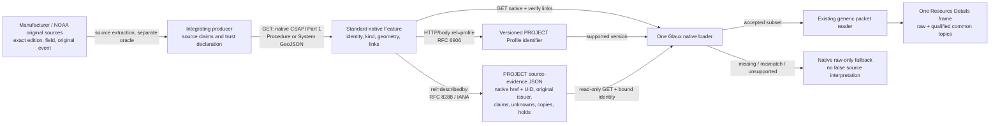
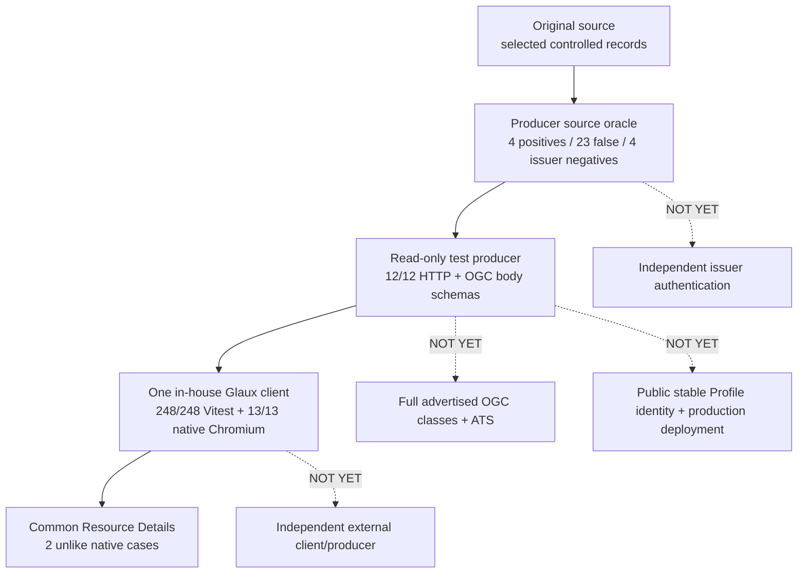

# Proposed Research Candidate — CSAPI Application Profile for Source-Qualified Whole-System Interpretation, Version 2

**Edition:** 0.1, 3 November 2026  
**Standing:** PROPOSED, PARTIALLY VALIDATED RESEARCH CANDIDATE — **not an adopted Open Geospatial Consortium (OGC) Profile, approved requirements class, certification claim, independently interoperable release, or deployed production specification**  
**Project:** DIM / OGC API – Connected Systems (CSAPI) Profile V2, research branch research/dim-profile-v2  
**Preparation:** Original **Step 42** of the 43-step plan; Step 43 final reproducibility/release judgment **PENDING**  
**Acceptance status:** **Gate E NOT CLOSED; Gate F NOT CLOSED for externally independent interoperability; Gate G NOT REACHED.** The bounded producer-to-client test passed; the original release acceptance conditions were not lowered.  
**Companion:** [Implementation-independent DIM proposed research candidate](DIM_Profile_V2_Proposed_Research_Candidate_DIM_v0.1_03NOV2026.md)  
**Antecedents:** [Integrated PR30-01–21 and G30-01–09 manuscript](CSAPI_Profile.md); [Step41R-01 registered-link carrier decision](../Whole_System_Recovery/Step41R01_Standards_Profile_Carrier_Decision_03NOV2026.md); [Step41R-06 actual producer/client report](../Whole_System_Recovery/Step41R06_Generic_Native_CSAPI_Profile_Client_03NOV2026.md); [owner-authorized plan](../PLAN_DIM_Profile_V2_Whole_System_Recovery_to_Delivery_v0.1_31OCT2026.md).

## Abstract

A source-faithful information model does not itself tell an arbitrary OGC API – Connected Systems (CSAPI) producer and client how to communicate source standing, identity, optional equipment details, original observations and derivations. This proposed research Profile investigates **native CSAPI Part 1 resource semantics supplemented by registered RFC 8288/6906 profile/describedby links to a versioned project-defined source-evidence description**. Its interpretive proposal consists of twenty-one source-qualified rules (PR30-01–21), linked to fifteen implementation-independent Domain Information Model (DIM) relational propositions and tested, in part, through four unlike equipment/history cases. A separately executable loopback producer serving **one reference Procedure and one historically sourced System** was actually consumed by one common Glaux Resource Details reader in real Chromium, with meaningful negative URI/UID and source-oracle checks. **But full OGC requirements-class advertisement/Abstract Test Suite (ATS), globally persistent Profile identifier/issuer governance, publisher authentication, a third-party implementation and complete native historical Observation/Deployment binding remain outstanding.** The supported result is thus **a partially validated proposed research candidate and demonstration**, not an adopted or fully interoperable standard (Robin 2025a, 2025b; Nottingham 2017; Wilde 2013; OS4CSAPI 2026a–d).

## 1. Problem, intended actors and permissible claim

The goal is that a producer mapping substantially different sensing systems to CSAPI can publish **the source-supported whole-System meanings**, and one capable client can discover and present those meanings without a special manufacturer rule. The companion [DIM](DIM_Profile_V2_Proposed_Research_Candidate_DIM_v0.1_03NOV2026.md) defines the concepts independently of serialization; this candidate Profile examines **how** producer and reader would exchange them using published OGC resources and a transparently authored supplemental project contract. A generic CSAPI client that does **not** implement that extension is not assumed to understand it. CSAPI or SensorML itself must not be blamed for data an integrator omitted or for UI meaning not interpreted (OS4CSAPI 2026e).

**Candidate producer target:** A service claiming this project Profile on a particular read-only native resource, declaring its actual base standard class/encoding support independently, publishing original source/context and accountable qualified assertions. **Candidate consumer target:** A Profile-aware client reading the actual native resource, following only supported registered links and presenting source/reference/individual, example/performed, derived/unknown and copy/original distinctions without inventing data. Neither target has been designated as a formal OGC ModSpec standardization target or conformance class; no candidate rule below is an enacted normative **SHALL**.

**Applicability is conditional and evidence-led.** A manufacturer **reference design** may be a native Part 1 **Procedure** with no installed unit or Observation; an **actual identified historic station** may be a Part 1 **System**. An actual DataStream, Observation, Deployment, ControlStream, issued Command or authorized operation is *not* automatically required of every descriptive resource. Stronger native Part 2, SensorML or SWE claims require their original published class dependencies, permitted representations and source facts. Our two-case producer intentionally demonstrates a narrower supported **source-evidence subset**: generic code branches on supported native **Procedure/System kinds** and a fixed versioned project source-standing contract; it is not yet a general-purpose extension interpreter for all possible CSAPI resources and evidence kinds.

## 2. Standards pedigree and explicit authority boundary

| Authority, edition and source location | Inherited concept/behavior available to a complying implementer | Not inherited / remaining Profile choice |
| --- | --- | --- |
| **OGC API – Connected Systems Part 1, 23-001 v1.0**, §§8–13, 19.1–19.2 (Robin 2025a) | System versus Procedure, System UID/local ID, Subsystem, Deployment, native GeoJSON and SensorML representation/class requirements when applicable. Published GeoJSON Requirement 77 and native System/Procedure schema requirements support selected validation. | No OGC-mandated SOURCE_FACT/DERIVED/UNKNOWN/copy vocabulary and no automatic proof that a model Procedure is a deployed System. |
| **OGC API – Connected Systems Part 2, 23-002 v1.0**, §§9–12, 14, 16 (Robin 2025b) | One producing System per DataStream, Observations with specified times/results/schema and class-specific JSON/SWE rules, ControlStreams/Commands/CommandStatus/SystemEvents where supported. | Not an authorization to invent a Bennett mean-producing System, resultTime, average-period mapping, executed command or native quality semantics. |
| **SensorML 3.0, 23-000**, §§7–8, especially §8.2.2.1 Req 9–10 (Robin 2025c) | Processes, components, kind/typeOf, outputs, capabilities, configurations, modes, history and optional community extension structure. | An ordinary SensorML parser **need not understand project/community extension content**; new project keys require an explicit Profile-aware consumer agreement. |
| **SWE Common 3.0, 24-014**, §§8.2–8.3, 9.6, 10.2 (Robin 2025d) | Typed quantity/text/time/data fields and JSON representation rules under actual claimed requirements. | A source context TimeRange or arbitrary QC field is not necessarily native OMS/CSAPI phenomenonTime or resultQuality. |
| **OGC API – Common Part 1 19-072 and OGC API – Features Part 1 17-069r4** | Discovery, conformance and typed link/resource practices, subject to actually implemented base classes. | Published class advertisement/ATS still must be independently proved; a project Profile URI must not masquerade as a class URI. |
| **RFC 8288 Web Linking (Nottingham 2017)** | Standard typed link context/target/relation and HTTP Link syntax. | Following a self-declared link does not authenticate an original publisher or validate the linked content. |
| **RFC 6906 profile relation (Wilde 2013)** | Registered **profile** relation signals additional conventions without changing baseline media type semantics. | A profile URI need not be dereferenceable under RFC 6906; Project's choice to serve a description is extra; no automated OGC approval follows. |
| **IANA describedby relation** | A registered description link can point to a different source-evidence representation. | Description does not become an alternate native System/Observation or an original issuer signature. |
| **OMS 3.0, OGC 20-082r4**, §§8.2, 8.4–8.8, 9.2.5 (Schleidt and Rinne 2023) | Performed Observation/Observer/Procedure, average phenomenonTime, actual result availability, quality, Host and Deployment meanings. | Historical missing resultTime, exact exchange moment and producing Observer cannot be supplied as OGC facts by our sidecar. |

Other targeted donors—AAS, OPC UA Devices/PA-DIM, IEEE 1451 public technical material, Integrated Sensor Architecture, The Open Group Sensor Open Systems Architecture, SAPIENT v2, W3C SOSA/SSN and Web of Things—provide **model pedigree, negative examples and possible specialization**, **not a Profile obligation that they be implemented**. The complete donor and edition limits are in the [DIM companion §7](DIM_Profile_V2_Proposed_Research_Candidate_DIM_v0.1_03NOV2026.md#7-donor-pedigree--source-native-contribution-versus-candidate-synthesis) and [source-native workbook §§15–18](../Whole_System_Recovery/README.md).

## 3. Candidate interoperability architecture

**Decision:** Retain original standards-native CSAPI resource bodies and media without inventing a required OGC field. A resource carrying the project contract adds **per-resource registered link relationships**. An integrating producer returns a **separately versioned PROJECT evidence document** describing that same native resource, original issuer/source, qualified claims, original event versus API-copy identity, and explicit holds. A compatible client validates the identity and supported version before using the **same generic source reader and Resource Details UI**. A mismatched or unsupported link/evidence result remains **native raw-only**, not secretly completed (OS4CSAPI 2026a, §§2–5).



**Figure 1.** Exact project research transport boundary, not a new CSAPI class. **Native Feature validation**, **source-side original-authority tests**, **sidecar identity checks**, **one client presentation**, and **OGC requirements-class/ATS proof** are **different** verifications. A successful one does not stand in for the others.

### 3.1 Producer contract — proposed, not adopted OGC requirements

For each **Profile-marked** native representation claiming this *project* contract, the proposal specifies: (i) native CSAPI semantics/body and original class requirements independently correct; (ii) HTTP Link and supported native body links identifying **the same resource-specific** versioned **profile** and **describedby** targets; (iii) a source-evidence document specifying exact native **href, UID, kind and source standing**, original issuer/edition/locator and separate integrating producer; (iv) individual claim values, raw field/unit/time precision, evidence label, source references, derived inputs and original-event/copy associations; and (v) documented unsupported fields, omissions and HOLDs. The producer's accountability obligation is **project-proposed** even when the links themselves are registered standard relations.

**Current test scope:** Link targets are read-only, same-origin under a deliberately conservative supported subset, with HTTPS required except explicit loopback HTTP; no credentials or redirects; the exact source-specific evidence document must match native URI/UID. A conforming *general* RFC 8288 parser can support syntax/forms beyond this implementation's deliberately narrow link matching. The test producer's profile URI is **loopback-local**, not a persistent globally governed Profile identifier. These are **documented constraints/gaps**, not universal mandated OGC behaviors.

### 3.2 Consumer contract — proposed, fail-closed where necessary

A supported consumer: GETs the native resource and checks HTTP/media/feature identity; checks exact native self and resource-specific registered links; recognizes only a supported project Profile edition; retrieves source evidence in its declared media; verifies it describes **that native URI/UID** and that source claim references are internally resolvable; then maps accepted source meaning through **one shared interpreter**. It must keep original source status such as SOURCE_EXAMPLE versus performed fact and project DERIVED/UNKNOWN explicit. It must **not** assert manufacturer/NOAA authentication simply because JSON is structurally sound or a link is served. Raw native representation remains available even when source interpretation fails.

The existing prototype handles a specific **reference Procedure** source standing and **historic station System** standing, plus a fixed set of project packet editions. It does not yet accept any arbitrary future domain context or all possible native System source-standing subtypes. Generalization beyond these supported contract types requires more tests and an independently published specification, not extrapolation from the absence of vendor-name branches in the source code.

### 3.3 Illustrative protocol and evidence — not a validated general standard example

The **actual tested producer** exposes the following single-resource routes and media:

| Native HTTP read | Native meaning and profile-bearing response | Source evidence and boundary |
| --- | --- | --- |
| **GET /api/procedures/dragino-s31-lb** | GeoJSON **Feature**, native SOSA Procedure, **geometry null**; native and Link-header profile/describedby relations. Official pinned OGC 23-001 **procedure.json** body schema validated. | Manufacturer reference **21 selected claims**, 0 acquired original events, no invented unit or actual effective setting. |
| **GET /api/systems/bennetts-point-acebpmet** | GeoJSON **Feature**, native SOSA System, source site Point for **station only**; linked project evidence. Official pinned OGC **system.json** body schema validated. | Historical real station **8 selected subjects/37 claims**, **two original NOAA events/four experimental API copies**, derived/unknown history preserved. |
| **GET /api/procedures**, **GET /api/systems**, **GET /api/collections/{collectionId}/items** | Real GeoJSON FeatureCollections, validated against pinned **procedureCollection.json** and **systemCollection.json**. | Only one selected record of each served source type; not full four-case native coverage. |
| **GET /api/profiles/dim-csapi-source-evidence/v0.1** and **GET /api/evidence/{id}** | Project-only, versioned read-only JSON documents, separately schema-checked; HTTP Link/body agreement and CORS header exposure tested. | No OGC-mandated source-claim vocabulary, no globally persistent Profile identifier or original-source digital issuer authentication. |
| **GET /api/conformance** | Explicitly **conformsTo: []**; candidate class URIs separately disclosed. | **No advertised OGC requirements-class PASS or ATS**, even though selected native GeoJSON bodies validate. |

These routes are **local test-service paths**, not prescribed universal CSAPI URL templates. Each native Feature and linked source evidence was served over actual HTTP; a static example alone would not count as those results. See [producer README and pinned original schemas](../Whole_System_Recovery/Step41R05_Native_Producer/README.md) and [Step 41R-05 source/schema execution](../Whole_System_Recovery/Step41R05_Read_Only_Native_CSAPI_Producer_and_Profile_Evidence_03NOV2026.md).

An abbreviated **project-only illustrative** sidecar shape makes the distinction clear:

```json
{
  "format": "dim-csapi-evidence-sidecar.v0.1",
  "profile": "http://127.0.0.1:8015/api/profiles/dim-csapi-source-evidence/v0.1",
  "describes": {
    "href": "http://127.0.0.1:8015/api/procedures/dragino-s31-lb",
    "uid": "urn:os4csapi:dim-v2:reference-procedure:dragino-s31-lb",
    "kind": "Procedure",
    "sourceStanding": "REFERENCE_ARRANGEMENT"
  },
  "integratingProducer": {
    "role": "INTEGRATING_PRODUCER_NOT_ORIGINAL_ISSUER",
    "verification": "PRODUCER_ASSERTED_UNVERIFIED"
  },
  "sourceEvidence": {
    "projectPacketFormat": "dim-csapi-source-packet.s41r03.v0.1",
    "packetId": "...",
    "focus": "...",
    "sources": [],
    "subjects": [],
    "assertions": [],
    "originalEvents": [],
    "representations": [],
    "holds": []
  }
}
```

**Example warning:** The abbreviated empty arrays/ellipsis are **explanatory only and deliberately NOT a schema-valid evidence payload**. The actual tested sidecar has the populated source assertions, exact required issuer/edition/locator references and project schema validation. Its vocabulary is explicitly **not** a standardized native CSAPI field or manufacturer-signed assertion. [Exact schema](../Whole_System_Recovery/Step41R05_Native_Producer/source-evidence.schema.json) and [producer implementation](../Whole_System_Recovery/Step41R05_Native_Producer/server.py) control reproducible tests.

## 4. Candidate profile-rule register (PR30-01–21)

**R = proposed required within an applicable supported Profile claim; C = proposed conditional on source facts and actual published base class support; O = proposed optional; H = explicit HOLD / excluded stronger binding.** These are **editorial proposal statuses**, not enacted normative SHALL/SHOULD words or certified OGC requirements. This is the publication consolidation of [original Step 30 PR30 register](CSAPI_Profile.md#3-candidate-pr30-rule-index--one-cross-case-contract-with-examples-and-original-authority), with later actual Step41R outcomes separately identified. The original rule meanings and numbering are retained.

| Candidate | Proposed producer/client meaning and actual source challenge | Base standard or tested project evidence | Current limit |
| --- | --- | --- | --- |
| **PR30-01 · R** | Declare exact described referent and original evidence scope: design vs actual identified station, not imaginary unit. | CSAPI Part 1 System/Procedure; DIM R24-01; two actual native test kinds. | Linked project source standing works for **two supported kinds**; arbitrary source authenticity held. |
| **PR30-02 · R, if System** | Separate local resource ID, System UID and original serial/issuer scope. | CSAPI Part 1 §§8–9, 19; Bennett station and two EE181 serials. | Producer-assigned UID ≠ original NOAA/manufacturer signed ID. |
| **PR30-03 · C** | A published Procedure kind is not the individual; link a System to a real resolvable kind only if evidenced. | CSAPI Part 1 §§9,13; SensorML typeOf; Dragino reference Procedure tested. | No fabricated installed Dragino System or inferred published EE181 kind URI. |
| **PR30-04 · C** | Represent composition separately from cabled/temporal aggregation, not one universal nested part tree. | CSAPI Part 1 Subsystems/Deployment; SensorML components; DIM R24-03–05. | Campbell pairing/reference, Bennett swap not validated as native Deployment. |
| **PR30-05 · H** | Retain date-only historic service without false exact Deployment.validTime. | CSAPI Part 1 Deployment; Bennett operator dated roles. | Native date-precision-safe Deployment **not proven**. |
| **PR30-06 · C** | Distinguish station/Host geometry from an individual probe point. | CSAPI Part 1 and OMS Host; source Bennett station coordinate. | No per-EE181 coordinate; client raw/Equipment view preserves station. |
| **PR30-07 · C** | Identify sensing, processing, reporting and support functions only as source attests. | SensorML 3.0 process/capability/output; DIM R24-06. | Function is not proof actual observation or installed role. |
| **PR30-08 · C** | Keep protocol/bus/channel/port/socket and emitted property as separate namespaces. | SensorML; IEEE 1451 technical evidence; two PM sockets vs PM mass fractions; SDI-12 positions. | No normative IEEE TEDS binding asserted. |
| **PR30-09 · C** | Preserve source-native fields, units, medium and subject; status and environmental results separate. | SWE Common 3.0 DataRecord/Quantity/Text; ClimaVue air temp ≠ logger PanelTemp. | Actual four-case native SWE schemas not all exercised. |
| **PR30-10 · C / Bennett H** | A real DataStream names **one source-defensible producing System**, not automatically its probe. | CSAPI Part 2 §9.2; Bennett H27-A station vs H27-B logger. | Historical completed-mean owner **not selected or proven**. |
| **PR30-11 · C** | DataStream property set, resultSchema/output and producer stay coherent; one multi-property output possible. | CSAPI Part 2 §§9.2, 9.6–9.7. | No fabricated stream from manufacturer sample formats. |
| **PR30-12 · C** | Only publish performed Observation with original activity/result evidence and valid native class. | OMS 3.0; CSAPI Part 2 §§9,16; two real Bennett source means. | Manufacturer references have **zero** acquired performed events. |
| **PR30-13 · H** | Separate actual averaging phenomenon interval and result availability; DERIVED period is not original resultTime. | OMS §§8.2.3–8.2.4; CSAPI Part 2 §§9,16. | Bennett original resultTime **UNKNOWN**, native average-period mapping unvalidated. |
| **PR30-14 · H/C** | Retain parameter-specific raw quality token, lexical precision and association; validate a native quality binding before claim. | SWE Common and OMS resultQuality; Bennett F_ATemp. | Exact **"<0> "** survives, native SWE/OMS quality mapping held. |
| **PR30-15 · R research ledger / H full portable trust** | Preserve issuer/edition/claim/derivation and one original event versus multiple digital representations. | DIM R24-01,15; actual project sidecar and source/oracle tests. | Bounded linked carrier implemented, independently authenticated issuer still **UNPROVEN**. |
| **PR30-16 · C** | Supported/default/desired/effective/reported settings must have distinct subject/time/source. | SensorML 3.0 modes/settings; Dragino 20-minute default vs 60,000 ms example. | Effective installed setting **UNKNOWN**; no live readback. |
| **PR30-17 · C, descriptive** | Supported command syntax not equal live ControlStream or authority to issue command. | CSAPI Part 2 control classes; three reference cases. | Executable Commands excluded from candidate demonstration. |
| **PR30-18 · C / execution excluded** | Actual request needs correct target/authorization and matched status/result; reported completion ≠ independent effect. | CSAPI Part 2 §§10,14; SAPIENT v2 negative TaskAck examples. | No valid executed physical control/status chain tested. |
| **PR30-19 · C/H** | Real maintenance and firmware updates retain target, as-of/time precision and source meaning, not pretend Commands. | CSAPI Part 2 SystemEvent conditional; Bennett 16/17 Apr roles. | No verified native typed-event/Deployment conversion. |
| **PR30-20 · O/C** | Include applicable equipment-specific power, comms, software, security and diagnostics without false live claims. | SensorML, OPC UA, WoT donor evidence; Dragino/AirGradient/Campbell. | Design supply ≠ live remaining charge; software source revision ≠ installed version. |
| **PR30-21 · R interpretive / H independent interop** | Supported client displays SOURCE_EXAMPLE, DERIVED, UNKNOWN and unsupported explicitly; retains native/raw fallback. | One generic Glaux loader; real 13-check Chromium and negative identity case. | Bounded local producer/client only; third-party/production still held. |

**Decision:** The full PR30-01–21 register is an **interoperability hypothesis with uneven evidence**. Parts of PR30-01/02/03/15/21 are now exercised by actual native Part 1 + project evidence for supported examples, while core issuer/class/independence criteria and PR30 historical Observation/Deployment/Command options remain unproved. No rule's **R** marker confers an OGC requirement or creates a formal adopted class. Preserve [21/21 earlier positive/negative conceptual contracts](CSAPI_Profile.md#step-31--contract-challenges-source-oracle-tests-and-bounded-gate-e-judgment) as a **documentary test design**, not 21 full ATS results.

## 5. Worked source-to-Profile-to-UI examples and controlled negative checks

### 5.1 Dragino: reference design Procedure, supported default and example

Original manual/documented decoder → DIM referent **reference kind**, one external SHT31, two measurable properties, message forms/status, and *supported 20-minute default* → actual tested **native Procedure GeoJSON** with resource-specific Profile/evidence links → same generic Glaux Resource Details **Configuration/Communications/Record** views. Printed **AT+TDC=60000 ms** is **SOURCE_EXAMPLE** and applied actual setting remains **UNKNOWN**; 0 source-original performed Observations. A test promoting a printed source example to well-formed SOURCE_FACT remains structurally readable but explicitly **PRODUCER_ASSERTED_UNVERIFIED**; the **separate source-specific oracle** must detect the false original-source claim (Dragino n.d.; OS4CSAPI 2026f, §3; OS4CSAPI 2026d).

### 5.2 AirGradient: multiple physical PM modules, multiple reported properties

Original pinned design → two **PMS5003 physical** module identities at PM1/PM2 sockets, distinct PM1.0/PM2.5/PM10 quantities, other components, solar/battery designs and separate Wi-Fi/cellular reporting modes → DIM R24-03/07/08/14 → **expanded source-qualified local project packet** and same generic Glaux interpreter. The manufacturer sample values and hardware/firmware Git commits are not acquired live data or installed version. **No AirGradient resource was natively served by the Step41R-05 producer**; claiming all four source cases passed native HTTP/Chromium would be false (Open Air Foundation 2026a, 2026b; OS4CSAPI 2026g, §§3–5).

### 5.3 Campbell: sensor field definitions versus logger status example

Original ClimaVue 50 manual table 8-1 → 14 response positions in one aR7! return, including ambient air temperature; separate CR1000X logger Status publication → 31 source example fields including **PanelTemp=25.91098 °C** → DIM physical, interface, property and reporting distinctions → common Glaux **local** Resource Details data presentation. The logger field cannot become measured ambient air of an installed combined station. The source packets include original publisher editions and qualifications; **no new native Campbell resource producer/Chromium integration was tested in 41R-05/06** (Campbell Scientific 2024; Campbell Scientific n.d.; OS4CSAPI 2026h).

### 5.4 Bennett: actual historical System, time/QA precision and original event copies

Original NOAA CDMO archive and operator statements → continuing station **acebpmet**, two EE181 physical serials over three original date-level service statements, station site location, separate logger/transmitter and true **two** historical 15-minute mean air-temperature records → native **System** with project evidence link, one generic Glaux **Equipment/Activity/Record/Map** view. Source **F_ATemp="<0> "** with trailing blank survives; separate blank F_Record remains distinct; **four** historical experimental API representations still refer to **two** source-original events. The source's exact 16 April maintenance window **does not** identify the EE181 handoff instant; nominal UTC averaging window and probe association are **DERIVED**, original resultTime and mean-producing System **UNKNOWN**. The browser refused deliberately wrong **describes.uid** to raw-only instead of joining unrelated evidence (NOAA/CDMO 2024; ACE Basin National Estuarine Research Reserve 2025; OS4CSAPI 2026d).

### 5.5 Adversarial acceptance examples (project-only)

| Challenge | Current executed standing / required consumer behavior | Interpretation limit |
| --- | --- | --- |
| Native/evidence **describes.uid** mismatch | **Real Chromium negative PASS:** native raw-only, no false qualified history. | Checks binding, not all source-content truth. |
| Different source/evidence **href** | Unit negative PASS: no project Profile interpretation. | Source original publisher still unverified. |
| Missing/non-matching HTTP link; unsupported Profile version | Unit negative PASS: native raw-only, not fake recognized Profile. | Narrow supported link syntax, not entire RFC 8288 parser. |
| Cross-origin evidence link or insecure external HTTP | Unit negative PASS: fail closed/no unintended fetch; real browser path GET only. | Current conservative project contract, not universal OGC CORS rule. |
| Fabricated reference-Procedure geometry/performed event | Unit negative PASS: reject claimed qualified interpretation. | Test covers supported reference kind; arbitrary external claims require broader evidence/contract. |
| One of **23 original source-FALSE assertions** | Producer original-source oracle **23/23 FLAGGED**, plus **4/4 issuer spoofs**; unchanged 4/4 selected packet positives match. | Generic reader **cannot** detect a plausible syntactically valid lie without original source oracle. |
| Bennett original event copied into two digital representations | Same client preserves **two original / four copies**. | Does not establish full native OMS/CSAPI Observation conformance or required resultTime. |

## 6. Conformance and acceptance annex — executed results versus missing obligations

**Actual pinned runtime:** [GitHub Actions 41674774256](https://github.com/OS4CSAPI/glaux-client/actions/runs/41674774256) **COMPLETED SUCCESS** for application commit **6538577a3ffc684e91adaf1fa6e4edaf1f2990ca** on branch **work/details-view-20261023**, with immutable research-only Python producer revision **0672082f3ebe35936aa8dcd92d1a78072b16d013**. The workflow did **not deploy Cloudflare or mutate the Oracle/52°North service**.

| Executed acceptance evidence | Actual result / what it proves | Does **not** prove |
| --- | --- | --- |
| Node 24 TypeScript and Vite full build | **PASS** on tested app source; source-independent code compiles/builds. | Native OGC class conformance or deployed state. |
| Full installed Vitest | **248/248 PASS**, 19 test files, including 12 native-source Profile positive/negative unit cases. | Third-party independent Profile implementations or manufacturer fact authenticity. |
| Python 3.12 native loopback producer with pinned original OGC v1.0 GeoJSON schemas | **12/12 actual HTTP/media/link/selected original body-schema tests PASS**. | Complete OGC API Common/Features/CSAPI requirements class, ATS, SWE or Part 2 conformance. |
| Controlled selected-source producer truth oracles | **4/4 original positives, 23/23 source-FALSE mutations and 4/4 false issuer/authority cases** correctly treated. | Cryptographic publisher signature, full live source reacquisition or arbitrary producer content trust. |
| Real Chromium native producer→links→one existing Glaux Resource Details | **13/13 PASS**, including actual native reference Procedure and historical System and deliberately mismatched sidecar UID raw-only fallback. | Independent third-party producer/client, published global Profile URI, real production Oracle/Cloudflare deployment. |
| Prior local research-case Chromium regression on same checkout | **14/14 PASS**. | Four unlike **native producer** integrations. |
| Earlier Step39 specialized live Bennett and local-source work | **198/198 Vitest**, **14/14 local Chromium**, **14/14 Node native GET**, **10/10 specialized live Bennett browser**, separately tested earlier source revision. | Step41R-06 producer/client code was or is deployed. |

### 6.1 Unmet **normative standards** and project acceptance requirements

**F40-03 / G30-07 (critical):** The isolated producer deliberately returns **conformsTo: []**. Selected **23-001 v1.0 GeoJSON singleton/collection schema/body** validation and correct actual media are valuable limited results but **not** real OGC API Common/Features/Connected Systems class advertisement, full required dependencies, OGC Abstract Test Suite (ATS) or certification. A minimal illustrative OpenAPI description is not a complete applicable conformance implementation. No full native 52°North/OAPIF/SWE validation was added by this new producer.

**F40-01/02 and G30-01:** A discoverable and locally versioned project evidence association has been demonstrated; an independently hosted persistent **public Profile URI**, formal externally accessible full Profile specification/validation rules, independent original issuer governance and publisher signatures remain outstanding. A trusted HTTPS response is not evidence that NOAA or a manufacturer signed the integrating producer's source claims.

**F40-07 / G30-08:** One in-house Glaux client genuinely follows one common native route for unlike Procedure/System examples and performs a negative identity test. **No separately authored third-party Profile producer or client** was tested, and no production path was verified at the new app revision. The scope is not “arbitrary CSAPI implementation interoperability.”

**F40-06:** Original manufacturer-source detail selection is improved across four cases, not exhaustive; known source omissions remain distinguished from data the sources do not provide.

**F40-04/05 / G30-02–06:** Bennett full averaged **native Part 2 Observation** producer, original resultTime, phenomenon interval/quality schema mapping, and exact-time **Deployment** are **HELD**; do not fill any mandatory field with an inferred original fact. Station geometry is not probe geometry; source date-only intervals remain day-precise.

**F40-08 / G30-09:** Executable Commands, actual ControlStream authorization, correlated command execution and independently measured physical effects are **EXCLUDED** from this bounded descriptive research candidate. Manual command syntax is permitted as descriptive capability only.

### 6.2 Candidate future Abstract Test Suite (ATS) planning — NOT executed or adopted

These are **test design categories, not OGC formal Abstract Test Suite cases**. A stronger external Profile claim would need scoped, independently repeatable checks, among others:

| Project-only proposed test family | Necessary stronger acceptance observation | Current disposition |
| --- | --- | --- |
| **A — Base-native conformance** | Producer actually advertises each selected OGC class with dependencies and passes the original applicable Common/Features/CSAPI ATS and exact media/schema. | **HOLD**; /conformance empty, selected body schemas alone PASS. |
| **B — Persistent Profile governance** | Stable globally unambiguous version URI, publicly defined project extension, compatibility/version rules, trust governance and compliant producer announcements. | **HOLD**; localhost identifier only. |
| **C — Original-source attestation** | Independent issuer/edition/field checking or source-signed evidence; producer audit proves selected original facts, derivations and withheld values. | **PARTIAL controlled-source oracle only**; arbitrary issuer trust HOLD. |
| **D — Portable reader semantics** | Different independently written clients/producers discover unknown resource-specific links and preserve source qualifiers with consistent negative fallbacks. | **PARTIAL in-house two-kind browser pass**, external independent HOLD. |
| **E — Historical native Observations** | Single source-defensible mean DataStream producer, original source-time/quality, fully valid native averaged observation period/result availability and precision-preserving history. | **HOLD**; originals retained descriptive only. |
| **F — Actual management** | Independent authorization, Command/create, request ID, matching status/result and measured effect under separately agreed profile scope. | **EXCLUDED**; no device writes authorized. |

### 6.3 Diagram of actual proof boundaries



**Figure 2.** The positive path is demonstrated at a fixed local/source scope; the dotted branches are explicit **unmet obligations**, not inferred passes. The original project acceptance **Gates E and F remain NOT CLOSED**, **Gate G NOT REACHED**.

## 7. Release blocker and source-fidelity disposition register

| Source-linked item | Present demonstrable status | Step 42 publication instruction |
| --- | --- | --- |
| **G30-01 / F40-01** — generic source standing carrier | Local registered-link source-evidence path works for two served kinds. | Label **PROJECT EXTENSION**, limited URI, external Profile portability **HOLD**. |
| **F40-02** — source truth and issuer | Selected source oracles catch false claims; linked evidence bound to native UID. | Keep **PRODUCER_ASSERTED_UNVERIFIED**, do not claim manufacturer/NOAA authentication. |
| **F40-03 / G30-07** — published classes/media | Selected Part 1 GeoJSON actual HTTP/schema PASS; conformance list empty. | State full OGC class/ATS **HOLD** in abstract, table and annex. |
| **F40-06** — whole-System extraction | High-value source detail now available; omissions still explicit. | Do not publish 100% whole-system coverage or 182-donor review. |
| **F40-07 / G30-08** — generic client | One actual in-house path two native unlike resources and negative test; others local. | Do not claim independent producer/client or deployed full interoperability. |
| **G30-02/04/05/06 / F40-04** — historical Part 2 average | Original station results represented as qualified source reports, not fully compliant Obs. | **HOLD** producer/time/quality/encoding; no invented original resultTime. |
| **G30-03 / F40-05** — exact Deployment | Original day precision/2024 as-of; station-site only geometry. | **HOLD** precise native Deployment and per-probe position. |
| **G30-09 / F40-08** — actual control | Descriptive examples, no executable action. | **EXCLUDED**; do not generate command/write tests. |

A later accepted OGC Profile would require distinct governance and specification work. This proposed edition does **not** turn its illustrative status labels, SQL/JSON sidecars, source-claim properties, URI paths or present implementation policy into base-standard obligations.

## 8. Reproducibility, revision and editing control

The relevant research evidence is pinned in [41R-05 producer](../Whole_System_Recovery/Step41R05_Native_Producer/README.md), [41R-06 report](../Whole_System_Recovery/Step41R06_Generic_Native_CSAPI_Profile_Client_03NOV2026.md), [source oracles](../Whole_System_Recovery/step41r02-source-oracles.cjs), and the app branch's [native generic loader](https://github.com/OS4CSAPI/glaux-client/blob/work/details-view-20261023/src/profile/native-source-profile.ts), [shared source reader](https://github.com/OS4CSAPI/glaux-client/blob/work/details-view-20261023/src/profile/source-packet.ts), [browser test](https://github.com/OS4CSAPI/glaux-client/blob/work/details-view-20261023/scripts/verify-step41r06-native-browser.cjs) and [workflow](https://github.com/OS4CSAPI/glaux-client/blob/work/details-view-20261023/.github/workflows/dim-step41r06-native-client.yml). The current test producer is isolated loopback-only, not deployed. User-supplied native URL operates only within the explicitly supported project link/version/resource subset.

Changes to the Profile must specify exact new original normative base class/constraint, source evidence, project additional rule and interpretation target, independent positive/negative tests, backward/versioning decisions, and resulting G30/F40 status. Any change to R24 semantics belongs in the **separate DIM** manuscript and source pedigree, not a silent change in a Profile JSON Schema. Keep prior Step 30/31 candidate analysis as historical trace; do not replace it with newly invented OGC SHALL clauses.

**Final status:** **Step 42 publication-oriented proposed research candidate only**. Step 43 will separately review reproducibility and source fidelity, decide whether to publish a qualified results conclusion, and preserve all unclosed external release criteria. It has **not** been performed here.

## References — Chicago Manual of Style, 18th ed., author–date

British Standards Institution (BSI). 2024. *BSI Flex 335: SAPIENT, version 2.0 (March 2024)*. Original published examples are used as negative control, not an adopted CSAPI command mapping. https://www.bsigroup.com/siteassets/pdf/en/insights-and-media/insights/brochures/bsi-flex-335.pdf.

ACE Basin National Estuarine Research Reserve. 2025. *Meteorological Metadata: ACE Basin, Updated August 18, 2025*. https://cdmo.baruch.sc.edu/waf/YearlyFiles/ACE%20Basin/meteorological/metadata/acemet01-12.24m.pdf.

Campbell Scientific. 2024. *ClimaVue 50 Manual*. Revision 08/2024, table 8-1. https://s.campbellsci.com/documents/us/manuals/climavue50.pdf.

Campbell Scientific. n.d. “MQTT Status Example.” *Datalogger API*. https://help.campbellsci.com/datalogger-api/mqtt/status.html.

Dragino. n.d. “S31-LB Temperature and Humidity Sensor: Product Manual.” https://wiki.dragino.com/docs/LoRaWAN-End-Node/temperature-humidity-sensors/s31-lb/.

Nottingham, Mark. 2017. *Web Linking*. RFC 8288, Internet Engineering Task Force. https://www.rfc-editor.org/rfc/rfc8288.

Heazel, Charles, ed. 2023. *OGC API – Common – Part 1: Core*. Version 1.0.0, OGC 19-072. Open Geospatial Consortium. https://docs.ogc.org/is/19-072/19-072.html.

Internet Assigned Numbers Authority (IANA). n.d. “Link Relation Types.” Registry of registered relation types, including profile/describedby. https://www.iana.org/assignments/link-relations/link-relations.xhtml.

NOAA Centralized Data Management Office (CDMO). 2024. *ACE Basin Station acebpmet, Meteorological Data 2024*. Original archive CSV, selected lines 10130 and 10418. https://cdmo.baruch.sc.edu/waf/swmp_data_archives/acebpmet2024.csv.

Open Air Foundation. 2026a. “Open Air Max Main PCB.” Pinned hardware Git revision 89aacf5013fc0ffe4b988a2e3c5a227bce3c4983. https://github.com/Open-Air-Foundation/pcb-openair-max-main/blob/89aacf5013fc0ffe4b988a2e3c5a227bce3c4983/README.md.

Open Air Foundation. 2026b. “Open Air Max Firmware.” Pinned firmware Git revision 84e479a415d81151e7a81aea9a2f7449a15e98cc. https://github.com/Open-Air-Foundation/firmware-openair-max/blob/84e479a415d81151e7a81aea9a2f7449a15e98cc/README.md.

Robin, Alexandre, ed. 2025a. *OGC API – Connected Systems – Part 1: Feature Resources*. Version 1.0, OGC 23-001. Open Geospatial Consortium. https://docs.ogc.org/is/23-001/23-001.html.

Robin, Alexandre, ed. 2025b. *OGC API – Connected Systems – Part 2: Dynamic Data*. Version 1.0, OGC 23-002. Open Geospatial Consortium. https://docs.ogc.org/is/23-002/23-002.html.

Robin, Alexandre, ed. 2025c. *OGC SensorML Encoding Standard*. Version 3.0, OGC 23-000. Open Geospatial Consortium. https://docs.ogc.org/is/23-000/23-000.html.

Robin, Alexandre, ed. 2025d. *OGC SWE Common Data Model Encoding Standard*. Version 3.0.0, OGC 24-014. Open Geospatial Consortium. https://docs.ogc.org/is/24-014/24-014.html.

Portele, Clemens, Panagiotis (Peter) A. Vretanos, and Charles Heazel, eds. 2022. *OGC API – Features – Part 1: Core Corrigendum*. Version 1.0.1, OGC 17-069r4. Open Geospatial Consortium. https://docs.ogc.org/is/17-069r4/17-069r4.html.

Schleidt, Katharina, and Ilkka Rinne, eds. 2023. *OGC Abstract Specification Topic 20: Observations, Measurements and Samples*. Version 3.0.0, OGC 20-082r4. https://docs.ogc.org/as/20-082r4/20-082r4.html.

OS4CSAPI. 2026a. “Step 41R-01: Standards-grounded Profile Discovery and Source-Evidence Carrier Decision.” November 3. [Research report](../Whole_System_Recovery/Step41R01_Standards_Profile_Carrier_Decision_03NOV2026.md).

OS4CSAPI. 2026b. “Candidate Application Profile, PR30-01–21 and G30-01–09.” November 2. [Research manuscript](CSAPI_Profile.md).

OS4CSAPI. 2026c. “Step 41R-05: Tested Read-only Native Producer, Original Body Schemas and Source Contract.” November 3. [Research report](../Whole_System_Recovery/Step41R05_Read_Only_Native_CSAPI_Producer_and_Profile_Evidence_03NOV2026.md).

OS4CSAPI. 2026d. “Step 41R-06: One Generic Native CSAPI Profile-aware Glaux Client and Real Browser Verification.” November 3. [Research report](../Whole_System_Recovery/Step41R06_Generic_Native_CSAPI_Profile_Client_03NOV2026.md).

OS4CSAPI. 2026e. “DIM / CSAPI Profile V2: Original Problem, Intended Solution, and Evidence-to-UI Path.” October 28. [Research baseline](../DIM_Profile_V2_Problem_and_Outcome_Baseline_v0.1_28OCT2026.md).

OS4CSAPI. 2026f. “System Data Sheet C: Dragino S31-LB and Source-limited Controls.” October 30. [Source sheet](../Controlled_Corpus/System_Data_Sheets/Dragino_S31_LB.md).

OS4CSAPI. 2026g. “Step 41R-03: Dragino and AirGradient Whole-System Source Coverage.” November 3. [Research report](../Whole_System_Recovery/Step41R03_Dragino_AirGradient_Whole_System_Coverage_and_Client_Evidence_03NOV2026.md).

OS4CSAPI. 2026h. “Step 41R-04: Campbell and Bennett Source-to-Client Coverage.” November 3. [Research report](../Whole_System_Recovery/Step41R04_Campbell_Bennett_Source_to_Client_Coverage_03NOV2026.md).

Wilde, Erik. 2013. *The “profile” Link Relation Type*. RFC 6906, Internet Engineering Task Force. https://www.rfc-editor.org/rfc/rfc6906.

**Reference method:** Original OGC/IETF publications support native constraints and registered link behavior. Manufacturer/operator sources support their own subject facts. Project documents support only project assertions, selections, implementation and tests. This edition applies **Chicago 18 author–date** citations and separates those three types of authority; it does not borrow normative force from their placement together.
