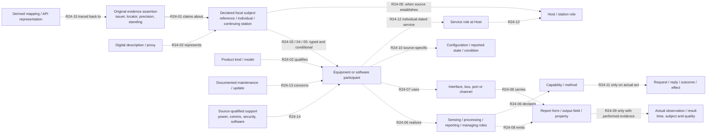
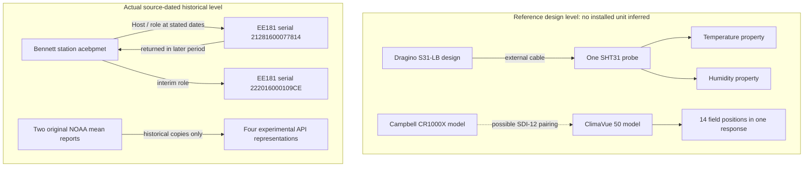

# Proposed Research Candidate — Whole-System Domain Information Model (DIM), Version 2

**Edition:** 0.1, 3 November 2026  
**Standing:** PROPOSED, PARTIALLY VALIDATED RESEARCH CANDIDATE — **not an adopted standard, accepted OGC information model, complete ontology, certified interoperability specification, or production release**  
**Project:** DIM / OGC API – Connected Systems (CSAPI) Profile V2; repository OS4CSAPI/glaux-client, research/dim-profile-v2  
**Purpose:** Publication-oriented consolidation prepared in original Step 42; **original Step 43 final independent review completed 3 November 2026**. [Final Step43 reproducibility/source-fidelity and conditional-stop decision](../Whole_System_Recovery/Step43_Final_Reproducibility_Source_Fidelity_and_Release_Decision_03NOV2026.md): **Gate E/F NOT CLOSED, Gate G REVIEWED / FULL RELEASE NOT APPROVED**. Research candidate may be shared for clearly qualified expert technical discussion, not normative/adopted release.  
**Companion:** [Separate proposed CSAPI application Profile](DIM_Profile_V2_Proposed_Research_Candidate_CSAPI_Profile_v0.1_03NOV2026.md)  
**Evidence:** [Original problem](../DIM_Profile_V2_Problem_and_Outcome_Baseline_v0.1_28OCT2026.md); [source-first cumulative workbook](../Whole_System_Recovery/README.md); [underlying candidate DIM and R24 register](DIM.md); [four-case fidelity assessment](../Whole_System_Recovery/Step40_Four_Case_Source_to_Client_Fidelity_Scorecard_03NOV2026.md); [Step 41R-06 actual integration report](../Whole_System_Recovery/Step41R06_Generic_Native_CSAPI_Profile_Client_03NOV2026.md).

## Abstract

A sensing-equipment integration can expose valid web resources while losing the distinctions that make equipment information useful: model versus individual, physical component versus channel, available operation versus executed action, result versus example, and source event versus its digital copies. This proposed Domain Information Model (DIM) supplies an **implementation-independent** interpretation of a source-attested focal sensing System or arrangement together with typed, qualified associations to equipment, processes, interfaces, observations, configuration, reporting, history, management and representations. It does not prescribe a CSAPI resource hierarchy, a vendor UI, a universal physical superclass, an eight-module architecture or compulsory relationships. The candidate derives fifteen testable relational propositions (R24-01–15), evaluated against three manufacturer-reference cases and a genuinely historical monitoring station. These tests support a **bounded documentary conceptual fit**, not complete population coverage or formal semantic proof. A separate proposed CSAPI Profile investigates how parts of this information can be published and interpreted; outstanding source-trust, OGC conformance and independent interoperability obligations remain explicit (Open Geospatial Consortium 2025a, 2025b; Schleidt and Rinne 2023; OS4CSAPI 2026a–c).

## 1. Problem, intended readers and scope

The motivating user problem is one reusable **Resource Details** experience for unlike sensing systems without a different vendor-hard-coded renderer for every manufacturer. Early TRSS and OmniSense examples made that problem visible but are not sufficiently rich authenticated operating corpora for the current controlled proof. This edition uses source-supported facts for Dragino S31-LB, AirGradient Open Air Max, Campbell CR1000X with first-generation ClimaVue 50, and Bennett's Point (ACE Basin) instead. The first three describe **product/reference arrangements**, while Bennett records an **actual continuing station with historical identified equipment and NOAA data**. Their evidentiary levels cannot be silently equated (OS4CSAPI 2026a, §§ 1–3; OS4CSAPI 2026b, §§ 2–6).

The **working** domain boundary is a source-attested, equipment-realized sensing System/arrangement, including its warranted physical, functional, reporting, power, communications, configuration, management and life-cycle context. “System and sensor and equipment” remains a provisional description, not a minted formal domain name. A reference arrangement, one physical manufactured unit, an observing/reporting arrangement and a persisting field station can be useful views of different subjects. None is imposed as the single universal root. Gate C selected **approach D**: declare one focal referent, then identify other referents and the kinds of relationships actually evidenced (OS4CSAPI 2026c, workbook §19).

The DIM covers **meaning**, not serialization. A product brochure does not create a serialized installed System; an output field does not create another physical sensor; a supported command does not establish a command having occurred. This edition explicitly excludes an adopted ontology namespace, prescribed RDF/UML cardinalities, vendor mapping certification, required deployment geometry, real command execution and any inference of current 2026 operation from a 2024 record. The companion Profile alone addresses candidate native CSAPI carriers and producer/client interpretation obligations.

## 2. Source hierarchy, method and evidence standing

The order of authority is **original manufacturer/operator or published standard** → controlled source inventory with edition/locator → independent donor-native comparison → **candidate DIM proposition** → separate candidate Profile → actual producer/client evidence. A later project report is a record of our interpretation, not independent proof that the original donor standardized the interpretation. The source population contains **182 frozen artifacts**, including editions, companion schemas, repositories and reports, **not 182 equally assessed independent standards**. Targeted primary source reviews in workbook §§15–18 are evidence of their inspected coverage, not an exhaustive re-evaluation of every artifact (OS4CSAPI 2026c).

Evidence status attaches to **each assertion and relation**, including original issuer, document/edition, original locator/field, subject identity, as-of/time precision, raw value/unit, derived transformation and verification standing. The analytical vocabulary **SOURCE_FACT**, **SOURCE_EXAMPLE**, **DERIVED**, **CANDIDATE_MAPPING**, **VERIFIED_RUNTIME**, **UNKNOWN**, and **REJECTED_EQUIVALENCE** is **project research vocabulary, not a set of OGC normative wire tokens**. A SOURCE_FACT in a manufacturer manual is a fact about a **design**, not a measured state of a fielded individual. UNKNOWN is not false, zero, empty, disabled or healthy. A useful source assertion can be true at reference level even when any installed counterpart is absent.

For source-authenticity claims distinguish **original source issuer** (manufacturer, instrument operator, archive), **integrating producer** (the party asserting a model mapping and publishing an API), and **consuming client**. A source URL, file hash, HTTPS origin or self-described issuer does not authenticate arbitrary claims. At the current experimental test producer's level, linked evidence is explicitly **PRODUCER_ASSERTED_UNVERIFIED**, even though selected controlled-source truth oracles detect contradictions (OS4CSAPI 2026d, §§2–4).

## 3. Connected conceptual view — candidate associations, not compulsory classes

The nodes below denote **roles of referents and assertions**, not a proposed universal UML inheritance tree. Every dashed edge requires independent source support; no diagram edge implies that all systems possess it. An actual continuing station can itself be the Host; a separate Host instance must not be invented simply because a diagram shows a role.

**Figure 1.** Conditional focal-subject and relationship trace map; synthesized from R24-01–15 and four case falsification tests, not an adopted ontology. The original [Step 24 figure](DIM.md#integrated-relationship-diagram--analytical-propositions-not-software-classes) is retained as its line-by-line evidence ancestor. In particular, **source → focus**, **kind → design**, **part**, **external connection**, **hosting**, **observation**, **time-scoped service**, and **representation** must not collapse into one generic “component” relation.

## 4. Terms and semantic distinctions

| Conceptual role | Proposed use and necessary boundary | Primary pedigree / case discriminator |
| --- | --- | --- |
| **Declared focal subject** | Exactly what source evidence describes: reference kind/arrangement, actual individual, or persisting station; neither a mandatory artificial instance nor merely its URI. | CSAPI Part 1 System/Procedure; AAS AssetInformation; Bennett vs Dragino. |
| **Kind, model or type description** | Reusable design/capability information. Its model ID and the serial/UID of any individual are separate claims. | AAS type/instance; OPC UA Devices type versus nameplate Model; CSAPI Procedure and System. |
| **Individual equipment** | One source-established physical person-independent unit, with serial/identifier issuer and dated knowledge. | Bennett two EE181 serials versus one S31-LB manufacturer model. |
| **Digital representation / proxy** | Description, database resource, Thing Description or network proxy about an underlying referent; separate digital and physical identity. | AAS Shell and asset; W3C WoT Thing Description/Model; ISA composition visibility. |
| **Physical constituent** | An actually supported part-of-assembly relation at the declared design or instance level. | SensorML PhysicalSystem/components; two PMS5003 units inside AirGradient design. |
| **Supplied / externally connected equipment** | Connection, possible pairing or supplied attachment, not automatically integral nested composition. | Dragino external SHT31 cable; Campbell ClimaVue ↔ CR1000X SDI-12. |
| **Function, method and capability** | Sensing, processing, reporting or management roles and supported ways of acting; neither a necessarily physical part nor a performed act. | SensorML processes; OMS observer/procedure; SAPIENT and ISA capability roles. |
| **Interface, address and channel** | Preserve protocol/address namespace, physical socket, transducer channel and output position separately. | IEEE 1451 TEDS public evidence; AirGradient PM1/PM2 versus PM1.0; Campbell 14 response positions. |
| **Output, property and reporter** | Field definition with original subject, quantity, medium, unit, schema and reporting role; may be status or sample, not necessarily an Observation. | SWE Common DataRecord; Dragino FPorts; logger PanelTemp ≠ ClimaVue air temperature. |
| **Performed observation and result** | Only with evidence that a result was actually produced, with source-supported observed subject/property, method/Observer, time and QA distinctions. | OMS 3.0; two original NOAA Bennett mean reports vs no actual manufacturer-reference events. |
| **Configuration, status, condition** | Supported option, printed default, requested/applied value, last reported status, diagnostic, quality and equipment health are distinct. | OPC UA Devices offline/online; SensorML settings/modes; SAPIENT TaskStatus. |
| **Control evidence chain** | Available command → actual request → correctly correlated response/status → claimed outcome → independently demonstrated effect, only where evidenced. | CSAPI Part 2; SAPIENT v2 negative ACK examples; no physical command performed here. |
| **Service role / Host / maintenance** | A distinct individual served a role at a source-named station over a statement of known date or time precision; maintenance concerns a specified target. | OMS Host/Deployment semantics, Bennett returning EE181 and separate logger OS update. |
| **Evidence, derivation and copy** | Source assertion and its original event are distinct from project join, transformations and multiple digital representations. | NOAA rows and previous experimental APIs: two events, four copies. |

The terms above are **definitions for reading this candidate**, not a claim that every row should become a new named software class or that concept names are directly compatible across donors.

## 5. R24 relational propositions and falsification requirements

Each R24 label is a **local research identifier**, not an adopted property URI, normative rule or cardinality. A relation is asserted only if its endpoints, direction, original source and scope are supported. The full original trace and source limitations are preserved in the [Step 24 register](DIM.md#r24-relationship-register--one-connected-model-individually-testable-meanings).

| Candidate proposition | Direction and testable meaning | Reject / keep unresolved when |
| --- | --- | --- |
| **R24-01** | Evidence assertion → correct described referent; identity, original issuer, edition, locator and claim standing travel together. | An example value is promoted to an actual event, or a producer-assigned UID is mislabeled manufacturer-issued. |
| **R24-02** | Product kind → design, and digital description → separately identified represented referent. | A brochure becomes an installed System, or a proxy identifier becomes a physical serial. |
| **R24-03** | Physical participant → assembly as **physical constituent**, qualified by reference versus actual scope. | Reported output count or network visibility is treated as part count. |
| **R24-04** | Participant ↔ supplied/externally connected arrangement, retaining bus/cable/support roles. | Dragino external probe or Campbell sensor/logger association becomes permanent physical containment without evidence. |
| **R24-05** | Equipment/role → demonstrated Host, manager or support relation with exact role. | Station location is copied to individual probes, or a manager is presumed a physical subpart. |
| **R24-06** | Equipment/software participant → functional role → declared capability/method. | Capability becomes evidence that the action or measurement occurred. |
| **R24-07** | Participant → interface/address **within its native namespace**. | AirGradient hardware PM socket is confused with particulate PM property; LoRaWAN FPort becomes IEEE transducer channel. |
| **R24-08** | Reporter → output form; output form → field → source-described meaning/unit/medium. | All number-valued fields become environmental measures or hardware parts. |
| **R24-09** | Source-evidenced observing act → Observer/method/subject/property/original result/time/quality at warranted level. | Original resultTime, producing Observer or average time interval is manufactured to fit a format. |
| **R24-10** | Source → supported/default/desired/applied/reported state for the **specified** equipment or mode. | Printed example/default becomes effective installed setting; QC flag becomes health status. |
| **R24-11** | Offered action → actual request → matched reply/outcome → independent effect evidence, if stages exist. | Task ID, reply direction/status or physical-effect verification is missing or inconsistent. |
| **R24-12** | Identified individual → stated role at named Host during its **original date/time precision**. | A date-only swap becomes a minute-precise Deployment, or 2024 “as of” becomes 2026 current. |
| **R24-13** | Source maintenance/calibration/software event → correct affected equipment/Host. | 16 April station outage and 17 April logger update become one EE181 replacement command. |
| **R24-14** | Supporting power/comms/security/software/quality claim → the exact participant or assertion it qualifies. | Rated battery, enabled interface or source QA is passed off as live health/permissions. |
| **R24-15** | Derived assertion or copy → original claims/events and transformation, with separate identities. | Four experimental API records are counted as four original NOAA mean observations. |

**Completeness boundary:** R24-01–15 are a coherent **conditional proposal** covering the observed needs; they are **not** a closed universal taxonomy. A new original donor concept can revise, split or replace these propositions if the source and falsification evidence justify it. No required cardinality, fixed eight-area module count or compulsory root was adopted (OS4CSAPI 2026c, §§19, 28; OS4CSAPI 2026e).

## 6. Four empirical arrangements and worked relationship tests

### 6.1 Dragino S31-LB — design source with an external probe

A manufacturer-described S31-LB node has one external, three-meter **SHT31** probe supporting temperature and humidity, an internal primary battery/radio arrangement and documented LoRaWAN FPort 2 current, FPort 3 history and FPort 5 status messages. The equipment/source distinctions are **external physical probe → two environmental properties**, with radio/port/message fields distinct from physical sensors. The manual's **20-minute default** and printed **AT+TDC=60000 ms** command example are not proof of any effective fielded unit setting; an actual issued command and observations are **UNKNOWN / not evidenced** (Dragino n.d., §§1–3; OS4CSAPI 2026f, C-I01–14, C-O03; OS4CSAPI 2026g, §3).

### 6.2 AirGradient Open Air Max — assembled reference with multiple channels

The gas-equipped O-M-1PPSTON-CE reference design has **two physical PMS5003 modules at hardware sockets PM1 and PM2**, but **PM1.0, PM2.5 and PM10** are separately reported particulate properties, not additional physical sockets. Other source-supported components include CO2, SGP41, SHT40, gas module and main/controller assemblies; design-level solar and battery arrangements and cellular/Wi-Fi reporting must retain source edition and possible-versus-installed standing. Pinned hardware and firmware repository revisions are **two source snapshots, not an authenticated running pair**. A printed particulate value is an example, not an acquired observation (Open Air Foundation 2026a, 2026b; OS4CSAPI 2026h, A-I01–12; OS4CSAPI 2026g, §4).

### 6.3 Campbell CR1000X + first-generation ClimaVue 50 — externally associated sensing and logging

These are **two distinct manufactured product kinds**, documented as a possible SDI-12 arrangement but not proven as a joined installed station. The first-generation ClimaVue 50's **single aR7! response has 14 ordered source-defined field positions**, including air temperature at position 8; there are **not fourteen independent sensors**. A separately published CR1000X Status example has **31 fields**. In that unrelated example **PanelTemp=25.91098 °C** belongs to the logger, not the ClimaVue's measured outdoor ambient air. Version and uncertainty matter: the ClimaVue 08/2024 manual, historical example program, and newer logger Status publication are distinct sources (Campbell Scientific 2024, table 8-1; Campbell Scientific n.d.; OS4CSAPI 2026i, §§2, 5; OS4CSAPI 2026j, §4).

### 6.4 Bennett's Point — actual persistent station and individual historical probes

The NOAA/CDMO and ACE Basin operator records support **one persisting station acebpmet**, **two individual EE181 probes** (serials **21281600077814** and **222016000109CE**) and **three date-only service statements**, with the first serial returning. They also identify logger **CR1000X serial 13916**, GOES transmitter **TX321 serial 2335** and three further separate instruments. A published station site point **32.55934 N, −80.45456 W** is **not** a surveyed point for either EE181. The 16 April 2024 **09:45–13:30 fixed EST** event is station-wide maintenance, **not an exact probe handoff instant**; 17 April concerns a separate logger operating-system update. “In use as of 31 December 2024” is not proof of removal then or active status in 2026 (ACE Basin National Estuarine Research Reserve 2025, §§5, 9, 13; OS4CSAPI 2026j, §5).

Two original NOAA/CDMO historical **15-minute mean air-temperature reports**, 15 April 2024 **29.1 °C** and 18 April 2024 **27.3 °C**, are **two original source events**. Four earlier test API Observation resources represent those same two, **not four newly performed acts**. Original **F_ATemp="<0> "** retains its trailing space; **F_Record** is a separate blank source field. The source's fixed EST clock and station stamp are retained; nominal UTC 15-minute intervals and likely EE181 assignment are **DERIVED**; original result availability **resultTime** and single completed-mean producing System remain **UNKNOWN**. Native full OMS/CSAPI averaged Observation conformance is withheld (NOAA/CDMO 2024, lines 10130 and 10418; Schleidt and Rinne 2023, §§8.2–8.8; OS4CSAPI 2026k).

### 6.5 Two falsification views — why “one chassis” is not a physical tree

**Figure 2.** Contrasting two legitimate evidence levels, intentionally not a native Deployment or event ownership ontology. AirGradient is separately represented in §6.2: its **two PM hardware slots** versus **three particulate fields** supply another falsification of universal part/channel count.

## 7. Donor pedigree — source-native contribution versus candidate synthesis

The analysis below records **what an inspected source family actually contributes** and what our synthesis must not pretend it mandates. It is neither a standards conformance matrix nor a tally of endorsements (OS4CSAPI 2026c, §§15–18).

| Donor / examined edition | Relevant source-native contribution | Explicit non-equivalence or access qualification |
| --- | --- | --- |
| **OGC API – Connected Systems Part 1, 23-001 v1.0 (2025)** | Distinguishes System, Procedure, Subsystem, Deployment, GeoJSON/SensorML representations. | Native API resource is not the underlying equipment; a reference Procedure is not installed System. |
| **SensorML 3.0, 23-000 (2025)** | Processes, physical component/system, typeOf, capability, outputs/parameters, composition/configuration/history. | Domain extensions do **not** oblige an ordinary compliant SensorML parser to understand project semantics (Req 9–10). |
| **SWE Common 3.0, 24-014 (2025)** | Field meaning, unit, output and typed DataRecord/Quantity/Text representations. | A field definition or TimeRange does not itself validate a completed OMS Observation. |
| **OMS 3.0, 20-082r4 (2023)** | Observation, Observer, procedure, observed subject, phenomenonTime, resultTime, quality, Host/Deployment. | Actual result time and mean-producing Observer cannot be invented from a station CSV timestamp. |
| **W3C/OGC SOSA/SSN (2017 Recommendation)** | System, Sensor, Procedure, Observation, Platform/hosting; human/software observers possible. | Separate from **The Open Group SOSA**; a 26 Oct 2026 SSN Working Draft is informative draft material, not revised adopted CSAPI requirements. |
| **AAS Part 1 v3.2; OPC UA Devices Part 100 v1.05; PA-DIM v1.02** | Type/instance/representation, connected versus component roles, device management, signals and condition. | AAS Shell ID ≠ physical serial; PA-DIM ComponentType is not Devices DeviceType; offline configuration ≠ current effective state. |
| **IEEE 1451.0-2024 official scope + 2024-linked NIST/Playground technical materials** | APP/NCAP/TIM, Meta TEDS, Transducer Channel TEDS, calibration/sampling/channel metadata. | Public technical evidence is substantive but **not** a complete independent reading or conformance test of licensed 2024 normative SHALLs. |
| **ISA 6.0r5/r12 (2023); The Open Group SOSA C239 ed. 1.1 and DSDM ed. 1.0** | Physical versus visible/virtual/opaque participants, sensor elements, host, functions, managers, capabilities and state. | Network-visible/component identity ≠ physical unit; the two different SOSA acronym lineages must not be conflated. |
| **BSI Flex 335 SAPIENT v2 (2024) + Dstl companion protobufs** | Capability/mode, task/reply/status, declared versus performed actions, response correlation. | Inconsistent/missing example TaskAck statuses/IDs are **negative controls**, not evidence of successful management. |
| **W3C Web of Things Thing Description/Architecture 1.1 (2023)** | Thing Model/template, interaction affordances, security metadata, proxy/digital-twin identities. | A description/intermediary is not proof of installed equipment, current data or actual authorization. |
| **IETF RFC 8288 (2017), RFC 6906 (2013)** | Registered typed Web links and profile relation for a *separate* proposed transport contract. | Discovery links do not automatically certify original issuer authenticity, DIM propositions or OGC Profile adoption. |

The editorial decision is **source reuse without forced term adoption**. The model's distinguishing propositions are analytically synthesized, with source-specific lineage and disallowed equivalences. The [30 October research-drift study](../DIM_Profile_V2_AI_Hallucination_and_Drift_Case_Study_v0.1_30OCT2026.md) governs: no resurrected V1 eight-subject structure, preferred power/condition chassis, donor “challenge” bias or self-citation elevated into independent standard authority.

## 8. Evidence and validation annex — what passed and what did not

**Conceptual evidence:** Gate C selected working approach D only provisionally. Gate D was **qualified documentary acceptance** of the integrated R24 graph against four different source arrangements and twelve negative challenges. This is a defensible *candidate-model fit* at the source levels described, not machine-verified ontology completeness, original-source signature, full manufacturer operating history, or DIM conformance certification (OS4CSAPI 2026c, §§19, 28).

**Executable evidence is supporting integration evidence, not a formal DIM test:** Step 39 historical app run **41609815744** passed **198/198 installed Vitest**, **14/14 local browser**, **14/14 native Node HTTP GETs** and **10/10 specialized live Bennett browser** checks. The subsequent Step 41R-05 isolated native producer matched pinned original published **OGC Part 1 GeoJSON schema bodies** with **12/12 actual HTTP/schema tests**. The final Step 41R-06 application [run 41674774256](https://github.com/OS4CSAPI/glaux-client/actions/runs/41674774256), at app revision **6538577a3ffc684e91adaf1fa6e4edaf1f2990ca** and pinned producer **0672082f3ebe35936aa8dcd92d1a78072b16d013**, passed full TypeScript/Vite build, **248/248 Vitest across 19 files**, **12/12 native producer HTTP/published GeoJSON body-schema**, **13/13 real Chromium native resource→linked evidence→same Glaux Details**, and **14/14 legacy local browser regression**. Original selected-source controls passed **4/4 unchanged**, detected **23/23 source-false** and **4/4 issuer mismatches**. In the browser, an intentionally mismatched linked evidence UID caused a **native raw-only fallback**. These results do not validate all R24 propositions or authenticate the original source issuer (OS4CSAPI 2026d, 2026l).

**Remaining evidentiary ceilings:** Only **two unlike cases** (Dragino reference Procedure and Bennett historical System) were actually served by the isolated native test producer; AirGradient and Campbell used the existing same generic **local** source-reader path. The CI success does not deploy a new application, prove native Part 2 Observation/Deployment, certify OGC API requirements classes, verify third-party Profile implementations or establish fielded reference systems.

| Open DIM issue / affected project gates | Source-safe current treatment | New evidence required for stronger model claim |
| --- | --- | --- |
| **F40-01/02; G30-01: source standing and issuer trust** | Source assertions/proxies and exact URI/UID bound in proposed producer contract; issuer still unverified. | Published stable profile and independently verifiable original issuer assertions, source governance and external trial. |
| **F40-03; G30-07: native standards/classes** | Selected Part 1 GeoJSON body/schema only; /conformance returns **conformsTo: []**. | Full class prerequisites/advertisement and applicable ATS execution on actual claimed implementation. |
| **F40-04; G30-02/04/05/06: Bennett observing producer/time/QA** | Preserve source and qualified historic report without claiming full native averaged Observation. | Original completed-mean producer/result availability evidence; approved interval/quality encoding and tests. |
| **F40-05; G30-03: service periods and points** | Date-only roles and station-level geometry; no invented exact Deployment or probe points. | Precise original equipment-use evidence or source-faithful standards binding supporting date-only semantics. |
| **F40-06: coverage selection** | Selected source-backed whole-System details; known omissions recorded for all four cases. | Clearly bounded fuller source inventories/selection plus falsification, not claims of exhaustive manuals. |
| **F40-07; G30-08: external interoperability** | One in-house same-client read-only path for two native kinds; rest local. | Independently implemented producer/client and production source Profile behavior. |
| **F40-08; G30-09: executable controls** | Supported/descriptive capability only, real Commands excluded. | Authenticated source-authorized command/reply/status/effect evidence under a separate approved effort. |

**Gate E NOT CLOSED; Gate F NOT CLOSED for the original external-interoperability criterion; Gate G REVIEWED, FULL RELEASE NOT APPROVED under the [Step43 final audit](../Whole_System_Recovery/Step43_Final_Reproducibility_Source_Fidelity_and_Release_Decision_03NOV2026.md).** This editorial candidate preserves the broader goal and does not transform a partial achievement into a final release.

## 9. Revision, falsification and governance

A future revision must document (1) the exact new original source and edition; (2) which focal referent and evidence level it supports; (3) whether R24 predicates are retained, revised, split, replaced or discarded; (4) explicit negative-case and source-fidelity outcomes; (5) Profile mapping implications without confusing standard obligations and project proposals; and (6) independently checked software/test standing where applicable. Retain the old R24 register as the provenance-bearing predecessor. Update both publication editions **separately**; neither document's publication converts the other into an adopted standard.

**Review standing after Step43:** This remains a coherent publication-oriented **proposed, partially validated research candidate suitable for explicitly qualified expert technical reading**, **not** OGC adoption, external Profile/production implementation approval or conformance. Original Step **43 reproducibility/cross-branch/source-fidelity review was completed with a CONDITIONAL STOP and open Gate E/F obligations**, as recorded in the [final audit](../Whole_System_Recovery/Step43_Final_Reproducibility_Source_Fidelity_and_Release_Decision_03NOV2026.md).

## References — Chicago Manual of Style, 18th ed., author–date

ACE Basin National Estuarine Research Reserve. 2025. *Meteorological Metadata: ACE Basin, Updated August 18, 2025*. NOAA/CDMO operator metadata. https://cdmo.baruch.sc.edu/waf/YearlyFiles/ACE%20Basin/meteorological/metadata/acemet01-12.24m.pdf.

British Standards Institution (BSI). 2024. *BSI Flex 335, SAPIENT, version 2.0 (March 2024)*. https://www.bsigroup.com/siteassets/pdf/en/insights-and-media/insights/brochures/bsi-flex-335.pdf. Consult the original v2 text and the project source-edition caveats; not the unavailable v3.

Campbell Scientific. 2024. *ClimaVue 50 Manual*. Revision 08/2024, especially table 8-1. https://s.campbellsci.com/documents/us/manuals/climavue50.pdf.

Campbell Scientific. n.d. “MQTT Status Example.” *Datalogger API*. https://help.campbellsci.com/datalogger-api/mqtt/status.html.

Dragino. n.d. “S31-LB Temperature and Humidity Sensor: Product Manual.” https://wiki.dragino.com/docs/LoRaWAN-End-Node/temperature-humidity-sensors/s31-lb/. Consult exact S31-LB sections; source page is mutable.

IEEE 1451 Playground. n.d. “Transducer Channel TEDS.” University of Beira Interior online technical resource explicitly keyed to IEEE 1451.0-2024 §6.5 and table 19. https://iml.ubi.pt/playground/docs/ieee1451/teds/transducer-channel-teds/. Technical evidence, not a substitute for full normative 1451 text.

IEEE Standards Association. 2024. *IEEE 1451.0-2024: Standard for a Smart Transducer Interface for Sensors and Actuators—Common Functions, Communication Protocols, and Transducer Electronic Data Sheet (TEDS) Formats*. Public publisher scope, not full normative-text conformance examination. https://standards.ieee.org/ieee/1451.0/11001/.

Industrial Digital Twin Association. 2026. *Asset Administration Shell: Part 1, Metamodel*, version 3.2. https://industrialdigitaltwin.io/aas-specifications/IDTA-01001/v3.2/spec-metamodel/core.html.

Internet Engineering Task Force. 2013. *The 'profile' Link Relation Type*. RFC 6906. https://www.rfc-editor.org/rfc/rfc6906.

Internet Engineering Task Force. 2017. *Web Linking*. RFC 8288. https://www.rfc-editor.org/rfc/rfc8288.

National Institute of Standards and Technology (NIST). 2024. “NIST and University Researchers Present Online Tool to Support IEEE Standards.” December 1. https://www.nist.gov/news-events/news/2024/12/nist-and-university-researchers-present-online-tool-support-ieee-standards.

NOAA Centralized Data Management Office (CDMO). 2024. *ACE Basin Station acebpmet, Meteorological Data 2024*, archive CSV, original selected rows 10130 and 10418. https://cdmo.baruch.sc.edu/waf/swmp_data_archives/acebpmet2024.csv. The current work reuses the frozen source selection, not a newly issuer-signed CSV.

OPC Foundation. 2025a. *OPC UA Part 100: Devices*, version 1.05.0. https://reference.opcfoundation.org/specs/OPC-10000-100/.

OPC Foundation. 2025b. *OPC 30081: Process Automation Device Information Model (PA-DIM)*, version 1.02.0. https://reference.opcfoundation.org/specs/OPC-30081/.

Open Air Foundation. 2026a. “Open Air Max Main PCB.” Pinned GitHub revision 89aacf5013fc0ffe4b988a2e3c5a227bce3c4983. https://github.com/Open-Air-Foundation/pcb-openair-max-main/blob/89aacf5013fc0ffe4b988a2e3c5a227bce3c4983/README.md.

Open Air Foundation. 2026b. “Open Air Max Firmware.” Pinned GitHub revision 84e479a415d81151e7a81aea9a2f7449a15e98cc. https://github.com/Open-Air-Foundation/firmware-openair-max/blob/84e479a415d81151e7a81aea9a2f7449a15e98cc/README.md.

Open Geospatial Consortium. 2025a. *OGC API – Connected Systems – Part 1: Feature Resources*, version 1.0, OGC 23-001. Edited by Alexandre Robin. https://docs.ogc.org/is/23-001/23-001.html.

Open Geospatial Consortium. 2025b. *OGC API – Connected Systems – Part 2: Dynamic Data*, version 1.0, OGC 23-002. Edited by Alexandre Robin. https://docs.ogc.org/is/23-002/23-002.html.

Open Geospatial Consortium. 2025c. *OGC SensorML Encoding Standard*, version 3.0, OGC 23-000. Edited by Alexandre Robin. https://docs.ogc.org/is/23-000/23-000.html.

Open Geospatial Consortium. 2025d. *OGC SWE Common Data Model Encoding Standard*, version 3.0.0, OGC 24-014. Edited by Alexandre Robin. https://docs.ogc.org/is/24-014/24-014.html.

The Open Group. 2023. *Sensor Open Systems Architecture (SOSA) Technical Standard*, edition 1.1, C239. Public primary edition reviewed and qualified in [project source review §16](../Whole_System_Recovery/README.md#16-step-12--isa-60-and-the-open-group-sosa-physical-functional-visible-and-managed-relationships). Not the W3C/OGC SOSA ontology.

OS4CSAPI. 2026a. “DIM / CSAPI Profile V2 — Original Problem, Intended Solution, and Evidence-to-UI Path.” October 28. [Project source](../DIM_Profile_V2_Problem_and_Outcome_Baseline_v0.1_28OCT2026.md).

OS4CSAPI. 2026b. “Four-Case Original-Source-to-Client Fidelity Scorecard.” November 3. [Project source](../Whole_System_Recovery/Step40_Four_Case_Source_to_Client_Fidelity_Scorecard_03NOV2026.md).

OS4CSAPI. 2026c. “Whole-System Recovery Workbook,” especially §§15–19 and 28. October 31–November 3. [Project source](../Whole_System_Recovery/README.md).

OS4CSAPI. 2026d. “Step 41R-02: Producer Source-Assertion Accountability, Truth Oracles, and Negative Controls.” November 3. [Project source](../Whole_System_Recovery/Step41R02_Producer_Source_Assertion_Contract_and_Oracles_03NOV2026.md).

OS4CSAPI. 2026e. “AI Hallucination and Research Drift in DIM/Profile V2.” October 30. [Project source](../DIM_Profile_V2_AI_Hallucination_and_Drift_Case_Study_v0.1_30OCT2026.md).

OS4CSAPI. 2026f. “System Data Sheet C — Dragino S31-LB.” October 30. [Project source](../Controlled_Corpus/System_Data_Sheets/Dragino_S31_LB.md).

OS4CSAPI. 2026g. “Step 41R-03: Dragino and AirGradient Whole-System Coverage Repair.” November 3. [Project source](../Whole_System_Recovery/Step41R03_Dragino_AirGradient_Whole_System_Coverage_and_Client_Evidence_03NOV2026.md).

OS4CSAPI. 2026h. “System Data Sheet A — AirGradient Open Air Max.” October 30. [Project source](../Controlled_Corpus/System_Data_Sheets/AirGradient_Open_Air_Max.md).

OS4CSAPI. 2026i. “System Data Sheet D — Campbell CR1000X and First-Generation ClimaVue 50.” October 30. [Project source](../Controlled_Corpus/System_Data_Sheets/Campbell_CR1000X_ClimaVue50.md).

OS4CSAPI. 2026j. “Step 41R-04: Campbell and Bennett's Point Source-to-Client Coverage Repair.” November 3. [Project source](../Whole_System_Recovery/Step41R04_Campbell_Bennett_Source_to_Client_Coverage_03NOV2026.md).

OS4CSAPI. 2026k. “Candidate Domain Information Model, Integrated R24.” November 2. [Project source](DIM.md).

OS4CSAPI. 2026l. “Step 41R-06: Native CSAPI Profile-aware Glaux Resource Details and Actual Browser Verification.” November 3. [Project source](../Whole_System_Recovery/Step41R06_Generic_Native_CSAPI_Profile_Client_03NOV2026.md).

Schleidt, Katharina, and Ilkka Rinne, eds. 2023. *OGC Abstract Specification Topic 20: Observations, Measurements and Samples*, version 3.0.0, OGC 20-082r4. Open Geospatial Consortium. https://docs.ogc.org/as/20-082r4/20-082r4.html.

U.S. Army. 2023a. *Integrated Sensor Architecture (ISA) Software Design Document*, release 6.0, revision 5, October 31. Original source passages analyzed in [project source review §16](../Whole_System_Recovery/README.md#16-step-12--isa-60-and-the-open-group-sosa-physical-functional-visible-and-managed-relationships).

U.S. Army. 2023b. *Integrated Sensor Architecture (ISA) Data Model Specification*, release 6.0, revision 12, October 31. Original source passages analyzed in [project source review §16](../Whole_System_Recovery/README.md#16-step-12--isa-60-and-the-open-group-sosa-physical-functional-visible-and-managed-relationships).

World Wide Web Consortium (W3C). 2017. *Semantic Sensor Network Ontology (SOSA/SSN)*. Recommendation, October 19. https://www.w3.org/TR/2017/REC-vocab-ssn-20171019/.

World Wide Web Consortium (W3C). 2023a. *Web of Things (WoT) Thing Description 1.1*. Recommendation, December 5. https://www.w3.org/TR/2023/REC-wot-thing-description11-20231205/.

World Wide Web Consortium (W3C). 2023b. *Web of Things (WoT) Architecture 1.1*. Recommendation, December 5. https://www.w3.org/TR/2023/REC-wot-architecture11-20231205/.

**Citation scope:** Primary references above document their own standards or source facts; OS4CSAPI references document the project's extractions, comparisons, code and test evidence. Proposed R24 semantics are **synthesis**, not quotations or normative assertions attributed to the original authors.
