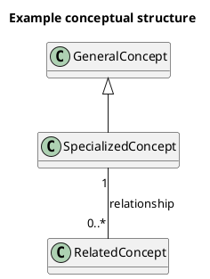
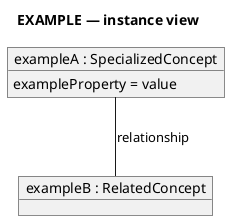
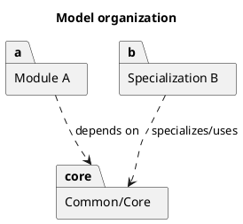
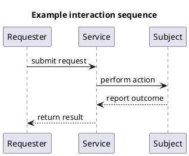
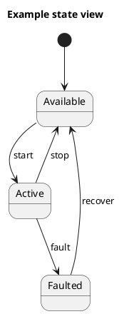
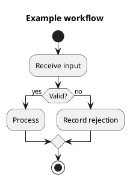

# DIM/Profile V2 Modeling and Visualization Guide

**Version 0.1 — 25 October 2026**  
**Standing:** Working visualization convention for V2 research and design artifacts.  
**Purpose:** Make V2 diagrams accurate, consistent, reproducible, and useful without turning the project into a model-driven-engineering program.

> **Governing rule:** This guide governs how V2 information is depicted. It does not define V2 domain semantics. A diagram represents decisions and evidence established elsewhere; visual convention must never create model meaning by itself.

## 1. Goal and scope

The goal of this guide is to provide a small, durable set of instructions that can be applied every time a V2 diagram or visual model is created. The guide is deliberately narrower than a general UML manual. It defines which visual forms V2 uses, when each form is appropriate, what the principal symbols mean, how V2-specific provenance and status are shown, what visual-quality rules apply, how diagram source is preserved, and what must be checked before a figure is accepted.

The guide is grounded principally in OMG UML 2.5.1 and OGC conceptual-modeling practice. OMG maintains UML 2.5.1 as the current formal UML specification and publishes normative machine-readable metamodel artifacts. OGC Testbed-17 recommends that conceptual models be platform independent, that UML class diagrams be used for conceptual structure, that UML follow OMG UML 2.5.1, that models add value, remain consistent with supporting text, and be preserved in machine-readable form where appropriate. The OMG UML Profile for NIEM provides additional precedent for representing reusable information models with UML and machine-readable model artifacts.

V2 does **not** adopt every UML diagram type. The approved repertoire below is intentionally small. If a diagram does not improve understanding, use prose or a table instead.

## 2. Approved visual repertoire

| Question to answer | Default representation | Standing |
| --- | --- | --- |
| What concepts exist, how are they specialized, and how are they related? | UML class diagram | Primary conceptual-model view |
| What does one concrete example or configuration look like? | UML object/instance diagram | Illustrative, never normative by itself |
| How is the model organized into packages/modules or specializations? | UML package diagram | Use only for actual model organization |
| Who interacts with whom, and in what order? | UML sequence diagram | Interaction/time view |
| What states can something occupy, and what transitions change state? | UML state-machine diagram | Lifecycle/state view |
| What workflow, branching, or parallel activity occurs? | UML activity diagram | Process/workflow view |
| What are the major layers or scope boundaries? | Controlled context/layer diagram | Explanatory; not an authoritative DIM model |
| Which sources support which concepts, mappings, or decisions? | Matrix/table | Preferred over network/spaghetti diagrams |

### 2.1 Class diagrams are the default DIM view

The authoritative visual view of DIM conceptual structure is a UML class diagram unless a different view answers the question better. Class diagrams are used for concepts, generalization/specialization, associations, association roles, and intrinsic multiplicities. They should remain platform independent. CSAPI paths, JSON members, SensorML placement, and other binding mechanics do not appear in the conceptual DIM class view unless the figure is explicitly a binding view rather than a DIM view.

### 2.2 Instance diagrams separate examples from concepts

When showing TRSS, OmniSense, Smart Citizen, a fictional reference system, or any other concrete configuration, use an object/instance diagram. An instance diagram must be visibly labeled **EXAMPLE** or **INSTANCE VIEW**. Real or fictional instance names must not be drawn as though they are classes. Example values may be shown when they clarify the model, but they do not establish normative requirements.

### 2.3 Package diagrams show real organization only

Package/module diagrams are used only after V2 has actually established modules, packages, subdomains, or specializations. A package box is not a convenient visual grouping device. Visual grouping that is merely explanatory should use a note, frame, or context diagram rather than imply that a formal model package exists.

### 2.4 Sequence, state, and activity diagrams are not interchangeable

Use a sequence diagram when the important question is **ordered interaction among participants**. Use a state diagram when the important question is **valid states and transitions of one modeled subject**. Use an activity diagram when the important question is **workflow, branching, parallel work, or procedural flow**. Do not use a generic flowchart when one of these established views precisely answers the question.

### 2.5 Context diagrams are explanatory, not semantic shortcuts

A context/layer diagram may explain relationships such as DIM → Profile → Binding → Implementation, source-family boundaries, or research workflow. It is not a substitute for the DIM. Every arrow must be labeled with an explicit verb or relationship such as **selects**, **constrains**, **binds to**, **implements**, **produces**, or **uses**. Unlabeled arrows are not allowed.

### 2.6 Matrices are the default for many-to-many evidence

When the problem is source-to-concept support, donor comparison, coverage, traceability, or disposition, use a matrix/table. Do not create a force-directed network or dense cross-linked graph merely because the data are relational. A matrix is generally more accurate and auditable for many-to-many evidence.

## 3. Diagram selection rule

Before drawing anything, complete this sentence:

> **This figure shows ______ so that the reader can understand ______.**

Then choose the view:

- **Concepts and relationships?** Class diagram.
- **A concrete configured example?** Object/instance diagram.
- **Model partitioning?** Package diagram.
- **Participants exchanging messages over time?** Sequence diagram.
- **Discrete states and permitted transitions?** State diagram.
- **Workflow or decision flow?** Activity diagram.
- **Layers, scope, or artifact relationships?** Context/layer diagram.
- **Evidence, donor support, or crosswalk?** Matrix/table.

If none of these makes the subject clearer than prose, do not create a diagram.

## 4. UML semantic rules used by V2

V2 uses established UML notation where UML is selected. The visual symbol carries semantic meaning and must not be used decoratively.

| Notation | Meaning in V2 | Rule |
| --- | --- | --- |
| Hollow triangle generalization arrow | “is a specialization of” | Use only for true generalization/specialization. Arrow points to the more general concept. |
| Solid association line | Defined relationship between concepts | Name the association or its roles when meaning is not obvious. |
| Multiplicity such as `1`, `0..1`, `0..*`, `1..*` | Intrinsic cardinality | Show only when supported by the domain model/evidence. Do not encode a profile-only requirement as intrinsic DIM cardinality. |
| Dependency dashed arrow | One model element depends on/uses another | Use sparingly and label when ambiguity is possible. |
| Filled diamond composition | UML composite aggregation | Use only when UML composite-aggregation semantics are actually intended and supported. |
| Hollow diamond aggregation | UML shared aggregation | Use only when UML shared-aggregation semantics are actually intended and supported. |

### 4.1 CSAPI Composition/Aggregation warning

**Do not automatically draw UML diamonds merely because CSAPI uses the words Composition and Aggregation.** CSAPI defines domain/API semantics for enduring subsystem composition versus deployment-scoped aggregation and explicitly notes that its Composition meaning is looser than strict UML. Until V2 determines that a relationship satisfies UML aggregation semantics, depict the relationship as a labeled association (for example, `composition` or `deployment-scoped aggregation`) rather than importing a UML diamond by name alone.

### 4.2 Attributes and operations

Conceptual class diagrams should show only attributes/properties that are important to understanding the domain concept. They should not list every eventual API field. Operations/methods are omitted by default from DIM conceptual diagrams because the DIM is not a software class design. Add an operation only when behavior is itself a settled domain concept and the view genuinely needs it.

### 4.3 Association names and roles

Prefer meaningful verbs or role names: `hosts`, `implements`, `deployedOn`, `observes`, `supplies`, `produces`. Avoid vague labels such as `relatedTo`, `connectedTo`, or `has` unless the source itself defines that relationship and no more precise term exists. If a relationship has its own identity, attributes, time, provenance, or other independent meaning, consider whether it is a modeled relationship/entity rather than hiding those semantics on a line.

## 5. V2 provenance and status annotations

Source provenance and research standing must be visible without creating fake UML semantics. V2 uses **textual provenance/status tags**, not color alone and not ad hoc UML stereotypes.

Recommended compact annotations:

- `[source: SOSA/SSN]`
- `[source: CSAPI]`
- `[source: NIEM]`
- `[V2 candidate]`
- `[V2 adopted]`
- `[V2-authored]`
- `[example]`

These tags may appear as a small secondary line inside the element, in a nearby note, or in a legend. They are visualization metadata, not UML stereotypes and not part of the domain semantics unless the model explicitly defines them elsewhere.

### 5.1 Status must be textual

Do not encode “candidate,” “adopted,” “rejected,” “source-gated,” or similar status solely through red/green/gray colors, dashed borders, opacity, or line style. Color may support readability but the status must remain readable in grayscale and when copied as plain text.

### 5.2 Sourced and V2-authored meanings must not blur

When a diagram contains both external source concepts and V2-authored concepts, each V2-authored concept must be identifiable. A diagram must not make a locally authored relationship look like it came from an external standard merely because the boxes share a visual style.

## 6. Layer discipline

A diagram must state what layer it depicts. The principal layers are:

1. **DIM conceptual layer** — domain concepts and intrinsic relationships.
2. **Application-profile layer** — selected content and interoperability obligations.
3. **OGC binding layer** — concrete CSAPI/SensorML/SWE representation.
4. **Implementation layer** — server, adapter, client, validator, UI, storage, and runtime behavior.

Do not mix layers invisibly. A figure may deliberately show more than one layer only if the layer boundaries are explicit and the relationships between them are labeled. For example, a DIM concept Sensor and a CSAPI property `systemType = Sensor` may appear in one binding figure only if the figure clearly distinguishes **domain meaning** from **representation mechanism**.

## 7. Visual quality rules

Every maintained V2 diagram follows these rules:

- **One question per figure.** If a figure tries to answer several unrelated questions, split it.
- **One obvious reading direction.** Prefer left-to-right or top-to-bottom.
- **Minimize crossed connectors.** Re-layout or split the view rather than tolerate spaghetti.
- **Keep labels short.** Put definitions and long explanations in prose or notes, not inside boxes.
- **Use consistent typography and spacing.** Similar things look similar; different semantics are labeled rather than merely styled differently.
- **No decorative arrows.** Every connector has a defined meaning.
- **No relationship by proximity.** Two boxes being near each other never implies a relationship.
- **No color-only meaning.** Every semantic distinction survives grayscale printing.
- **Do not duplicate a concept casually.** If the same concept must appear twice for layout, mark the duplication clearly or use a view mechanism that avoids ambiguity.
- **Keep the view readable at normal document size.** Split large models into overview and focused views rather than shrinking text.
- **Use legends only when needed.** A small stable legend is preferable to repeated explanation, but a figure that requires a page-long legend is too complicated.
- **Do not beautify away uncertainty.** Open or candidate concepts remain explicitly marked; the diagram must not visually imply a decision that the text has not made.

## 8. Authoring and repository convention

### 8.1 Preferred source mechanism

PlantUML is the preferred text-based source format for UML class, object, package, sequence, state, and activity diagrams. PlantUML is not the semantic authority; OMG UML 2.5.1 and this V2 guide are. PlantUML is selected because text-based source is reviewable, diffable, reproducible, and can generate the diagram rather than requiring manual redrawing. OGC’s own UML best-practice report lists PlantUML among available UML tools and emphasizes correctness, consistency, value, and machine-readable artifacts.

If PlantUML is unavailable or cannot express a required UML construct faithfully, another standards-compliant UML tool may be used. The source artifact must still be preserved in a reproducible form. Manually drawn PowerPoint/Word shapes are explanatory fallbacks, not authoritative model source.

### 8.2 Rendered formats

- Preserve the editable/text source (`.puml` or equivalent).
- Prefer SVG for repository/document figures when supported.
- Use PNG when raster output is required by the target document or toolchain.
- Never keep only a screenshot of an authoritative diagram.

### 8.3 Source-file header

Every maintained diagram source begins with metadata equivalent to:

```text
Title: <figure title>
View: <class | object | package | sequence | state | activity | context>
Question: <what this figure answers>
Layer: <DIM | profile | binding | implementation | mixed-explicit>
Status: <working | candidate | approved-for-current-draft>
Source artifact: <document/model version>
```

The rendered figure need not display all of this metadata, but the title and sufficient status/context must be visible when omission could cause confusion.

### 8.4 File naming

Use a stable descriptive basename, for example:

```text
conceptual-system-sensor-equipment.puml
conceptual-system-sensor-equipment.svg
example-weather-station-instance.puml
module-overview.puml
sequence-command-execution.puml
```

Avoid names such as `diagram1`, `newdiagram-final2`, or dates as the only identity.

## 9. Canonical starter patterns

These examples are intentionally generic. They establish the visual grammar without making new V2 domain decisions.

### 9.1 Conceptual class pattern



Use this pattern for the DIM. Replace example names only with concepts whose meaning and relationship are established.

### 9.2 Object/instance pattern



Instance diagrams are examples; they do not create classes or cardinalities.

### 9.3 Package/module pattern



Use only after the named packages/modules actually exist.

### 9.4 Sequence pattern



A sequence diagram describes ordered interaction; it does not establish a state machine.

### 9.5 State pattern



Only use states and transitions that are actual domain semantics.

### 9.6 Activity pattern



Use for workflow/decision logic, not for structural relationships among concepts.

## 10. Anti-patterns

Do **not** use these patterns in maintained V2 work:

- Generic boxes-and-arrows diagrams with unlabeled arrows.
- Force-directed donor/source networks for evidence that is better shown as a matrix.
- Class diagrams that mix conceptual classes, API endpoints, JSON fields, and real instances without explicit layer separation.
- UML diamonds used only because an English source says “component,” “composition,” or “aggregation.”
- Cardinalities invented from example data or profile convenience.
- Color keys with no textual equivalent.
- Dense “everything diagrams” shrunk until the text is unreadable.
- Decorative icons that look meaningful but have no defined semantics.
- Manual diagram edits with no corresponding source update.
- A diagram being treated as authoritative when it conflicts with the controlling text/model.

## 11. Pre-flight checklist

Before presenting or committing a substantive V2 diagram, verify all items below.

### Purpose

- [ ] I can state in one sentence what question this figure answers.
- [ ] A diagram is better than prose or a table for this question.
- [ ] I selected the approved view that matches the question.

### Semantics

- [ ] Every concept and relationship is sourced, adopted, candidate, example, or V2-authored as appropriate.
- [ ] Every arrow/connector has a defined meaning.
- [ ] Generalization really means specialization/generalization.
- [ ] Multiplicities are supported by domain evidence, not guessed from an example.
- [ ] UML aggregation/composition symbols are used only when UML semantics are actually intended.
- [ ] CSAPI Composition/Aggregation has not been mapped to UML diamonds by terminology alone.

### Layer discipline

- [ ] The diagram states or makes clear whether it is DIM, profile, binding, implementation, or an explicitly mixed view.
- [ ] Conceptual classes and concrete instances are not mixed invisibly.
- [ ] DIM semantics and CSAPI/SensorML/SWE representation mechanisms are not conflated.

### Visual quality

- [ ] The reading direction is obvious.
- [ ] Connector crossings are minimized.
- [ ] Text is readable at normal document size.
- [ ] Nothing important is conveyed only by color.
- [ ] Long prose has not been stuffed into boxes.
- [ ] Candidate/open status has not been visually disguised as settled.

### Reproducibility

- [ ] Editable/text diagram source is preserved.
- [ ] Rendered output matches the source.
- [ ] The source can be regenerated without manually reconstructing the layout or semantics.
- [ ] The source file and rendered figure have stable descriptive names.

**If any required check fails, fix the diagram before presenting it as V2 work.**

## 12. Governance and change control

This guide is intentionally small and should remain small. Add a new diagram type or notation rule only when a recurring V2 need cannot be represented accurately with the existing repertoire. Do not expand the guide merely because UML or a tool supports additional features. The guide should evolve when real project use reveals a repeated ambiguity, failure mode, or missing view.

A diagram may be informative, working, or authoritative for a particular V2 model version. The standing must be clear in the containing artifact. If a diagram conflicts with the controlling prose/model, the conflict must be resolved rather than silently choosing whichever representation is more convenient. Once the V2 DIM itself becomes formally modeled, the project may choose to designate the maintained model source as authoritative; this guide does not make that decision in advance.

## 13. References

Object Management Group (OMG). 2017a. Unified Modeling Language (UML), Version 2.5.1. Formal specification, December. https://www.omg.org/spec/UML/2.5.1.

Object Management Group (OMG). 2017b. UML Profile for NIEM, Version 3.0. Formal specification, April. https://www.omg.org/spec/NIEM-UML/3.0.

Open Geospatial Consortium. 2022. OGC Testbed-17: UML Modeling Best Practice Engineering Report. OGC 21-031. February 8. https://docs.ogc.org/per/21-031.html.

PlantUML. 2026. PlantUML Language Reference and Diagram Documentation. Accessed October 25, 2026. https://plantuml.com/.
