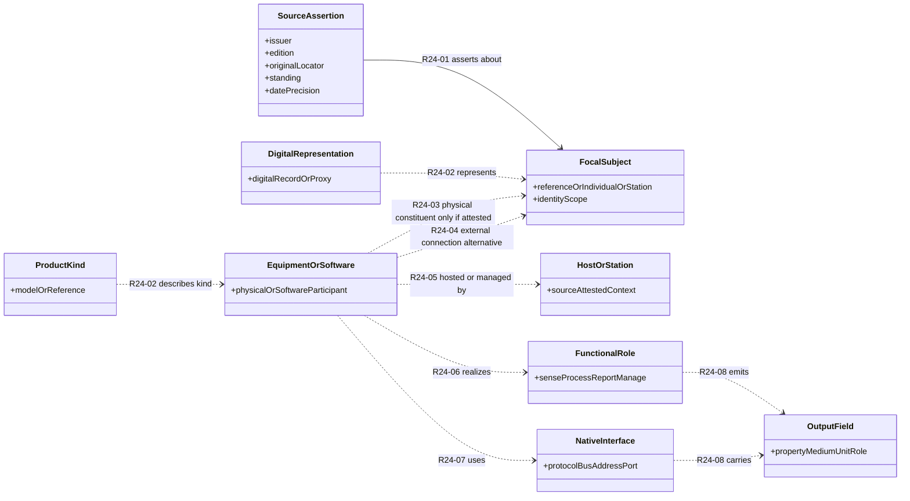
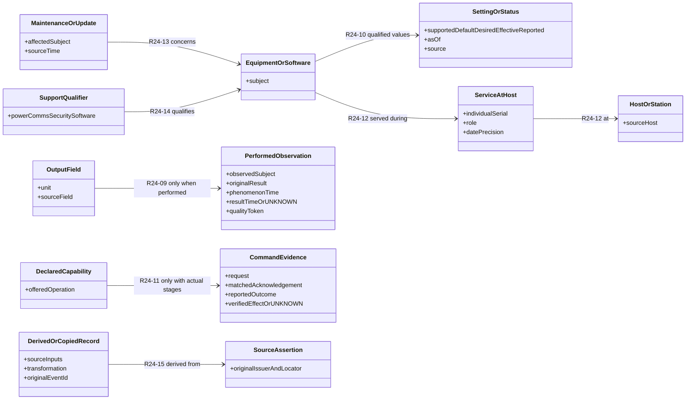

# DIM V2 — reviewable donor mapping and UML-style model

**4 November 2026 · Research working documents, NOT an adopted model or OGC application Profile.** This folder is the reader-facing home of the owner-requested donor→Domain Information Model (DIM) crosswalk and readable conceptual diagrams. Every proposed relationship is conditional on original source evidence; a manufacturer reference is not an installed unit, an interface field is not necessarily a physical component, and a published example is not a performed observation.

**Open in GitHub; no ChatGPT sandbox download required.**

**CURRENT STEP15 COMPLETE · 7 NOV 2026 · 15/40; STEP16 OWNER CHECKPOINT NEXT ONLY ON A SEPARATE “proceed.”** [**Editable 15-sheet v0.9 master**](../Donor_DIM_Crosswalk/Master_Donor_Concept_to_DIM_Crosswalk_v0.9_Step15_ISA_07NOV2026.xlsx) · [**unchanged 13-column accepted master**](../Donor_DIM_Crosswalk/Master_Donor_Concept_to_DIM_Crosswalk_v0.9_Step15_ISA_07NOV2026.md) · [**complete 14-column ISA PROPOSED owner preview**](../Donor_DIM_Crosswalk/Step15_ISA_6_Proposed_14_Column_Overlay_07NOV2026.md) · [**ISA 6.0 original 2023 source audit**](../Donor_DIM_Crosswalk/Step15_ISA_6_Original_Source_Clause_Audit_07NOV2026.md) · [**independent published-workbook CI PASS**](https://github.com/OS4CSAPI/glaux-client/actions/runs/42342501927). Original Distribution A ISA source texts reviewed from five 31 October 2023 documents (DMS 6.0r12, SDD 6.0r5, Component/Controller Requirements 6.0r4, ICD 6.0r5); **11 original-source-checked ISA correspondences STAGED** and 14 source-native concepts HELD, not adopted. **The accepted 13-column primary table and its 58 donor records were NOT changed**: 37 OGC/W3C original-source-checked, 6 IEEE 1451 public-technical-only, 15 OPC/SAPIENT prior-only. All 22 proposed DIM rows, nine case-only holds and 73 source-case entries preserved; all earlier 13 XLSX sheets byte-identical. Separate ISA overlay adds a proposed fourteenth column after SAPIENT, with DIM still rightmost; it requires Step16 owner disposition. **No accepted ISA column, new DIM/Profile/UML/Glaux/Cloudflare/server change or conformity claim.**

**CURRENT STEP14 COMPLETE · 6 NOVEMBER 2026 · 14/40; STEP15 INTEGRATED SENSOR ARCHITECTURE (ISA) 6.0 NEXT ONLY ON SEPARATE OWNER “proceed.”** [**13-sheet v0.8 editable master**](../Donor_DIM_Crosswalk/Master_Donor_Concept_to_DIM_Crosswalk_v0.8_Step14_IEEE1451_06NOV2026.xlsx) · [**full donor→DIM horizontal comparison**](../Donor_DIM_Crosswalk/Master_Donor_Concept_to_DIM_Crosswalk_v0.8_Step14_IEEE1451_06NOV2026.md) · [**IEEE 1451.0-2024 public-source technical audit**](../Donor_DIM_Crosswalk/Step14_IEEE1451_2024_Public_Technical_Evidence_Audit_06NOV2026.md) · [**six mapping decisions and fourteen held concepts**](../Donor_DIM_Crosswalk/Step14_IEEE1451_2024_Public_Technical_Evidence_Audit_06NOV2026.json) · [**independent published-binary GitHub Actions PASS**](https://github.com/OS4CSAPI/glaux-client/actions/runs/42340946419). Five existing IEEE donor cells rechecked, one source-backed **RELATED** MetaTEDS.UUID entry added to the existing proposed identifier row; **14 IEEE technical leads HELD**. **58 donor records = 37 OGC/W3C original-standard-source-checked + 6 IEEE 2024 publisher/NIST/IML PUBLIC-TECHNICAL-CHECKED (2024 normative clauses NOT inspected) + 15 prior-only** (OPC 6, SAPIENT 9). Source scope preserved: IEEE 1451.5-2007 PHY TEDS is **not** conflated with 1451.0-2024. 13 accepted columns, six sections, 22 proposed DIM rows, nine case holds and 73 original equipment-case source statements intact. No adopted DIM/Profile/UML/client/server/deployment/control changes. **Step15 NOT STARTED.**

**HISTORICAL CROSSWALK STEP13 COMPLETE (6 NOV 2026) · 13/40 COMPLETE, IEEE 1451/TEDS STEP14 NEXT ONLY.** [**Editable v0.7 horizontal 12-sheet XLSX**](../Donor_DIM_Crosswalk/Master_Donor_Concept_to_DIM_Crosswalk_v0.7_Step13_W3C_SOSA_SSN_06NOV2026.xlsx) · [**full master readable in GitHub**](../Donor_DIM_Crosswalk/Master_Donor_Concept_to_DIM_Crosswalk_v0.7_Step13_W3C_SOSA_SSN_06NOV2026.md) · [**Step13 W3C 2017 primary-source audit**](../Donor_DIM_Crosswalk/Step13_W3C_SOSA_SSN_2017_Original_Vocabulary_Audit_06NOV2026.md) · [**6 reviewed correspondences +12 held source distinctions**](../Donor_DIM_Crosswalk/Step13_W3C_SOSA_SSN_2017_Original_Vocabulary_Audit_06NOV2026.json) · [**independent published workbook CI PASS**](https://github.com/OS4CSAPI/glaux-client/actions/runs/42339617299). The six W3C 2017 source terms are source-checked (2 DIRECT, 4 PARTIAL), not adopted; the November 2026 W3C Working Draft and Open Group SOSA remain distinct. 57 donor correspondence entries: **37 original-source reviewed, 20 earlier only**. 13 owner-approved columns, six dividers, 22 proposed DIM rows, 9 case-only review holds, 73 equipment case statements and earlier OGC audit tabs preserved. No DIM, Profile, UML, deployed Glaux/server or equipment changes.

**HISTORICAL STEP12 COMPLETE (6 NOV 2026) · STEPS 01–12/40 COMPLETE; STEP13 W3C SOSA/SSN NEXT ON A SEPARATE OWNER “proceed” ONLY.** [**Source-checked editable v0.6 master**](../Donor_DIM_Crosswalk/Master_Donor_Concept_to_DIM_Crosswalk_v0.6_Step12_OMS_06NOV2026.xlsx) · [**full horizontal table**](../Donor_DIM_Crosswalk/Master_Donor_Concept_to_DIM_Crosswalk_v0.6_Step12_OMS_06NOV2026.md) · [**Step12 OMS original conceptual requirements audit**](../Donor_DIM_Crosswalk/Step12_OMS_3_Original_Clause_Audit_06NOV2026.md) · [**structured source/held-concepts decisions**](../Donor_DIM_Crosswalk/Step12_OMS_3_Original_Clause_Audit_06NOV2026.json) · [**independent GitHub Actions run 42334124885 PASS**](https://github.com/OS4CSAPI/glaux-client/actions/runs/42334124885). **Five existing OMS correspondences rechecked** against OGC 20-082r4 (3 narrow DIRECT concepts, 2 PARTIAL): Observer, ObservingProcedure, ObservableProperty, Observation, Host. **Twelve original OMS native concepts/constraints remain HELD**, especially the distinct phenomenonTime/resultTime, feature-of-interest, resultQuality and relatedObservation meanings. All **57 donor records** remain: **5 OMS + 4 SWE Common + 10 SensorML + 12 CSAPI = 31 original-source-reviewed terms**, plus **26 other prior-only donor extracts**. Original **73 source-case references**, 22 proposed DIM information rows, 9 case-only holds and 13 approved column positions were preserved. The **original Bennett NOAA resultTime remains UNKNOWN**; OMS 3.0 is an Abstract Specification conceptual/logical model, not an OMS-specific JSON encoding. No DIM/Profile/UML/Glaux/server changes or deployed conformance testing. **STEP13 NOT STARTED.**

**CURRENT STEP11 COMPLETE (6 NOV 2026) · STEPS 01–11/40 COMPLETE; STEP12 OMS 3.0 NEXT ON A SEPARATE OWNER “proceed” ONLY.** [**Source-checked v0.5 editable master**](../Donor_DIM_Crosswalk/Master_Donor_Concept_to_DIM_Crosswalk_v0.5_Step11_SWECommon_06NOV2026.xlsx) · [**readable horizontal table**](../Donor_DIM_Crosswalk/Master_Donor_Concept_to_DIM_Crosswalk_v0.5_Step11_SWECommon_06NOV2026.md) · [**Step11 native SWE Common audit**](../Donor_DIM_Crosswalk/Step11_SWE_Common_3_Original_Clause_Audit_06NOV2026.md) · [**source decisions JSON**](../Donor_DIM_Crosswalk/Step11_SWE_Common_3_Original_Clause_Audit_06NOV2026.json) · [**GitHub Actions 42329407289 PASS**](https://github.com/OS4CSAPI/glaux-client/actions/runs/42329407289). **Four original-source-checked SWE Common mappings** were added to the previously empty donor column on *existing proposed rows* (2 PARTIAL, 2 RELATED, 0 DIRECT); **13 native SWE Common source leads are HELD**, including an original OGC 24-014 §10.2.3 `recordsAsArrays` wording inconsistency. There are **57** donor correspondence records: 4 SWE + 10 SensorML + 12 CSAPI source-checked terms and **31** earlier historical donor extracts. **73 source-case entries**, **22 candidate DIM rows**, **9 case-only HELD rows**, **13 owner-approved column positions** and existing source workbooks are unchanged. The OGC data-representation classes are NOT sensor identities, original performed Observations, physical Command outcomes, or automatically adopted DIM/Profile obligations. Step12 is **NOT STARTED**.

**CURRENT STEP10 COMPLETE (6 NOV 2026) · STEPS 01–10/40 COMPLETE; STEP11 SWE Common 3.0 NEXT ON A SEPARATE OWNER “proceed” ONLY.** [**Editable source-checked v0.4 master**](../Donor_DIM_Crosswalk/Master_Donor_Concept_to_DIM_Crosswalk_v0.4_Step10_SensorML_06NOV2026.xlsx) · [**full horizontal table**](../Donor_DIM_Crosswalk/Master_Donor_Concept_to_DIM_Crosswalk_v0.4_Step10_SensorML_06NOV2026.md) · [**Step10 original SensorML 3.0 research audit**](../Donor_DIM_Crosswalk/Step10_SensorML_3_Research_Review_06NOV2026.md) · [**structured original-clause/JSON-schema evidence**](../Donor_DIM_Crosswalk/Step10_SensorML_3_Original_Clause_Audit_06NOV2026.json) · [**independent GitHub Actions run 42328048803 PASS**](https://github.com/OS4CSAPI/glaux-client/actions/runs/42328048803). **Eight previous SensorML donor cells rechecked and two source-backed terms added to existing proposed rows** (ObservableProperty direct concept match; Deployment qualified platform/location match). **Ten** source-checked SensorML donor mappings, **12** previously source-checked CSAPI mappings, **31** other unverified historical donor cells = **53** total. **Nine source-native SensorML leads HELD, not adopted**. **73 case source records**, 22 original proposed DIM elements, nine case-only holds, 13 owner-accepted columns and SWE Common blank column preserved. No adopted DIM, Profile, UML, Glaux client/server, deployment or actual SensorML producer conformance work. **Step11 is NOT STARTED.**

**CURRENT CROSSWALK PROGRAM · 9/40 COMPLETE; STEP09 CSAPI ORIGINAL-SOURCE COLUMN REVIEW PASS; STEP10 SENSORML 3.0 NEXT ON SEPARATE “proceed” ONLY.** Direct source terms/clauses of published OGC 23-001/23-002 were checked for 12 existing CSAPI column entries; their proposed DIM relationships are not adopted. Eight other CSAPI native capabilities are recorded as *review holds* and were not forced into DIM rows. 39 other donor mappings stay historical, 73 case records unchanged. [**Source-reviewed v0.3 workbook**](../Donor_DIM_Crosswalk/Master_Donor_Concept_to_DIM_Crosswalk_v0.3_Step09_CSAPI_06NOV2026.xlsx), [**full horizontal table**](../Donor_DIM_Crosswalk/Master_Donor_Concept_to_DIM_Crosswalk_v0.3_Step09_CSAPI_06NOV2026.md), [**original source audit**](../Donor_DIM_Crosswalk/Step09_CSAPI_Parts1_2_Original_Clause_Audit_06NOV2026.md), [**GitHub Actions result PASS**](https://github.com/OS4CSAPI/glaux-client/actions/runs/42325217851). Previous v0.2 accepted-layout file remains intact. No new DIM/Profile or app work. **Step10 not started.**

**CURRENT AUTHORITATIVE: STEP08 OWNER REVIEW COMPLETE (8/40) · STEP09 NEXT ON A SEPARATE “proceed” ONLY.** The owner accepted the **v0.2 working column layout**, **not** donor mapping equivalences, DIM/Profile meanings, nine case-derived review holds or rank. [**Step08 owner decision / limitations**](../Donor_DIM_Crosswalk/Step08_Owner_Review_Closeout_06NOV2026.md) · [**structured decision**](../Donor_DIM_Crosswalk/Step08_Owner_Review_Disposition_06NOV2026.json) · [**accepted-layout Excel master**](../Donor_DIM_Crosswalk/Master_Donor_Concept_to_DIM_Crosswalk_v0.2_06NOV2026.xlsx) · [**full GitHub table**](../Donor_DIM_Crosswalk/Master_Donor_Concept_to_DIM_Crosswalk_v0.2_06NOV2026.md) · [**XLSX validation PASS**](https://github.com/OS4CSAPI/glaux-client/actions/runs/42314409072). **22 DIM rows remain proposed; nine extra case-only rows remain HOLDS; 51 donor cells retain PRIOR_SOURCE_EXTRACT_ONLY; 73 source case entries remain qualified; SWE column blank.** The v0.2 workbook/JSON is an immutable pre-decision review snapshot and its old `PENDING` metadata is superseded for execution status by the Step08 owner-decision record. No Excel/source mappings changed in this closeout.

**STEP08 OWNER-REQUESTED FORMAT REVISION — PUBLISHED, VALIDATED, BUT NOT YET APPROVED (6 NOV 2026).** [**Open revised 13-column editable Excel workbook**](../Donor_DIM_Crosswalk/Master_Donor_Concept_to_DIM_Crosswalk_v0.2_06NOV2026.xlsx) · [**Read entire revised master on GitHub**](../Donor_DIM_Crosswalk/Master_Donor_Concept_to_DIM_Crosswalk_v0.2_06NOV2026.md) · [**Case-evidence CSV (73 original/source-qualified case cells)**](../Donor_DIM_Crosswalk/Master_Donor_Concept_to_DIM_Crosswalk_v0.2_06NOV2026_Case_Evidence.csv) · [**Review note and limitations**](../Donor_DIM_Crosswalk/Step08_Layout_Revision_Proposed_06NOV2026.md) · [**GitHub Actions PASS 42314409072**](https://github.com/OS4CSAPI/glaux-client/actions/runs/42314409072). The new left-to-right order is **Dragino | AirGradient | Campbell | Bennett | IEEE | OPC UA Devices | SAPIENT | W3C SOSA/SSN | OMS 3.0 | SWE Common 3.0 | SensorML 3.0 | CSAPI | PROPOSED DIM**. The new sixth divider and nine case-only rows are **REVIEW HOLDS, NOT APPROVED DIM ELEMENTS**; SWE Common donor cells are empty pending source-clause review; **51 prior donor cells were preserved**. The original v0.1 workbook remains unchanged. **Executed steps 01–07/40; Step08 still OPEN pending owner inspection, Step09 NOT AUTHORIZED.**

**NEW formally bounded follow-up (5 November 2026):** After accepting the seven-donor/22-row *layout*, the owner requested a dedicated step-by-step plan and recovery PITON before any wider mapping. [**Crosswalk workstream home**](../Donor_DIM_Crosswalk/README.md) · [**40-step proposed source-first plan**](../Donor_DIM_Crosswalk/PLAN_Donor_Concept_to_DIM_Master_Crosswalk_v0.1_05NOV2026.md) · [**new PITON v0.1**](../Donor_DIM_Crosswalk/PITON_Donor_Concept_to_DIM_Crosswalk_v0.1_05NOV2026.md). **Steps 01–07 complete; Step08 OWNER CHECKPOINT NEXT (no Step09 intake without acceptance).** The [actual six-sheet editable XLSX master](../Donor_DIM_Crosswalk/Master_Donor_Concept_to_DIM_Crosswalk.xlsx), [GitHub-readable donor-columns/DIM-last table](../Donor_DIM_Crosswalk/Master_Donor_Concept_to_DIM_Crosswalk.md), [Step06 report](../Donor_DIM_Crosswalk/Step06_Master_Workbook_Build_and_Verification_06NOV2026.md) and [GitHub validation PASS](https://github.com/OS4CSAPI/glaux-client/actions/runs/42297230272) are published. The [Step07 four-case 22-row audit](../Donor_DIM_Crosswalk/Step07_Four_Case_Row_and_Group_Review_06NOV2026.md) and [case CSV](../Donor_DIM_Crosswalk/Step07_Four_Case_Row_Review_06NOV2026.csv) are now available for the owner review; the master remains unchanged. **No new donor concepts mapped or model adopted.** The older 182-artifact/R24-oriented XLSX is not the approved owner-facing master. This independent workstream does **not** reopen the previous external interoperability Gate E/F conclusions.

## NEW — What the owner actually requested: donors across columns, DIM at far right

**[Open the directly viewable 22-element SAMPLE comparison table](DIM_V2_Donor_Columns_Sample_v0.1_05NOV2026.md)** — **THIS** is the new side-by-side layout to review before expanding the donor population. The **seven donor columns are fixed left-to-right from fewer to more sample matches**; the far-right column alone is the **proposed DIM information element**. Five full-width section divider rows group the concepts in a progressive order, and unique/unmatched needs get their own rows rather than being forced into false equivalences.

- [Open the same sample in Excel-compatible CSV](DIM_V2_Donor_Columns_Sample_v0.1_05NOV2026.csv).
- [Check the 51 cell-by-cell original source locators, relationship qualifications and URLs](DIM_V2_Donor_Columns_Sample_v0.1_05NOV2026_Evidence.csv).
- [Inspect the full structured sample (exact column order and source facts)](DIM_V2_Donor_Columns_Sample_v0.1_05NOV2026.json).

**This is a design/format sample, not the complete donor corpus, adopted model or a score of which standard is “best.”** Only 7 source families and 22 proposed information elements are represented. The previously produced **Family to R24** workbook is **NOT** this concept-to-DIM table; R24 are historical internal research IDs not needed to read the owner’s new master crosswalk.

---

**GitHub-downloadable deliverables — build verified on 4 November 2026:**

| Deliverable | Open or download on GitHub | Role |
| --- | --- | --- |
| **Excel traceability workbook (.xlsx)** | [DIM_V2_Donor_to_Model_Traceability.xlsx](DIM_V2_Donor_to_Model_Traceability.xlsx) | Seven sheets: source-native terminology, 30 donor family topics, R24 register, donor-by-R24 matrix, 182-artifact accountability and unresolved questions |
| **Model view A (SVG/PNG)** | [Scalable SVG](DIM_V2_Core_UML.svg) / [PNG](DIM_V2_Core_UML.png) | Focal identity, physical equipment, functions, interfaces and outputs |
| **Model view B (SVG/PNG)** | [Scalable SVG](DIM_V2_Activity_UML.svg) / [PNG](DIM_V2_Activity_UML.png) | Configuration, observations, control, history and derived provenance |
| **Bennett historical instance (SVG/PNG)** | [Scalable SVG](DIM_V2_Bennett_Instance.svg) / [PNG](DIM_V2_Bennett_Instance.png) | Station, two real probes, two original NOAA mean reports, four historical digital copies |
| **Editable model source** | [PlantUML](DIM_V2_Candidate_UML.puml) / [Graphviz core](DIM_V2_Core_UML.dot) / [Graphviz activity](DIM_V2_Activity_UML.dot) | Source models for modification and regeneration |
| **Entire packaged set (.zip)** | [DIM_V2_Donor_Mapping_and_UML_Review_Pack.zip](DIM_V2_Donor_Mapping_and_UML_Review_Pack.zip) | Single downloadable package in the GitHub repository |
| **Raw 182-artifact lineage accounting** | [CSV](DIM_V2_182_Artifact_Accountability.csv) | The original registered source IDs and clear review limitations |

**Provenance and limitation:** These downloadable binary assets were **reconstructed reproducibly from the research branch’s committed source register, original donor terminology comparison, and R24 model** by [the artifact builder](../../../../scripts/build_dim_review_deliverables.py) in [GitHub Actions run 41928134710](https://github.com/OS4CSAPI/glaux-client/actions/runs/41928134710). **They are not byte-for-byte copies of the earlier ChatGPT sandbox Excel/image/ZIP attachments.** The workbook deliberately labels source-family topic mappings as candidates and shows each individually unassessed artifact. The earlier standalone conversation workbook claimed 54 separate source-native mapping rows; the reproducible repository workbook instead contains the original committed side-by-side source terminology and family R24 review tables. It must **not** be represented as the exact 54-row file without checking that earlier file separately.

**Existing authoritative working sources:**
- [Original candidate DIM and 15 source-qualified R24 relationships](../Candidate_Specification/DIM.md#r24-relationship-register--one-connected-model-individually-testable-meanings)
- [Editable PlantUML view of R24](../Candidate_Specification/DIM_V2_Candidate_R24_UML_04NOV2026.puml)
- [182-artifact donor accountability crosswalk CSV](../Donor_Alignment/05_Donor_to_R24_Artifact_Traceability_04NOV2026.csv)
- [Original 182-artifact full-citation register](../Donor_Alignment/03_Source_Accountability_Register.csv)
- [Native meanings and established contributions by 13 donor lineages, with 17 preliminary/deferred families](../Concept_Donor_Comparison/Donor_Contributions.md)
- [Native donor terms side by side](../Concept_Donor_Comparison/Donor_Terms_Side_by_Side.md)
- [Proposed publication-style DIM](../Candidate_Specification/DIM_Profile_V2_Proposed_Research_Candidate_DIM_v0.1_03NOV2026.md)

## Readable model view A — identities, participants, functions and outputs

The nodes below are **analytical roles**, NOT a mandated ontology/class inheritance model. Conditional edges preserve attachment versus membership, process versus equipment, and output fields versus physical components. Relationship identifiers link to the original R24 sources.

**Important:** A dotted/association line above does **not** require every focal subject to have that association. A true manufacturer **reference** cannot be promoted to a physical fielded **individual** merely because a native description can be parsed. No source-unsupported cardinality is introduced.

## Readable model view B — qualified state, activity and history

### Donor-native mapping: developed lineages (family-level summary, NOT a completed 182-artifact equivalence table)

| Donor family | Original donor-native meanings actually inspected | Candidate DIM R24 roles | Key non-equivalence / HOLD |
| --- | --- | --- | --- |
| OGC API – Connected Systems Parts 1–2 | System versus Procedure, Subsystem, Deployment, DataStream, Observation, Command | R24-01/02/03/05/09/11/12 | Reference Procedure ≠ installed System; a DataStream has one producing System but Bennett's mean producer remains disputed |
| SensorML 3.0 | PhysicalComponent/PhysicalSystem, ProcessMethod, typeOf, inputs/outputs, components/connections, settings | R24-02/03/04/06/07/08/10 | Source-defined process and output form ≠ independently identified real component or performed observation |
| SWE Common 3.0 | DataRecord, Quantity, Text, TimeRange, encoding semantics | R24-08/09/14 | Source TimeRange side-field ≠ fully valid OMS phenomenonTime/resultTime without native evidence |
| OMS 3.0 | Observer, Observation, Procedure, Host, Deployment, phenomenonTime, resultTime | R24-05/09/12 | Do not invent independent resultTime or exact probe swap from source date |
| Asset Administration Shell v3.2 | Asset vs Shell, Type vs Instance, Submodel and relationship elements | R24-01/02/03/15 | Shell ID ≠ physical serial; AAS assetType ≠ CSAPI assetType |
| OPC UA Devices / PA-DIM | Model vs DeviceType, Device/ComponentType, ConnectsTo, offline/online state; signals and condition | R24-02/03/04/07/10/14 | ConnectsTo ≠ mechanical containment; PA-DIM source coverage is not complete |
| IEEE 1451 / TEDS | APP, NCAP, TIM, transducer channel, Meta/Channel TEDS, sampling and self-description | R24-06/07/08/10 | Public technical source depth exists but full 2024 licensed normative SHALLs not independently audited |
| Integrated Sensor Architecture | Component/Controller, CIC, visible/opaque/virtual membership, properties, observables and commands | R24-03/05/06/10/11 | Network-visible interface ≠ one physical sensing unit |
| The Open Group SOSA | Sensor, Sensor Hardware Element, Host Platform, functional management roles | R24-03/05/06/10/14 | Functional/management participants ≠ mandatory physical subparts |
| SAPIENT v2 | Registration, ModeDefinition, StatusReport, Task/TaskAck/Detection | R24-06/08/10/11 | Task acknowledgement ≠ independently verified execution/effect |
| W3C SOSA/SSN | System/Sensor, Observation, Procedure, Platform, Deployment, hasSubSystem | R24-03/05/06/09/12 | 2017 Recommendation and 2026 draft not interchangeable; not Open Group SOSA |
| W3C WoT | Thing Model/Thing Description, Property/Action/Event, Intermediary/Digital Twin | R24-02/06/10/11/15 | Description/proxy identity ≠ physical serial or fresh performed act |
| SAREF | Device/DeviceKind, consistsOf, Function/Service | R24-02/03/06 | Composition isn't necessarily a universal physical hardware hierarchy |
| OSUS-R | Asset/AssetProxy and middleware adaptation | R24-02/06/15 | Java implementation classes are not adopted DIM/OGC classes |

**Evidence boundary:** The developed source-level comparison covers 13 families (listed above except SWE Common, which is within core OGC foundations) and another 17 preliminary/deferred leads. The 182-artifact register records all individual concept reviews as **NOT_ASSESSED**; a family mapping does not upgrade every artifact in that family. Use the CSV for the full accountability trail. This document is not an adopted OGC DIM or a completed all-donor conformance assessment.

## What to test before adopting any R24 mapping

For each original native donor source: verify original edition and exact clause, native subject and relationship direction, whether the proposed mapping is direct or only analogous, a plausible counterexample, the actual source equipment evidence, and any unavailable operational fact. Record **accepted/rejected/partial/held** independently for each precise source claim. Do not use number of source artifacts as a vote for class inheritance or universal root selection.

**User-facing goal:** Give one generic Glaux Resource Details interface enough source-grounded meaning to distinguish physical equipment, equipment functions, technical interfaces, observed facts, software representation, configuration, operational state, and dated history without fabricating observations or installing nonexistent devices.
