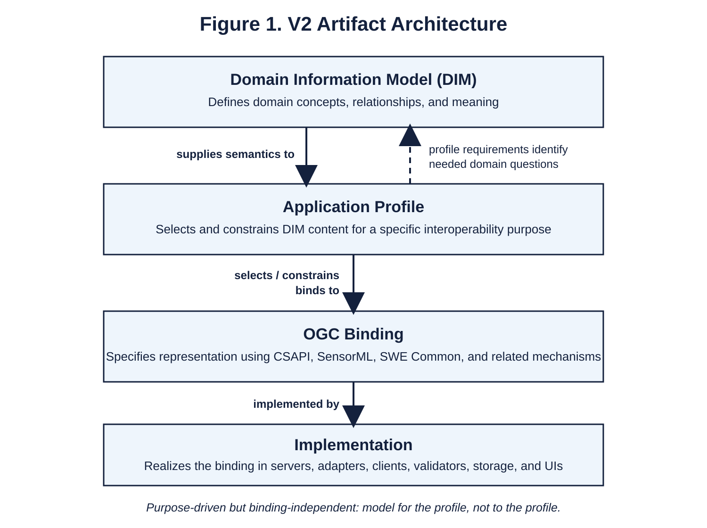

# Sensor Systems Domain Information Model and Application Profile

## Version 2 Working Draft

**Working draft v0.1 — 25 October 2026**  
**Working title:** The final domain-family name remains open.  
**Standing:** Clean V2 artifact; contains only established working decisions and explicitly identified candidates/open items.

## 1. Purpose and standing

This document is the clean Version 2 working artifact for the Domain Information Model (DIM) and the application profile that will ultimately use it. It is intended to become the self-describing statement of what Version 2 is, what problem it addresses, what concepts it adopts, how those concepts are organized, and how the resulting model is later selected and realized through the application profile and OGC binding. This first draft contains only conclusions that have been sufficiently established by the Version 2 research to date. It deliberately does not fill unresolved sections with provisional design simply to make the document appear complete.

The working title uses the plain-language phrase “Sensor Systems” only to identify the subject matter under investigation. Version 2 has not yet adopted a final boundary-defining family term beyond the sourced concepts already established, and this document must not silently invent one. The strongest current characterization of the motivating hardware systems remains a System whose primary activity is sensing or observing and whose realization is Equipment, expressed in CSAPI as `systemType = Sensor` together with `assetType = Equipment` (Open Geospatial Consortium 2025a, sec. 9.2.2). That characterization remains a candidate boundary to test rather than a final named class.

Version 2 is not coupled to MERLIN as a formal model or profile identity. MERLIN-era artifacts remain predecessor evidence because they record the original problem, donor research, implementation experience, and Version 1 design choices. They do not automatically determine Version 2 terminology, scope, relationships, modular structure, namespace, or profile obligations.

## 2. What this document contains

Version 2 separates four related but distinct artifacts: the Domain Information Model, the application profile, the OGC binding, and software implementations. Keeping these responsibilities separate is necessary to prevent domain meaning from being confused with a particular API field, encoding, or user interface. The separation follows established information-modeling practice in which conceptual information models are independent of lower-level data models and protocol realizations (Pras and Schoenwaelder 2003, secs. 2–4).

| Artifact | Question answered | Current standing |
| --- | --- | --- |
| Domain Information Model | What concepts and relationships exist in the domain, and what do they mean? | This draft begins that artifact. |
| Application profile | Which DIM content and additional interoperability obligations apply for this purpose? | Intended; substantive obligations not yet defined. |
| OGC binding | How are selected DIM/profile meanings represented in CSAPI, SensorML, SWE Common, and related standards? | Intended; concrete binding rules not yet defined. |
| Implementation | How do servers, adapters, clients, validators, and UIs produce, consume, validate, and present the representations? | Outside the DIM; not specified here. |

Figure 1 summarizes the relationship among these artifacts, including the intentional feedback from profile requirements into the domain questions that the DIM must answer.

**Figure 1. V2 Artifact Architecture.** The DIM establishes domain meaning and supplies semantics to the application profile. Profile requirements identify the domain questions the DIM must be able to answer, while the profile selects and constrains DIM content for a specific interoperability purpose. The OGC binding expresses those selected meanings using CSAPI, SensorML, SWE Common, and related mechanisms, and implementations realize the binding in concrete software.

## 3. Domain Information Model

For Version 2, a Domain Information Model is an implementation- and protocol-independent model of the common concepts, entities, relationships, and intrinsic semantic constraints needed to describe and understand a defined problem domain. This use of DIM is not project-invented terminology. ISO/IEEE 11073-10201 defines a Domain Information Model for a bounded medical-device interoperability domain, while RFC 3444 distinguishes an implementation-independent information model from the lower-level data models and protocol details that realize it (ISO and IEEE 2020; Pras and Schoenwaelder 2003). OGC similarly treats a conceptual model as an implementation-independent representation of the important concepts of a domain and recommends platform-independent conceptual modeling (Open Geospatial Consortium 2021).

The Version 2 DIM therefore exists to establish domain meaning before implementation representation. It may contain concepts, definitions, generalization and specialization, relationships and relationship roles, identity distinctions, states, lifecycle concepts, activities, temporal or spatial relationships, and intrinsic semantic constraints where the evidence supports them. It does not contain CSAPI endpoint paths, JSON member placement, SensorML or SWE encoding choices, HTTP behavior, software architecture, or user-interface behavior merely because those mechanisms may later carry or present the model.

The DIM is domain-scoped rather than universal. Its present purpose is to organize the information needed to understand a deployed sensor system as a complete operational subject. The exact final domain boundary and any established term that may better name the overall family remain open research questions.

## 4. Relationship to the intended application profile

The DIM is being developed because Version 2 is intended to support a CSAPI application profile, and the research should not pretend otherwise. Established domain-modeling practice begins from real information requirements and use cases; NIEM, for example, directs modelers to map actual information requirements to existing concepts, identify gaps, and create new content only where existing content is insufficient (NIEM 2016). A concrete interoperability purpose may therefore determine which questions the DIM must be capable of answering.

The governing Version 2 principle is **purpose-driven but binding-independent: model for the profile, not to the profile**. The intended profile may reveal which domain distinctions matter and what information requires coherent meaning, but it must not turn CSAPI representation mechanics or implementation convenience into domain facts. The application profile will later select and constrain the DIM content that participating implementations agree to support for a specific interoperability purpose, while the OGC binding will specify how those selected meanings are represented through CSAPI, SensorML, SWE Common, and any other selected standards.

The relationship is therefore reciprocal but responsibility-preserving: profile requirements identify questions that the DIM must answer, while the DIM supplies the semantics that the profile selects and constrains. A concept may belong in the DIM even when a particular profile does not require it, and a profile obligation may exist even when it is not an intrinsic truth about the domain.

## 5. Domain boundary and anchor concepts

The boundary of the domain and the root or anchor concept of the model are separate questions. A domain is a bounded universe of discourse or problem space; it does not require the project to invent a single umbrella class merely to give the model a visually tidy root (Open Geospatial Consortium 2021). Version 2 may ultimately discover an established concept that describes the family of systems under study more naturally than the current combination of System, Sensor, and Equipment, or it may determine that no such additional class is necessary.

This distinction allows the research to continue searching for a legitimate boundary-defining term without creating one in advance. The DIM can remain coherent even if several sourced concepts participate in defining its boundary. The current Sensor + Equipment characterization is therefore evidence about the motivating hardware sensing cases, not a mandate to create a new compound class or to make that combination the universal root of the model.

## 6. Current sourced conceptual foundation

The current sourced foundation comes principally from SOSA/SSN, OGC API – Connected Systems Part 1, and SensorML 3.0. In the current SOSA/SSN 2023 Edition Working Draft, Asset generalizes System and Platform; Sensor, Actuator, and Sampler are specializations of System, while Platform is separately an Asset that hosts other Assets (World Wide Web Consortium and Open Geospatial Consortium 2026, secs. 5.3.5, 5.4–5.6). Sensor denotes a System that implements an ObservingProcedure and does not by itself imply hardware, because a Sensor may be realized by a device, infrastructure, human agent, software system, or simulation.

CSAPI Part 1 provides two independent System-classification facets. `systemType` identifies the System’s principal role or activity using Sensor, Actuator, Sampler, Platform, or System, while optional `assetType` identifies the kind of realization using Equipment, Human, LivingThing, Simulation, Process, Group, or Other (Open Geospatial Consortium 2025a, sec. 9.2.2). CSAPI demonstrates that these facets are independent by combining them in examples such as Sensor + Equipment, Sensor + Human, Sensor + Simulation, and Platform + Equipment.

The strongest current characterization of the hardware sensor systems that motivated Version 1 is Sensor + Equipment. Equipment establishes the specific CSAPI meaning of hardware devices or pieces of equipment that interact directly with the real world, but it is not synonymous with every thing that can be described as physical. Version 2 therefore retains Sensor and Equipment as sourced building blocks and does not use “physical” as an unsourced taxonomic shortcut.

| Concept | Current V2 standing |
| --- | --- |
| System | Sourced conceptual foundation. |
| Sensor | Sourced System specialization associated with observing. |
| Equipment | Sourced CSAPI asset realization for hardware interacting directly with the real world. |
| Sensor + Equipment | Strongest current candidate characterization for motivating hardware sensing systems; not a newly named class. |
| Platform | Separate sourced concept that hosts Assets/Systems; not automatically a Sensor or parent class of all target systems. |
| Deployment | Sourced context for employment and for time-scoped aggregation/attachment. |

## 7. Whole-system scope

Whole system is an informational scope statement, not a taxonomic enlargement. It means that a user should be able to access, understand, and manage the deployed sensor system as a complete operational subject rather than only retrieve the observations that it produces. Identity, technical description, configuration, components, capabilities, telemetry, deployment context, communications, power, condition, management interactions, service and lifecycle history, provenance, and related supported information may therefore belong to the model without changing the top-level System into a system-of-systems or enterprise construct.

SensorML 3.0 supports this interpretation by describing physical sensor systems whose overall application is sensing even though their internal composition may contain sensing, actuation, computation, and other subprocesses (Open Geospatial Consortium 2025b, secs. 8.5–8.6). A complete description of a sensor system may therefore include heterogeneous internal roles while the overall system remains a Sensor. The model should follow the sourced classification of the System itself rather than infer a broader category simply because the information needed to describe it is diverse.

## 8. Composition and deployment-scoped attachment

Version 2 must preserve the distinction exposed by CSAPI between Composition and Aggregation. Composition applies when a subsystem is an integral or ordinarily enduring part of its parent, even if maintenance can physically remove it. Aggregation applies when a subsystem is not permanently attached and can be associated with different parent Systems at different times; CSAPI represents that relationship through Deployment (Open Geospatial Consortium 2025a, sec. 10.2). A cable, connector, mounting rail, or other physical attachment mechanism is not by itself the deciding criterion.

This finding illustrates how a binding standard can legitimately contribute semantics to an implementation-independent DIM. The enduring-versus-deployment-scoped distinction may prove to be a domain relationship worth preserving, while `/subsystems`, Deployment resources, and concrete link structures remain CSAPI binding mechanisms. Version 2 should preserve useful domain distinctions revealed by CSAPI without making their API carrier identical to the concept itself.

## 9. Model organization and modularity

Version 2 may be modular, and established information-modeling practice supports modular organization where semantic cohesion justifies it. DMTF’s Common Information Model separates core, common, and extension content; TM Forum partitions its information model into domains and Aggregate Business Entities; NIEM promotes reuse of existing components and creation of new content only where demonstrated requirements expose gaps (DMTF 2010; NIEM 2016; TM Forum 2026). These precedents support modularity as a design principle without prescribing a particular module taxonomy for this domain.

A candidate subject area should be promoted to a reusable module or subdomain only when the evidence shows strong internal semantic cohesion, meaningful concepts and relationships of its own, bounded dependencies, plausible applicability across more than one specialization, and a substantial source or standards lineage. A document heading does not create a module, and the word subdomain should not be applied merely because a topic is important. The architecture should be derived from semantic evidence rather than from the presentation structure of Version 1.

The governing reuse policy is **reuse invariants; specialize variation**. Concepts should be shared only when their meaning genuinely survives across the relevant system families. Realization-specific concepts should remain specific even when that reduces superficial reuse. Version 2 should optimize first for semantic correctness of the demonstrated sensor-system domain and preserve future reuse where the semantics themselves justify it.

## 10. Standing of the Version 1 information subjects

Version 1 organized its whole-system problem into eight recurring information subjects. They remain useful predecessor evidence because they record the clusters of information that emerged when Version 1 attempted to describe an employed sensing system comprehensively. Version 2 has not adopted them as eight subdomains, modules, or “sub-DIMs,” and their architectural status must be re-evaluated through the controlled donor-review process.

1. identity / model / technical description
2. equipment / composition / physical arrangement
3. sensing capabilities / performance / outputs
4. deployment / emplacement / location / responsibility
5. operating configuration / modes / actions
6. communications / connectivity / access
7. power sources / operating arrangement
8. condition / service / recovery / lifecycle

These are **candidate subject areas to test**, not inherited V2 modules. Different subjects may ultimately resolve to core semantics, reusable modules, cross-cutting relationships, specializations, or a different partition altogether.

## 11. Current decisions and open questions

The following table records the present standing of the Version 2 work. A working decision controls the methodology unless later evidence overturns it; a candidate is supported enough to test but is not final; and an open item must not be resolved silently by implementation convenience or by carrying forward a Version 1 term.

| Topic | Standing | Current result |
| --- | --- | --- |
| DIM terminology | Working decision | Retain Domain Information Model as the methodological anchor. |
| DIM abstraction level | Working decision | Domain-scoped, conceptual, implementation- and protocol-independent. |
| Relationship to CSAPI profile | Working decision | Purpose-driven but binding-independent; model for the profile, not to the profile. |
| Whole-system meaning | Working decision | Informational completeness about the sensor system; not automatically a system-of-systems. |
| Domain boundary vs root concept | Working decision | Treat as separate questions. |
| Top-level hardware characterization | Candidate | Sensor + Equipment. |
| New compound/root class | Not adopted | Do not coin one without source evidence and demonstrated need. |
| Composition vs Aggregation | Working decision | Preserve enduring vs deployment-scoped relationship distinction. |
| Modularity | Working decision | Use where semantic cohesion and bounded reuse justify it. |
| V1 eight subjects | Candidate evidence | Treat as subject areas to test, not inherited modules/subdomains. |
| Final domain-family name | Open | Continue research for an established boundary-defining concept. |
| Final modules/subdomains | Open | Derive through donor review and synthesis. |
| Formal visualization/modeling notation | Open / next workstream | Establish before substantive donor/model construction. |
| Donor organization and disposition method | Open / queued | Establish after visualization convention. |

## 12. Development sequence

This working artifact should grow only as decisions are earned. The next workstream is not additional DIM content: Version 2 must first establish a controlled visualization and modeling convention so that conceptual structure, instances, behavior, scope, and evidence are represented consistently and reproducibly. The following workstream will then organize the neutral donor population and define the common donor-review protocol before substantive donor extraction and synthesis begin.

Individual donor reviews will not directly modify the DIM. Donor concepts, relationships, constraints, and distinctions will be extracted independently using a common method and accumulated as evidence. Model synthesis will occur only at an explicit synthesis gate after the agreed comparison population has been examined under common rules. This sequencing is intended to prevent the early-source bias experienced in Version 1.

## 13. References

DMTF (Distributed Management Task Force). 2010. *Common Information Model (CIM) Infrastructure*. DSP0004, version 2.6. https://www.dmtf.org/sites/default/files/standards/documents/DSP0004_2.6.pdf.

ISO and IEEE. 2020. *Health Informatics—Device Interoperability—Part 10201: Point-of-Care Medical Device Communication—Domain Information Model*. ISO/IEEE 11073-10201:2020. https://www.iso.org/standard/77339.html.

NIEM. 2016. *Introduction to Domain Modeling*. August 24. https://reference.niem.gov/niem/guidance/dmg/technical/domain-modeling-guide/content.html.

Open Geospatial Consortium. 2021. *OGC Testbed-17: UML Modeling Best Practice Engineering Report*. OGC 21-031. https://docs.ogc.org/per/21-031.html.

Open Geospatial Consortium. 2025a. *OGC API – Connected Systems – Part 1: Feature Resources*. OGC 23-001, version 1.0. July 16. https://docs.ogc.org/is/23-001/23-001.html.

Open Geospatial Consortium. 2025b. *OGC SensorML Encoding Standard*. OGC 23-000, version 3.0. July 16. https://docs.ogc.org/is/23-000/23-000.html.

Pras, Aiko, and Jürgen Schönwälder. 2003. “On the Difference between Information Models and Data Models.” RFC 3444. January. https://www.rfc-editor.org/rfc/rfc3444.html.

TM Forum. 2026. “Information Framework (SID).” Accessed October 25, 2026. https://www.tmforum.org/oda/information-systems/information-framework-%28sid%29/.

World Wide Web Consortium and Open Geospatial Consortium. 2026. *Semantic Sensor Network Ontology – 2023 Edition*. W3C Working Draft, October 21. OGC 25-022. https://www.w3.org/TR/vocab-ssn-2023/.
