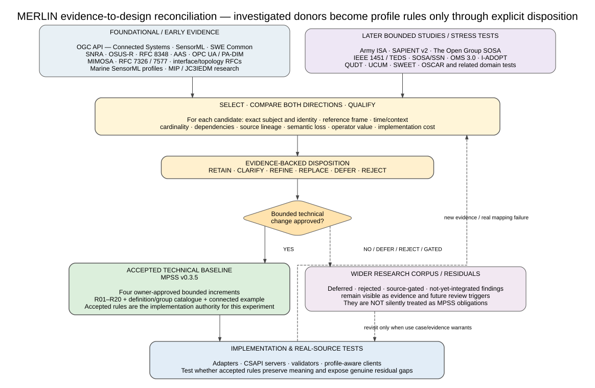
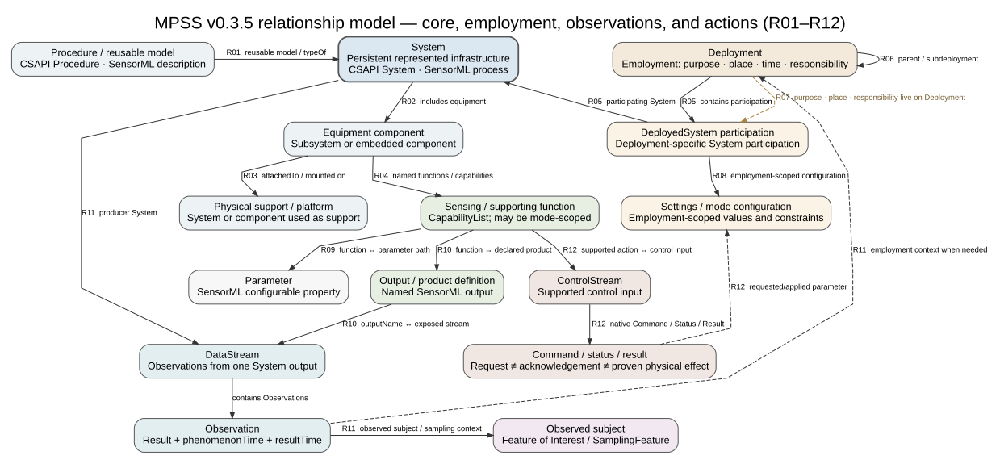
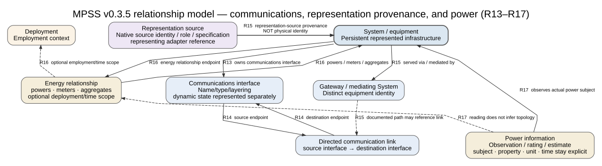
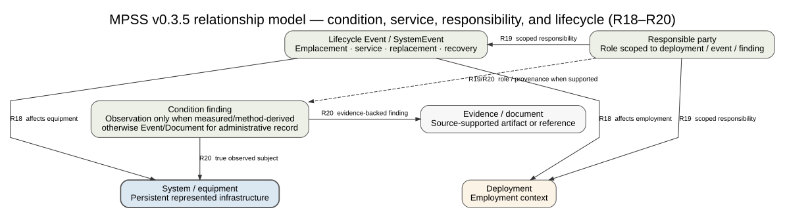

# Evaluating Sensor Information Preservation Through OGC Integration

*A Smart Citizen experiment with the MERLIN domain information model and Managed Physical Sensing Systems profile*

MERLIN Project

Working paper version 0.10 | 25 October 2026 | Corrective model-currency revision with reviewed Phase 1–4 evidence

## Abstract

Integrating a sensing system requires preserving the meaning of its information as well as transporting its measurements. This paper evaluates a MERLIN domain information model (DIM) and Managed Physical Sensing Systems (MPSS) application profile intended to organize the whole employed sensing system: persistent identity, equipment, functions and products, deployment, configuration and actions, communications, power, condition, and lifecycle. The work is not a new sensor transport API; it is an evidence-controlled synthesis that selects, compares, qualifies, and explicitly dispositions concepts from a broad research corpus before binding accepted meanings to OGC API - Connected Systems (CSAPI), Sensor Model Language (SensorML), and Sensor Web Enablement (SWE) Common. Smart Citizen is used as an independent real-source experiment to test whether that accepted model can preserve meaning through adaptation, standardized publication, retrieval, and presentation.

A corrective model-currency audit was performed before adapter implementation after an earlier paper revision exposed an outdated summary of the donor research. The audit found that the frozen source acquisition and characterization remain valid, the Phase 3 mappings retain their core semantics with repaired later-donor traceability, and the Phase 4 resource count remains defensible with a required R15 representation-source provenance carrier and clearer processing/execution distinctions (MERLIN Project 2026p). MPSS v0.3.5 remains the accepted technical baseline, while the wider v0.10 research corpus preserves accepted, rejected, deferred, conditional, and source-gated findings rather than silently turning every investigated standard into a profile obligation (MERLIN Project 2026n; 2026o). The deterministic adapter, CSAPI round trip, connected Glaux traversal, and matched generic/profile-aware interface comparison remain unexecuted, so no interoperability or operator-benefit result is claimed.

**Keywords:** sensor integration; domain information model; application profile; OGC API Connected Systems; SensorML; semantic preservation; standards reuse; resource details.

## 1 Introduction

Modern sensing integrations can transport values successfully while still losing the distinctions that make those values operationally intelligible. A client may receive a temperature, battery percentage, status code, or derived product yet still be unable to determine which persistent system produced it, what real-world subject it concerns, which deployment or configuration applied, what processing occurred, or which source assertion justified the representation. MERLIN's DIM/MPSS work addresses that semantic problem by organizing an employed physical sensing system as a connected domain model and then binding accepted meanings to existing OGC mechanisms. The experiment in this paper asks whether that architecture survives contact with a real producer rather than only with authored examples.

The model did not originate from Smart Citizen. It grew from the Resource Details problem and unattended-sensor reference cases, then expanded through a controlled research program spanning OGC sensing standards, sensor-network and unattended-sensor architectures, hardware and industrial-device models, lifecycle and power models, communications models, and later bounded studies such as Army ISA, SAPIENT v2, The Open Group SOSA, IEEE 1451/TEDS, OMS, SOSA/SSN, I-ADOPT, QUDT, UCUM, SWEET, and the OSCAR stress test (MERLIN Project 2026n; 2026o; MERLIN Project 2026q; MERLIN Project 2026r; MERLIN Project 2026s). The project does not combine all of those standards indiscriminately or claim that investigating one means implementing it. Instead, each candidate contribution receives an explicit evidence-backed disposition before it can change the accepted technical baseline.

This paper therefore explains the research-to-design method and current model before introducing the Smart Citizen case in detail. It then records the experiment's frozen source evidence, mapping method, audited Phase 4 resource graph, experimental server/client boundaries, and planned evaluation. Acronyms and formal definitions are retained as appendices so they support reading without interrupting the opening argument. Phase 5 remains intentionally blocked until this corrective paper and documentation closeout are complete.

## 2 From research evidence to the MERLIN model

### Research program and current corpus

The current research record is larger and more mature than the early profile-era source-selection table that was mistakenly used in paper v0.9. The repository continuity checkpoint identifies the master bibliography and source register as version 0.10, dated 22 October 2026, with 140 persistent source identities and 29 workbook worksheets; it also retains later SAPIENT, ISA, power, OMS, The Open Group SOSA, IEEE 1451/TEDS, foundational-semantics, and OSCAR work with their individual evidence limits (MERLIN Project 2026o). The accepted technical profile is separately versioned at MPSS v0.3.5 and does not automatically absorb every research finding. That separation between research evidence and accepted technical rules is a core control rather than a documentation inconvenience.

The research program asks two directions of every material candidate: whether the existing model already preserves the donor's meaning accurately, and whether the donor exposes a distinction the current model would otherwise lose. Review considers the exact subject and identity, reference frame, time/context, cardinality, dependencies, source lineage, semantic loss, operator value, and implementation cost rather than matching labels alone (MERLIN Project 2026q; 2026r). Candidate dispositions include RETAIN, CLARIFY, REFINE, REPLACE, DEFER, and REJECT. A later source can therefore strengthen or challenge a relationship without forcing an architecture reset or being ignored because an earlier draft already exists.



**Figure 1. Evidence-to-design reconciliation and model currency.** Foundational evidence and later bounded studies enter the same comparison process rather than being stacked as simultaneous runtime dependencies. Only an explicitly approved bounded change becomes part of the accepted MPSS technical baseline, while deferred, rejected, gated, and not-yet-integrated findings remain visible in the wider research corpus. Real-source implementation can feed new evidence or a genuine mapping failure back into that reconciliation loop. This figure summarizes the current control model recorded by the update plan, continuity materials, and Smart Citizen currency audit (MERLIN Project 2026o; 2026p; 2026q; 2026r).

### Donor and stress-test landscape

**Table 1. Principal donor and research families in the current program.** The table distinguishes foundational donors, later bounded donor studies, semantic resources, and stress tests by the role the research assigns them rather than by implying universal adoption. Some findings have already informed owner-approved MPSS v0.3.5 rules, while others remain comparator-only, conditional, source-gated, deferred, or residual. The master bibliography and source register retain exact editions, locators, inspection depth, and source identities beyond this readable summary (MERLIN Project 2026n; 2026o; 2026p). The Open Group SOSA and W3C/OGC SOSA/SSN are different source families and are not conflated.

| Source family / study | Role in the research program | Current standing relevant to this experiment |
| --- | --- | --- |
| OGC API - Connected Systems, SensorML, SWE Common | Base resource, relationship, descriptive, dynamic-data, command, semantic-definition, unit, and encoding stack | Accepted technical foundation; MPSS adds purpose-specific domain obligations without redefining base meaning |
| Sensor Network Reference Architecture and OSUS-R | Whole-system, node/gateway, unattended-sensor asset, capability, command, status, and media comparators | Foundational donors; OSUS concepts may be reused or translated without implementing the OSUS Java/OSGi runtime |
| Hardware, industrial-device, lifecycle, communications, and power sources | RFC 8348; Asset Administration Shell; OPC UA/PA-DIM; MIMOSA; RFC 2863/8343/8345; RFC 7326/7577; marine SensorML profiles; MIP/JC3IEDM and related sources | Bounded concept donors and precedents; selected accepted meanings are represented through OGC rather than by silently stacking source protocol runtimes |
| Army Integrated Sensor Architecture (ISA) | Capability contract; assignment versus actuation; physical composition versus proxy/mediation; normalized-plus-native information; extension maturity | Later bounded donor; selected identity/mediation/configuration/action clarifications informed v0.3.5, but ISA runtime implementation is not required |
| SAPIENT v2 | Sender/source versus physical identity; declared versus current mode; task acknowledgement versus proven effect; detection/track/fusion lineage | Later bounded donor; selected refinements informed v0.3.5, while native SAPIENT protocol implementation remains separate |
| The Open Group SOSA | Hardware/module/host distinctions, physical versus logical composition, System Manager state, signal products, PowerPort/interface concepts | Later bounded donor; selected interpretive constraints informed v0.3.5 and do not make SOSA's modular architecture the universal MERLIN hierarchy |
| OGC Observations, Measurements and Samples (OMS) 3.0 | Observer, observing procedure, host, deployment, observation semantics, prospective capability, and measured-versus-administrative condition distinctions | Later bounded donor; selected semantic refinements informed v0.3.5 without requiring a parallel OMS service |
| IEEE 1451 / Transducer Electronic Data Sheets | Candidate transducer/channel identity, range, timing, units, calibration and uncertainty semantics | Conditional/source-gated for exact normative obligations; no IEEE/TEDS implementation is claimed by the first public Smart Citizen load |
| W3C/OGC SOSA/SSN, I-ADOPT, QUDT, UCUM, SWEET and related semantic work | Observation lineage, variable/property descriptions, quantity/unit semantics, ontology/vocabulary alignments | Semantic resources and comparison material; definition reuse or mapping does not imply mandatory RDF/ontology runtime conformance |
| OSCAR and related domain stress tests | Test whether the common model survives a richer radiation-screening implementation and expose residual needs | Research stress test; identified residual questions around artifacts, processing/derivation execution, and operational episodes without silently modifying v0.3.5 |

### Accepted technical baseline versus residual research

Research currency does not mean that every newer paper replaces the technical profile. MPSS v0.3.5 is the accepted implementation authority for this experiment because it records four owner-approved bounded increments and the current R01-R20 relationship/binding text, catalogue, and connected example; the wider v0.10 corpus remains evidence that can reinforce, challenge, or trigger a future profile change (MERLIN Project 2026a; 2026o; 2026p). This arrangement protects the experiment from two opposite errors: implementing an obsolete early draft and silently turning every newly investigated donor idea into a requirement. A mapping is current only when its source evidence, accepted profile rule, and relevant later research disposition are all visible.

**Table 2. Authority and currency layers used by this experiment.** Each layer answers a different question and therefore cannot substitute for the others. The Smart Citizen model-currency audit explicitly compared the first four experiment phases across these layers before allowing adapter implementation to proceed (MERLIN Project 2026p). Later research remains capable of exposing a gap, but it becomes implementation authority only through explicit disposition and acceptance. This table is the paper's control for distinguishing 'researched' from 'adopted.'

| Layer | Controlling material | What it controls |
| --- | --- | --- |
| Native Smart Citizen evidence | Frozen specimen `20261025T024348Z`, source documentation, inspected API implementation | What the producer actually reported: identities, values, units, source times, aggregation behavior, and source limitations |
| Accepted technical baseline | MPSS v0.3.5 plus its accepted definition/group catalogue and connected example | Current owner-approved R01-R20 meanings and OGC/SensorML/SWE binding rules implemented by this experiment |
| Wider research corpus | DIM bibliography/source register v0.10; bounded Power, ISA, SAPIENT, The Open Group SOSA, IEEE 1451/TEDS, OMS/foundational-semantics and OSCAR studies | Evidence that can confirm, refine, reject, defer, or expose gaps in the accepted baseline |
| Experiment currency audit | Smart Citizen `06_MODEL_CURRENCY_AUDIT.md` plus corrected mapping ledger/resource graph | Proves which Phase 1-4 decisions survive current research and identifies required corrections before code |

## 3 The current DIM and Managed Physical Sensing Systems profile

### Domain model, application profile, binding, and implementation

The DIM, application profile, OGC binding, and software implementation are related but different artifacts. The DIM supplies the domain concepts and relationships needed to describe an employed sensing system coherently; the application profile states the shared scope and obligations; the binding selects concrete OGC resources, SensorML structures, SWE components, definition identifiers, and reference rules; and implementations produce, consume, validate, and present those representations (MERLIN Project 2026a; 2026o). Keeping those layers separate makes failures diagnosable instead of allowing a server limitation, source gap, mapping mistake, and model defect to collapse into one vague 'interoperability' result. It also prevents the client interface from becoming the de facto information model.

**Table 3. Layers of the current MERLIN architecture.** The table distinguishes conceptual meaning, interoperability obligations, technical representation, and runtime behavior. A model is not completed merely because a JSON payload validates, and a useful client does not prove that a server or source conforms to every donor standard. Conversely, a donor concept can legitimately inform the model without requiring its originating protocol stack. These distinctions govern both the profile and the Smart Citizen evaluation (MERLIN Project 2026a; 2026p).

| Layer | Question answered | MERLIN/MPSS responsibility |
| --- | --- | --- |
| Domain information model | What entities, properties, relationships, roles, times, and distinctions matter? | Whole-system concepts and relationships across identity, equipment, employment, products/actions, communications, power, condition and history |
| Application profile | Which concepts, options, constraints, and obligations are shared for this purpose? | Managed-physical-sensing-system scope, recognized groups/definitions, reference behavior, producer/consumer expectations, and specialization boundaries |
| OGC binding | How are accepted meanings represented in the selected standards stack? | CSAPI resources/associations, SensorML descriptions, SWE structures, semantic definitions, units, schemas, and profile-authored references where native mechanisms are insufficient |
| Implementation and client | Can independent software produce, preserve, retrieve, validate, interpret, and present the agreed information? | Source adapters, CSAPI servers, validators, standards libraries, profile interpretation, and operator presentation |

### Eight connected information subjects

The model is centered on the persistent physical sensing system in employment rather than on a manufacturer screen, a single API response, or a list of SensorML properties. Eight connected information subjects organize the complete potential description: identity/model/technical description; equipment/physical arrangement; sensing capabilities/products; deployment/emplacement/responsibility; configuration/modes/actions; communications/access; power arrangement; and condition/service/recovery/lifecycle (MERLIN Project 2026a; 2026o). These subjects are not eight mandatory resources, eight servers, or eight user-interface tabs. A particular source populates only what its evidence actually supports, while family/domain specializations can add detail without changing the common meanings.

**Table 4. Eight connected information subjects.** Each subject answers a different operational question while remaining connected to the same persistent System and employment context. The organization is deliberately broader than the fields available from any one vendor example, because absence in one source does not remove a concept from the common model. It is also deliberately narrower than a complete enterprise architecture, because analytics execution, storage, security infrastructure, and mission-specific workflows can remain companion contracts or specializations. The Smart Citizen experiment exercises only a subset and must preserve the rest as unpopulated rather than fabricate coverage.

| Information subject | Principal question |
| --- | --- |
| Identity, model, and technical description | What persistent System is represented, what reusable model/kind describes it, and what technical description applies? |
| Equipment, composition, and physical arrangement | What sensing/supporting equipment participates, and what composition, attachment, or support relationships are actually known? |
| Sensing capabilities, performance, and outputs | What functions can the equipment perform, what parameters/conditions qualify them, and what products are exposed? |
| Deployment, emplacement, location, and responsibility | Where, why, when, and under whose scoped responsibility is the System employed? |
| Operating configuration, modes, and supported actions | What configuration applies, what state is merely reported, and what actions can legitimately be requested and verified? |
| Communications, connectivity, and access arrangement | What interfaces, links, gateways, or mediation relationships are known, distinct from the URL of the representing API? |
| Power sources and operating power arrangement | What source powers what consumer, what metering/aggregation relationship applies, and what readings or service history describe the arrangement? |
| Condition, service, recovery, and lifecycle | What measured/method-derived condition evidence and what service/replacement/recovery history explain the current situation? |

### Relationship model R01-R12: system, employment, products, observations, and actions

The current relationship framework uses R01-R20 as local MPSS review/binding identifiers rather than OGC-native relationship names. R01-R12 connect persistent System identity to reusable model description, equipment and functions, deployment participation and configuration, parameters and products, observations and their true subjects, and controls/commands whose acknowledgement remains distinct from proven physical effect (MERLIN Project 2026a; 2026p). The current v0.3.5 wording includes later-donor refinements around source versus physical identity, mode-scoped capability, assignment versus action, and observation subject/context without introducing parallel universal classes merely because ISA, SAPIENT, or another donor defines them. The diagram therefore shows domain roles and selected carrier relationships, not a claim that each box must be a separately addressable CSAPI resource.



**Figure 2. MPSS v0.3.5 core relationship model, R01-R12.** The view follows the persistent System through reusable model/type information, equipment and physical support, named functions, deployment participation, employment-scoped settings, parameters/products, observations, and supported actions. Solid relationships show the principal modeled connections; dashed/contextual paths distinguish employment context and requested/applied configuration from durable identity. The command path explicitly preserves the later-research distinction between a request, an acknowledgement, and verified physical effect. This is a UML-style explanatory view of the accepted relationship families, not a normative UML metamodel or a cardinality-complete schema (MERLIN Project 2026a; 2026p).

### Relationship model R13-R17: communications, representation provenance, and power

R13-R17 extend the same System into communications, mediation/provenance, and power without allowing those concerns to replace System identity. R13-R14 describe interfaces and directed links when evidence supports them, while R15 covers mediated access and the accepted representation-source provenance that distinguishes native source/adapter identity from the physical System represented by an OGC resource (MERLIN Project 2026p). R16-R17 represent power relationships and power information separately so a voltage, battery percentage, or estimate cannot silently create a supply topology. These relationships were informed by multiple donors, but their OGC realization and cross-domain reference rules remain the explicitly governed MPSS contract.



**Figure 3. MPSS v0.3.5 communications, representation-provenance, and power relationships, R13-R17.** The System remains the persistent represented infrastructure while source/adapter provenance, gateway mediation, communications interfaces/links, and energy relationships remain separate subjects. R15 representation-source provenance explains where the standardized representation came from and is explicitly not physical identity; R15 gateway mediation likewise does not replace the served System with the gateway. R16 makes supply/metering/aggregation a directed relationship and R17 keeps a reading tied to its actual subject rather than treating the reading as evidence of topology. The figure is explanatory and omits family-specific radio and electrical vocabularies that belong in specializations or source mappings (MERLIN Project 2026a; 2026p).

### Relationship model R18-R20: lifecycle, responsibility, and condition evidence

R18-R20 organize change and condition without collapsing historical events, responsibility, and observations into one generic status field. Lifecycle Events or SystemEvents can record emplacement, service, replacement, recovery, and other changes affecting equipment or employment; R19 scopes people/organizations to the deployment, event, or finding to which their responsibility actually applies; and R20 connects a condition finding to its true subject and supporting evidence (MERLIN Project 2026a; 2026p). Later OMS/foundational-semantics work sharpened an important boundary: a measured or method-derived estimate can be an Observation, while a maintenance decision, administrative finding, or work order does not become an Observation merely because a UI wishes to show it under 'condition.' This is one example of later donor research refining the model without replacing its OGC foundation.



**Figure 4. MPSS v0.3.5 condition, service, responsibility, and lifecycle relationships, R18-R20.** Lifecycle change remains associated with the persistent equipment and employment instead of overwriting System identity, while responsibility is scoped to the record where it is asserted. Condition findings retain their actual subject and supporting evidence; the model does not manufacture a universal readiness score or treat every administrative record as an Observation. The arrangement allows present condition and explanatory history to be assembled together without conflating them. As with the other relationship figures, the diagram explains the accepted conceptual/binding structure rather than prescribing one screen layout (MERLIN Project 2026a; 2026p).

**Table 5. R01-R20 relationship families.** The table provides a compact index to the three relationship diagrams and keeps the numbering subordinate to meaning. The relationship identifiers are stable review/binding handles used to trace source evidence, accepted profile rules, representations, and implementation findings. Later donor work can refine a relationship's semantics or carrier only through explicit disposition rather than by changing the meaning silently. Detailed locators and profile-authored terms remain in MPSS v0.3.5 and its definition catalogue (MERLIN Project 2026a; 2026p).

| Relationship family | IDs | Core responsibility |
| --- | --- | --- |
| Model, equipment, and function | R01-R04 | Reusable model/type, equipment/component roles, physical attachment/support, named functions and capabilities |
| Deployment and participation | R05-R08 | Participants, parent/subdeployment, purpose/place/responsibility, employment-scoped configuration |
| Products, setup, and actions | R09-R12 | Function-to-parameter/output correspondence, producer/subject/context, controls, command/status/result distinctions |
| Communications and representation provenance | R13-R15 | Interfaces, directed links, gateway mediation, and source/adapter provenance distinct from physical identity |
| Power | R16-R17 | Directed powers/meters/aggregates relationships plus correctly scoped power ratings/readings/estimates |
| Condition and lifecycle | R18-R20 | Events affecting equipment/employment, scoped responsibility, and evidence-backed condition findings |

### Profile binding, generic access, and honest maturity

MPSS uses existing OGC mechanisms first and adds the smallest justified profile-owned rule where the domain relationship would otherwise be ambiguous. Accepted content is carried through CSAPI resources and links, SensorML descriptions/groups, SWE typed components and semantic definitions, plus explicit local identifiers/reference rules where MPSS authors a cross-domain association (MERLIN Project 2026a). A standard `profile` link relation can advertise the additional contract without changing the underlying media type, and a generic client should still be able to inspect the base resources, types, units, definitions, and links that it understands. A profile-aware client adds recognized whole-system assembly; it is not permitted to hide unsupported content or invent missing relationships merely to produce a cleaner interface.

The work should be described at its present maturity as an evidence-controlled domain-information-model and application-profile synthesis in progress, not as a completed ontology, a finished formal conceptual schema, an OGC-approved profile, or proof that every donor has been reconciled (MERLIN Project 2026n; MERLIN Project 2026o; MERLIN Project 2026p; MERLIN Project 2026s). MPSS v0.3.5 is concrete enough to provide accepted R01-R20 rules, a definition/group catalogue, a connected synthetic example, and an implementation target for bounded experiments. The wider research corpus remains intentionally visible because rejected, deferred, source-gated, and not-yet-integrated findings are part of the evidence record rather than failures to remember. The next engineering proof is independent implementation and real-source testing against that accepted baseline, followed by explicit disposition of any genuine model break.

## 4 Experiment design and model-currency control

### Research questions

The Smart Citizen study is a traceable integration case followed by a controlled comparison of information presentation. It separates semantic preservation, profile contribution, and transferability so that a successful transport or attractive screen cannot stand in for model evidence. The unit of technical analysis is a traceable assertion: a value, identity, relationship, or contextual statement with an identified source, accepted interpretation, and evidence standing. Findings about transport, domain meaning, profile interpretation, and presentation are reported separately.

1. **Semantic preservation.** Which source-supported meanings survive acquisition, adaptation, CSAPI publication, retrieval, and presentation, and where does meaning become ambiguous or lost?
2. **Profile contribution.** Which operator questions become easier to answer through the DIM and MPSS when compared with competent presentation of the same standard resources without profile-specific organization?
3. **Coverage and transfer.** Which information subjects and relationships are exercised, which remain unavailable from this source, and which mappings remain reusable when a second producer is introduced?

### Corrective model-currency audit before implementation

The paper-review failure that exposed an outdated donor summary triggered a proof-level audit before any adapter code was written. That audit compared each experiment phase with three independent authorities: the frozen Smart Citizen evidence, the accepted MPSS v0.3.5 technical rules, and the wider later research corpus (MERLIN Project 2026p). The question was not whether later standards had been researched, but whether any later accepted or still-residual finding contradicted the actual Smart Citizen mappings or resource design. Phase 5 remains blocked unless the mapping ledger, Phase 4 graph, and audit agree.

**Table 6. Phase-by-phase model-currency audit.** The audit did not simply declare the prior experiment 'current'; it assigned a disposition to each phase and recorded concrete corrections where later accepted research mattered. Source capture and native characterization survive because donor research cannot change what Smart Citizen actually returned, while semantic mapping and target design were checked at the relationship/carrier level. One accepted carrier omission was found and corrected: R15 representation-source provenance for SC-SYS-001; aggregate processing also received a clearer System/Procedure/execution distinction. No mapping was preserved merely because implementation work had already been planned (MERLIN Project 2026p).

| Phase | Audit disposition | What changed or was proved |
| --- | --- | --- |
| Phase 1 - frozen specimen | RETAIN | Exact Device/history responses, headers, requests and hashes remain source evidence independent of later model revisions |
| Phase 2 - native characterization | RETAIN | Source identifiers, catalogue roles, values, source times, notification settings, location limitations and processing semantics remain valid; later research reinforces several cautions |
| Phase 3 - mapping ledger | RETAIN CORE SEMANTICS; REPAIR TRACEABILITY/CARRIERS | Environmental, battery, RSSI, SD and aggregate decisions remain; later ISA/SAPIENT/The Open Group SOSA/OMS/foundational lineage is made explicit; R15 provenance becomes applicable to SC-ID-01 |
| Phase 4 - resource graph | RETAIN RESOURCE COUNT WITH CORRECTIONS | Still 2 Systems, 2 Procedures, 10 DataStreams/schemas, 56 Observations; add R15 representation-source; clarify persistent aggregate process versus reusable Procedure versus one query execution; qualify authored aggregate-property definitions |

This audit does not say that every item in the v0.10 corpus is already part of MPSS v0.3.5. IEEE 1451/TEDS exact obligations remain source-gated for this use, OSCAR leaves residual processing/artifact/operational-context questions, and semantic-model studies may remain optional resources or future refinements (MERLIN Project 2026p). That is a feature of controlled synthesis: the experiment implements accepted rules while retaining residual research as evidence and a future review trigger. If Phase 5 uncovers a real mapping failure, it returns to the reconciliation process shown in Figure 1 rather than being patched silently in adapter code.

### Experimental path

The immediate path is frozen public Smart Citizen evidence through a documented deterministic adapter into an identified CSAPI test service, followed later by Glaux retrieval and matched generic/profile-aware presentation. The adapter is required to implement the audited mapping and resource graph rather than invent semantic decisions while coding. An owned kit remains a later extension for physical installation, configuration, power, and lifecycle evidence that the public feed cannot establish, while an independent producer such as AirGradient is planned to test transfer. No live polling or server write is part of the current corrective paper phase.


**Figure 5. Smart Citizen experiment architecture.** The frozen source and published definitions inform the adapter only through the audited mapping decisions, while the CSAPI service forms a separate preservation boundary that must later be tested by create/retrieve comparison. Standard and profile-aware client conditions use the same standardized evidence so the profile does not receive a more favorable dataset. The provider interface remains a separate presentation reference rather than an authority for the standardized model. All adapter and service connections shown here remain proposed until their respective execution phases are performed (Open Geospatial Consortium 2025a; 2025b; MERLIN Project 2026p).

### Why Smart Citizen is the first real-source case

Smart Citizen was selected because the preliminary study found accessible current and historical responses, informative channel metadata, official model documentation, and a plausible path to later owned hardware (MERLIN Project 2026c). The source is useful precisely because it is not one of the original unattended-ground-sensor reference cases and does not natively expose MPSS; it therefore tests whether the model can accept a genuinely different producer without merely reproducing a vendor-specific schema. The case is purposive rather than statistically representative and does not establish generality by itself. A second producer and later physical hardware are required for broader transfer and lifecycle questions.

## 5 Smart Citizen system and frozen source evidence

### System and selected public case

The Smart Citizen Kit (SCK) is a modular environmental monitoring system. Its documented measurements include air temperature, humidity, particulate matter, noise level, light, and pressure. Figure 6 introduces the SCK2.3 model reported by the first public data specimen selected for this study (Smart Citizen n.d.-c, “What is the Smart Citizen Kit?” and “Measurements”; MERLIN Project 2026b, record “smart-citizen-current-19639”).


**Figure 6. Smart Citizen Kit 2.3 model reference.** The photograph shows the Data Board at left, Urban Board in the center, and particulate-matter module at right. It is reproduced unchanged from the official Smart Citizen / Fab Lab Barcelona documentation (Smart Citizen n.d.-c, “Versions”). It illustrates the product model; it has not been verified as a photograph of the unit associated with registration 19639. The boards and module are shown separately, so the image does not establish that unit's assembled configuration, enclosure, or power connections.

The Data Board provides logging, Wi-Fi, memory-card access, Universal Serial Bus (USB), and a battery connector. The Urban Board carries sensing components and connects a separate particulate-matter module (Smart Citizen n.d.-c, “What is the Smart Citizen Kit?”). For this study, those component roles make physical equipment, sensing functions, communications, and power concrete subjects to examine through the domain information model (DIM) and MPSS. Their presence in model documentation does not establish a verified component inventory for an individual installation.

The selected specimen is public Smart Citizen registration 19639. A formal capture made on 25 October 2026 at 02:43:48 Coordinated Universal Time (UTC) retained the complete Device response, response headers, and bounded temperature and PM2.5 histories with request Uniform Resource Locators (URLs) and Secure Hash Algorithm 256-bit (SHA-256) hashes; it supersedes the earlier 24 October feasibility values as the evidence basis for formal mappings (MERLIN Project 2026k). The source reports hardware “SmartCitizen Kit 2.3,” type “SCK,” version “2.3,” and slug “sck:2,3,” while its channel catalogue includes environmental observations and system-related telemetry such as battery level, received signal strength indication (RSSI), and SD-card indication. The registration and reported model identify the selected data specimen, but enduring physical identity and installed configuration remain separate evidence questions.

**Table 7. System identification and study boundary.** The table separates the physical product family, selected source record, and service through which the study will obtain data. Model-level descriptions and registration metadata have different evidentiary roles. These entries identify the first case without implying that its integration has already been executed (Smart Citizen n.d.-a; n.d.-c; MERLIN Project 2026b).

| Item | Identification | Meaning for this experiment |
| --- | --- | --- |
| System type | Modular environmental monitoring kit | Plain-language description of the equipment; not a newly adopted MPSS classification code |
| Reported product model | SmartCitizen Kit 2.3; type SCK; version 2.3; slug sck:2,3 | Native metadata to preserve and compare with official product documentation |
| Selected public record | Registration 19639; formal frozen capture 20261025T024348Z | Evidence basis for the Phase 1–4 source, mapping, and resource-design work; not a verified physical serial number |
| Source software platform | Smart Citizen Platform and its public API | Existing source service for acquiring data; the proposed CSAPI service and Glaux client have different roles |
| Physical installation | Photograph, serial identity, installed inventory, enclosure, and supply connections unverified | Evidence to obtain before claiming a complete unit-specific equipment or deployment model |

The first case therefore concerns one public Smart Citizen registration, with documentary descriptions of its reported product model. It does not begin with a kit acquired or operated by this project. An owned kit is a later extension for physical and lifecycle evidence, and AirGradient is a later independent comparison. TRSS and McQ OmniSense II remain motivating systems whose accommodation matters to the wider model, but their native datasets are not the input to this first integration case (MERLIN Project 2026c; 2026e).

### Published definitions and observed responses

Smart Citizen publishes a human-readable schema description, endpoint tables, field meanings, and examples. Its sensor and measurement records also carry descriptive metadata and, where supplied, vocabulary and unit-definition links. The study has verified those resources and actual responses; a complete machine-readable OpenAPI or JSON Schema contract for the exact deployed source API has not yet been verified (Smart Citizen n.d.-d, “Schema,” “Sensors,” and “Measurements”).

Official kit documentation describes modular equipment and sensing functions, and the platform documentation describes data access and front-end applications. The project publishes separate hardware, firmware/tooling, and platform licensing information. Openness helps inspection but does not remove the need to examine data and media reuse terms separately (Smart Citizen n.d.-a; n.d.-b; n.d.-c).

Model documentation must remain distinct from unit-specific evidence. For example, the supplier states that kits shipped from July 2026 omit the UV sensor, while older public records may expose UV channels. A model designation alone therefore does not establish an exact installed inventory (Seeed Studio n.d.; MERLIN Project 2026c).

### Formal Phase 1 source evidence

The 24 October feasibility check established that registration 19639 could provide useful current and historical data, but it is no longer the evidence basis for formal mappings. Phase 1 froze a new complete specimen at `2026-10-25T02:43:48Z`, including the Device response, response headers, request URLs and one-day temperature and PM2.5 histories with SHA-256 hashes (MERLIN Project 2026k). The source reports 21 current channels, with eleven non-SEN5X channels at `02:40:21Z` and ten SEN5X particulate channels at `02:36:21Z`. This two-cohort timing pattern is itself evidence that device-level `last_reading_at` cannot replace channel-specific time.

**Table 8. Selected observations from the formal frozen specimen.** The table uses the retained 25 October source body rather than the earlier feasibility values. Values and times are source-reported and have not yet passed through the proposed adapter or CSAPI server. System-related telemetry is shown alongside environmental observations to exercise different subject and interpretation questions. None of the rows is a readiness or health assessment (MERLIN Project 2026k).

| Reported channel | Source value and unit | Source time UTC | Question exposed |
| --- | --- | --- | --- |
| Air temperature | 19.59 ºC | 02:40:21 | Are property, unit, environmental subject and time preserved? |
| Relative humidity | 65.54 % | 02:40:21 | Can a second SHT31 output remain distinct from component identity? |
| PM2.5 | 9.3 ug/m3 | 02:36:21 | Does the older particulate-channel time remain visible? |
| Battery level | 99.0 % | 02:40:21 | Is parent-System status kept separate from battery identity and supply topology? |
| Wi-Fi RSSI | −45 dBm | 02:40:21 | Can received-signal power remain telemetry without becoming interface/link status? |
| SD-card indication | 1 | 02:40:21 | Is the source categorical meaning retained without becoming Boolean health? |

The formal one-day temperature history contains 24 one-hour average tuples and reports `sample_size=1439`; the corresponding PM2.5 history also contains 24 tuples but reports `sample_size=288` (MERLIN Project 2026k). Smart Citizen documents `sample_size` as the readings examined to build the response, while `rollup=1h` and `function=avg` define the grouping request (Smart Citizen n.d.-d). Returned timestamps are not exact hour boundaries and differ between the two series, so the study preserves each tuple time exactly rather than constructing nominal intervals. These histories are source-platform derived products and are mapped separately from current source-reported results.

**Listing 1. Selected formal temperature fields.** These members are reproduced from `/data/sensors/18` in the frozen Device response. Other members are omitted, and the excerpt is not a source schema or complete response. The listing is retained as a companion JSON file and verified against the frozen body. It replaces the earlier feasibility excerpt as the formal mapping specimen (MERLIN Project 2026k).

```json
{
  "id": 55,
  "name": "Sensirion SHT31 - Temperature",
  "unit": "ºC",
  "unit_definition": "https://qudt.org/vocab/unit/DEG_C",
  "value": 19.59,
  "last_reading_at": "2026-10-25T02:40:21Z"
}
```

The native source also exposed semantic traps that matter to the experiment. Smart Citizen documents `notify.low_battery` and `notify.stopped_publishing` as notification settings, so a false value is not evidence of a healthy battery or healthy publishing state (Smart Citizen n.d.-d; MERLIN Project 2026k). Likewise, `prev_value` has no independent timestamp in the current Device representation and is not used to manufacture a timed trend. These examples show why a familiar label cannot substitute for source semantics.

The inspected Smart Citizen API source adds a further processing qualification. At revision `25a524cb...`, `RawStorer` calls `normalized_value` before storing the `<sensor_id>_raw` entry and then stores the output of a method named `calibrated_value` under the sensor ID that the public Device response exposes as `value` (Smart Citizen 2026). The study therefore calls the public values source-platform reported/processed results rather than untouched raw sensor output, and the method name does not establish calibration in the VIM sense without calibration standards, uncertainty relationships or traceability evidence (Joint Committee for Guides in Metrology 2012). The exact production revision remains unverified, so repository source explains the inspected implementation path without proving byte-for-byte production behavior.

## 6 Experimental integration infrastructure

### Experimental CSAPI server

#### Origin and implementation lineage

pygeoapi is an open-source Python server implementation of the OGC API family, designed around a Hypertext Transfer Protocol (HTTP) API, configuration, core API behavior, and pluggable data, process, and formatter components (pygeoapi Development Team 2026, “How pygeoapi works”). 52°North developed its Connected Systems implementation on that foundation and describes the repository as a proof of concept of OGC API – Connected Systems based on pygeoapi (52°North Spatial Information Research GmbH n.d.-a). 52°North reports that the initial Connected Systems API design and prototype were developed through several research projects and were followed by continued pygeoapi-community work around the prototype (52°North Spatial Information Research GmbH 2023; n.d.-b). This lineage explains where the server implementation came from without implying that pygeoapi itself natively supplies every Connected Systems behavior used by the prototype.

The implementation tested by MERLIN was upstream commit `6ad75aa7fbfc76517c8a24c21446471845007855`, whose project metadata identifies connected-systems-pygeoapi version 0.6.0 and pins the 52°North pygeoapi fork at commit `ec1eb38d9a64d93ec9a2e1b9db6fea6dc05f194a` (52°North Spatial Information Research GmbH n.d.-a). At that revision, the container starts Hypercorn over `connected-systems-api/app:APP` and includes the native geospatial dependencies required by the implementation. The upstream repository provides examples for multiple backends and a simulator for inserting example data, so its source tree represents several deployment possibilities rather than one fixed storage architecture. The exact backend used by the OS4CSAPI instance therefore has to come from our deployment evidence, not from inference based on the upstream dependency list.

#### OS4CSAPI Oracle deployment

The server selected for this experiment is the existing Oracle-hosted OS4CSAPI deployment at `https://129-80-248-53.sslip.io/csapi-pygeoapi` (MERLIN Project 2026f). The tested running build corresponded to upstream commit `6ad75aa7...` plus documented deployment adaptations, with container image ID `sha256:15e6991a3697e5f7130ed50bbb958720f2ffa7954f114a70be66cc93c0c489da`. Those adaptations consisted of a public-URL correction, an asynchronous full-scan/bootstrap-ID patch, and retained 64-bit processor-architecture/native-dependency adaptations. Project inventory recorded the endpoint as unauthenticated for the test environment, but that access posture will be reverified before the Smart Citizen run.

The retained evidence does not establish the running instance's exact storage/backend choice, persistent-volume layout, reverse-proxy configuration, restart policy, or complete Docker Compose topology (MERLIN Project 2026f). Upstream examples support multiple backends, and the tested source includes dependencies for more than one potential storage technology, so assigning one of them to the Oracle instance without runtime evidence would be speculation. These configuration details matter because the experiment will eventually evaluate publication, retrieval, relationships, history, and durability rather than only a single request. They are therefore explicit pre-run evidence requirements rather than assumed infrastructure facts.

A separate 52°North demonstration is publicly available at `https://csa.demo.52north.org/`, where the landing page identifies 52°North Spatial Information Research GmbH as the provider and advertises Connected Systems assets (52°North Spatial Information Research GmbH n.d.-c). That service is not the Oracle-hosted deployment used in the MERLIN preservation experiment. Earlier verification work explicitly corrected a test package that targeted the 52°North demo when the intended primary comparison was the OS4CSAPI Oracle instance (MERLIN Project 2026f). The Smart Citizen study will preserve that deployment distinction so a result from one environment cannot be attributed to the other.


**Figure 7. Experimental CSAPI server lineage and study role.** The solid path identifies the implemented lineage from pygeoapi through 52°North's Connected Systems proof of concept to the OS4CSAPI Oracle deployment. The separate 52°North public demo is shown as another deployment rather than as part of the study server. Dashed arrows identify the proposed Smart Citizen adapter and Glaux use, which have not yet been executed. The figure is an authored synthesis of the upstream repositories and the retained deployment baseline (52°North Spatial Information Research GmbH n.d.-a; MERLIN Project 2026f; pygeoapi Development Team 2026).

**Table 9. Server identity and deployment baseline.** The table records facts established for the tested server and distinguishes them from deployment details that still need to be recovered. The exact image and upstream revisions provide a reproducible software checkpoint, while the unknown backend and persistence settings remain real evidence gaps. These gaps do not prevent beginning the mapping work, but they must be closed before claims about durability or exact deployment reproduction (MERLIN Project 2026f).

| Item | Recorded baseline | Standing for this study |
| --- | --- | --- |
| Upstream implementation | 52North/connected-systems-pygeoapi | 52°North Connected Systems proof of concept based on pygeoapi |
| Tested upstream revision | `6ad75aa7fbfc76517c8a24c21446471845007855` | Exact source checkpoint used to identify the running build |
| Project version at tested revision | 0.6.0 | Upstream package metadata, not a conformance level |
| Pinned pygeoapi fork revision | `ec1eb38d9a64d93ec9a2e1b9db6fea6dc05f194a` | Upstream dependency of that source revision |
| OS4CSAPI endpoint | `https://129-80-248-53.sslip.io/csapi-pygeoapi` | Intended Smart Citizen CSAPI target, subject to fresh pre-run health check |
| Hosting | Oracle Cloud test environment | Existing project infrastructure; no new server is required for the first run |
| Tested container image | `sha256:15e6991a3697e5f7130ed50bbb958720f2ffa7954f114a70be66cc93c0c489da` | Exact image identity recorded during October verification |
| Deployment adaptations | Public-URL fix; async full-scan/bootstrap-ID patch; 64-bit processor-architecture/native-dependency adaptations | Local deployment differences from the upstream source checkpoint |
| Authentication | Recorded as none for the test endpoint | Must be reverified before live publication |
| Backend, persistent storage, restart policy | Not established by the recovered evidence | Capture from the running deployment before durability or reproducibility claims |
| 52°North public demo | `https://csa.demo.52north.org/` | Separate external deployment; not the primary study server |

#### Why this implementation is the initial study server

The server was not selected by a claim that 52°North/pygeoapi is universally the best Connected Systems implementation. The glaux-client bootstrap already identified the existing pygeoapi CSAPI test server as the intended server for the later prototype, and a subsequent 19 October 2026 comparison supplied a more specific experimental reason to keep it (MERLIN Project 2026f). In that bounded comparison, the same profile-style SensorML System was submitted to three running Oracle deployments: CS-GO rejected `characteristics`, OpenSensorHub accepted the resource but omitted tested group IDs and conditions on retrieval, and pygeoapi accepted the resource and returned all submitted fields. This result aligns directly with the present study's question about whether profile-relevant meaning survives an integration boundary.

The pygeoapi creation returned HTTP 201 with an explicit UUID in the response body but no `Location` header, so the harness used that UUID only after verifying the fixture's `uniqueId` before cleanup (MERLIN Project 2026f). The retrieved representation preserved every submitted field under the stated comparison rules, the tested response passed the supplemental schema validation used for that sample, and cleanup returned HTTP 200 followed by GET 404. Those findings establish one successful System-level preservation sample rather than complete CSAPI conformance. Restart durability, time-bearing representations, datastream and observation writes, commands, access control, and the complete set of operations needed by the Smart Citizen experiment remain to be exercised separately.

#### Role in the Smart Citizen experiment

The proposed adapter will obtain documented Smart Citizen source data, construct the selected CSAPI/SensorML/SWE representations, and publish them to the Oracle deployment. Glaux will then retrieve the server-hosted resources rather than reading the Smart Citizen API directly for the profile-aware comparison. This makes the server an explicit experimental boundary at which meaning can be preserved, changed, rejected, or lost. A successful server write will therefore be reported separately from the correctness of the mapping and from the usefulness of the resulting client presentation.

Before the first live run, the study will capture the active server revision, image, local patch state, backend/provider, storage configuration, proxy/public-base-URL settings, persistence/restart behavior, authentication posture, and the specific publication interfaces used. Any change from the October 2026 verified build will become part of the execution record rather than being silently treated as the same environment. The experiment will also perform the smallest read/write checks necessary for the actual System, DataStream, schema, and Observation operations it intends to use. This turns deployment configuration into reproducibility evidence instead of background infrastructure that the paper assumes.


### Experimental Glaux client

#### Origin and implementation lineage

The experimental client is `OS4CSAPI/glaux-client`, a standalone TypeScript/Vite browser application created for this study rather than a fork of the existing Glaux, CSAPI Explorer, Alephex, or client-library applications. Its purpose is to keep standards access, MERLIN interpretation, and operator presentation under one observable application boundary while allowing each layer to be tested separately (MERLIN Project 2026g). The name reflects its relationship to the broader Glaux effort and possible future contribution, not an adoption or endorsement by DGIWG or another organization. The current study therefore treats Glaux Client as project-authored experimental software whose behavior must be versioned and examined like the server and adapter.

Standards access is supplied by `OS4CSAPI/ogc-client-CSAPI_2`, an OS4CSAPI fork of Camptocamp's TypeScript `ogc-client` library, while the application code remains a separate repository. The selected `phase-10` revision is pinned at `4ca1d7db9b1ccdf545adbef42ef941139fe11977` and is consumed under the upstream package identity `@camptocamp/ogc-client` through the explicit `@camptocamp/ogc-client/csapi` export (MERLIN Project 2026h; OS4CSAPI 2026). The dependency is linked as a Git submodule and built from its own committed lockfile, so a moving branch or npm release cannot silently change the experiment. Camptocamp's BSD-3-Clause license and attribution are retained, and the application records the library revision independently of its own source revision (Camptocamp n.d.; MERLIN Project 2026h).

#### Why a standalone client and selected library

An earlier architecture review compared forking CSAPI Explorer with building a smaller application on a client library. Explorer offered useful navigation and inspection features, but it also added application behavior such as discovery fallbacks, proxy-relative URL substitutions, and other state that would complicate attribution when a relationship appeared to work or fail (MERLIN Project 2026g). The same review considered `cs-client-ts` a strong alternative because it provides authentication, pagination, validation, and transport hooks. Its convenient common model, however, would add another common-model transformation layer between the wire representation and MERLIN's own interpretation, which is undesirable when the interpretation itself is the object of study. The control-first choice was therefore a standalone application using the ogc-client CSAPI fork, while retaining Explorer and other clients as external inspection or comparison tools rather than experimental foundations.

This choice is task-specific rather than a claim that the selected library is the best general CSAPI software development kit (SDK). The key experimental advantage is that request behavior and original responses remain under application control, allowing the study to distinguish what the server returned from what the parser extracted and what the profile interpreter concluded (MERLIN Project 2026g). The client also preserves unknown or unsupported content for Standard View rather than requiring the profile to explain every supplied field. A future library replacement should therefore be judged by whether it preserves this observable boundary, not by API similarity alone.

#### Application architecture and comparison boundary

Glaux Client deliberately separates three responsibilities: `src/data` performs read-only retrieval, independent source capture, pinned-library parsing, and generic extraction; `src/profile` applies bounded MPSS/DIM interpretation; and `src/presentation` implements the operator-facing views (MERLIN Project 2026g). This separation supports the experimental chain from server representation, through generic parsing, through profile interpretation, to presentation without collapsing those stages into one opaque transformation. Standard View exposes supplied properties, types, units, definitions, relationships, warnings, original text or JSON, and response-body downloads even when the profile does not recognize their meaning. Operator View uses the bounded interpretation layer to organize only supported meanings and retains per-fact source and mapping disclosures.

Both presentation modes operate over the same captured source information, so switching between them is not supposed to retrieve a more favorable dataset. Unsupported or ambiguous content remains available for generic inspection rather than being suppressed to make profile-aware behavior appear better (MERLIN Project 2026g). The current client also preserves the distinction among source time, retrieval time, measurement, estimate, configuration, and reported status when the source provides those meanings. These constraints make the client useful as an experimental instrument because a visible result can be traced backward to the server response and the interpretation rule that produced it.


**Figure 8. Glaux experimental client architecture and interpretation boundary.** The `src/data` layer captures the server response and supplies generic extraction before the evidence branches to competent Standard View inspection and bounded MPSS/DIM interpretation. The `src/profile` layer is the only branch in this diagram that applies project-specific semantic interpretation, while `src/presentation` organizes those recognized meanings for the operator. Both branches therefore begin from the same captured evidence rather than from separate favorable and unfavorable datasets. Smart Citizen connected-resource traversal is shown only as the experiment's next client increment and is not current deployed behavior (MERLIN Project 2026g).

#### Deployed client baseline

The public experimental application is deployed as the Cloudflare Pages project `glaux-client` at `https://glaux-client.pages.dev/` (MERLIN Project 2026i). The current recorded runtime is Git commit `71297c971e2e7532f7c7139600f41e9b58bdcc22`, Cloudflare deployment `97c801c4-c44f-4484-a175-e6651639fe07`, published by Direct Upload rather than Git-triggered deployment. Its Resource Details template opens at the recovered 560 × 440 CSS-pixel working frame and preserves fixed identity/navigation regions around a scrolling content body. Later research and manuscript commits do not alter that deployed runtime unless a separate application build and Pages upload occurs.

**Table 10. Client identity and deployment baseline.** The table records the application, pinned standards-access dependency, public deployment, and current remote-read boundary that exist before the Smart Citizen integration. Application, library, and deployed-runtime revisions are separate identifiers because each can change independently. The proposed Smart Citizen traversal is not attributed to the deployed client until that behavior is implemented and verified (MERLIN Project 2026g; 2026h; 2026i).

| Item | Recorded baseline | Standing for this study |
| --- | --- | --- |
| Application repository | `OS4CSAPI/glaux-client` | Project-authored standalone experimental client; not a fork of Glaux or Explorer |
| Application stack | TypeScript / Vite browser application | Current implementation technology, not a DIM or profile requirement |
| CSAPI library | `OS4CSAPI/ogc-client-CSAPI_2`, branch `phase-10` | Pinned standards-access dependency; separate from application source |
| Exact library revision | `4ca1d7db9b1ccdf545adbef42ef941139fe11977` | Reproducible client-library checkpoint used by the current application |
| Package/export | `@camptocamp/ogc-client` 1.3.1-dev / `@camptocamp/ogc-client/csapi` | Actual package identity and explicit CSAPI import boundary |
| Public application | `https://glaux-client.pages.dev/` | Cloudflare Pages production origin for the experiment UI |
| Deployed runtime commit | `71297c971e2e7532f7c7139600f41e9b58bdcc22` | Application revision actually represented by the current public runtime |
| Cloudflare deployment | `97c801c4-c44f-4484-a175-e6651639fe07` | Direct Upload deployment associated with the recorded runtime |
| Default review frame | 560 × 440 CSS pixels | Recovered Resource Details working size; not a final Dockview constraint |
| Current remote read boundary | Direct System URL, no credentials, at most one advertised SensorML alternate/describedby | Existing capability; full connected-resource traversal remains to be implemented |

The deployed client can currently read an explicitly supplied System resource URL, issue a credential-free GET, preserve the received body, and follow at most one advertised typed SensorML `alternate` or `describedby` link (MERLIN Project 2026g). It does not yet authenticate to a service, discover arbitrary collections, or traverse the full System-to-equipment/deployment/DataStream/schema/Observation graph required by the proposed Smart Citizen study. The existing synthetic power example resolves a fixed local bundle rather than discovering that graph from a server. Consequently, the Smart Citizen experiment includes a client implementation increment rather than assuming the current deployment already provides the necessary traversal.

#### Role in the Smart Citizen experiment

For the live experiment, Glaux will consume the connected resources published through the selected 52°North CSAPI server rather than reading Smart Citizen's native API directly for the operator comparison. The data layer must retrieve and retain the relevant standardized resources and responses, the profile layer must recognize only supported MPSS/DIM meanings, and the presentation layer must reconstruct the Resource Details experience from those meanings. The generic condition will remain competent enough to expose the same standard properties, relationships, units, times, and raw evidence without profile-specific organization. A profile-aware benefit will therefore require an observable difference in supported interpretation or task performance, not merely a more polished layout.

Each executed run will record the Smart Citizen capture revision, adapter revision, CSAPI server revision and image, Glaux source revision, Glaux deployed-runtime revision, pinned client-library revision, and MPSS profile revision. This version chain is necessary because a change at any one layer could alter the final display without changing the others. The first client increment will add the connected-resource retrieval and Smart Citizen presentation needed for the study while retaining the existing original-response and Standard View boundaries. Until that increment is built and verified, Figure 13 and any claim that Glaux reconstructed the Smart Citizen dataset from connected CSAPI resources remain pending experimental evidence.

## 7 Mapping method and reviewed mappings

### Model-currency rule for every mapping

The mapping ledger is governed by the accepted MPSS v0.3.5 technical baseline and is cross-checked against the wider research corpus rather than against the earlier v0.3 source-selection summary (MERLIN Project 2026p). The current audit found that the core Smart Citizen semantic decisions remain defensible, but it also identified under-documented later-donor lineage and one missing accepted carrier: R15 representation-source provenance for the standardized System. A later research source therefore does not silently become an implementation obligation, but neither may an accepted later-donor refinement disappear from the experiment because an older summary omitted it. Every mapping below must agree with the mapping ledger, the Phase 4 resource graph, and the model-currency audit before it can become adapter authority.
### Evidence collection and scope

The formal first dataset now includes source registration and model metadata, a complete 21-channel inventory, definitions, units, individual timestamps, current readings and bounded temperature/PM2.5 history (MERLIN Project 2026k). The representative Phase 3 mapping set covers registration/model identity, temperature, PM2.5, humidity, pressure, A-weighted sound level, battery percentage, RSSI, SD-card indication and the two one-hour aggregate products (MERLIN Project 2026l). Other inventoried channels remain deliberate deferred cases rather than silently unmapped omissions. The selection exercises semantic distinctions rather than maximizing record count.

The formal acquisition retains the endpoint/query, UTC acquisition time, HTTP outcome, response headers, complete response bodies and SHA-256 fingerprints; a later acquisition should additionally freeze the API root/version information when available (MERLIN Project 2026k). Published excerpts identify their relationship to those retained bodies, and the raw capture remains separate from application fixtures. The earlier 24 October evidence record remains a feasibility record and is not retroactively relabeled as the formal specimen (MERLIN Project 2026b). This preserves the difference between feasibility evidence, source evidence and later mapped representations.

Source-reported facts, documentary model information, integration-created facts, and unresolved assertions will remain distinguishable. A model guide can support a description of available interfaces without proving the current peer or configuration of a selected unit. Similarly, an adapter's version and acquisition history are real integration facts, but an adapter restart is not a physical sensor service event.

### Identity and subject relationships

The represented physical system, a platform registration, a sensor catalogue entry, and the adapter have different identity scopes. The source API allows multiple registrations of one physical device and documents components as device-to-sensor associations. Their identifiers cannot silently become physical serials (Smart Citizen n.d.-d, “Schema” and “Components”). Any integration-assigned resource identity will state what it identifies and the evidence linking it to the source.

Environmental measurements must retain their observed environmental subject rather than become measurements of the kit merely because the kit produced them. Equipment-related readings need their appropriate subject as well. Where that subject cannot yet be identified precisely, the mapping will preserve the source assertion and its uncertainty rather than invent a battery resource or redirect historical observations to a later component (MERLIN Project 2026a, R01–R02, R11, R17).


**Figure 9. Proposed conceptual distinctions for the mapped specimen.** This is a model explanation, not a diagram of resources already created on a server. The physical producer, observed subject, model, source registration, and representing software remain distinct. Missing power endpoints or deployment intervals are unresolved evidence requirements, not implicit relationships. Native carrier choices will be fixed in the mapping record (MERLIN Project 2026a, R01, R11, R15–R17; Open Geospatial Consortium 2025a; 2025b).

### Mapping records and concept lineage

For every consequential field, the mapping record will identify its source location, definition, identity scope, subject, quantity, unit, time meaning, aggregation, missing-value treatment, target resource/property, applicable MPSS rule, and presentation decision. Each transformation will have a rationale and an evidence locator. Conflicts between documentation and observed payloads will be recorded and resolved for the affected mapping. Consulting implementation code may help, but its exact revision does not automatically identify the revision deployed by the public service.

Every mapping explanation will connect the native assertion to its underlying DIM concept, the applicable MPSS binding, and the selected CSAPI concepts and representation. It will identify the relevant System, DataStream, Observation, or other resource and explain why that resource has the intended role. Where SensorML or SWE supplies the representation, the explanation will name the actual member, component, semantic definition, and unit mechanism. A JSON destination alone is an incomplete account because it does not explain the meaning being preserved or the model decision behind it.

Each individual donor concept invoked by that explanation will have its own attribution, including its name or identifier, source edition, exact section or object, and inline author-date citation. The account will state whether the concept is directly reused, adapted through an identified binding, used to constrain interpretation, or considered without an established equivalence. A source may contribute both conceptual meaning and an encoding mechanism, but those contributions will be explained separately. Multiple donors supporting one mapping will remain individually visible, and similarity of terminology will not be treated as evidence of historical derivation.

The donor explanation will distinguish an established contribution to the retained model from a source vocabulary encountered in this experiment. It will also identify MERLIN-authored bindings and experiment-authored transformations rather than crediting them to an external standard. Where the donor relationship is unverified, the mapping will say that it is not established and identify the missing evidence. The following requirements apply to every mapping added to this paper, including metadata and relationships as well as numerical readings.

**Table 11. Required explanation for each mapping.** Each mapping receives a stable study-local identifier and a narrative covering these layers. Every invoked donor receives a separately attributable concept entry, even when several donors support the same mapping. Unresolved relationships remain visible until source evidence and review support a disposition.

| Layer | Required explanation | Evidence to identify |
| --- | --- | --- |
| Native assertion | What the source actually asserts, about which subject and time | Source path, definition, capture, and limitations |
| Underlying DIM concept | Entity, property, relationship, and distinctions the mapping preserves | Model concept and exact baseline locator |
| Individual donor concepts | The meaning contributed by each donor and how it is invoked | Concept identifier, edition, section or object, citation, and reuse status |
| MPSS binding | Existing rule applied and any project-authored specialization | Exact rule, rationale, and remaining gap |
| Standard representation | CSAPI resource/association and SensorML/SWE carrier | Standard clause, field/component, definition, and unit |
| Transformation and presentation | Authored conversion, enrichment, label, or grouping and its reason | Mapping revision, code/listing, and source-to-display trace |
| Review outcome | What was preserved, unsupported, changed, or left unresolved | Executed check, evidence, and explicit limits |

### Phase 1–3 review checkpoint

The mapping review was deliberately reopened before Phase 4 so that source-characterization and semantic defects could be corrected before code or server behavior made them implicit; that Phase 1–3 gate is now a completed historical checkpoint. The review retained the core identity, environmental-observation, battery and SD-card conclusions, corrected RSSI's earlier overconfident status classification, and brought the two aggregate-history products into the mapping ledger with explicit processing provenance (MERLIN Project 2026l). It also corrected the source-processing description and the 11+10 timing cohort count, while preserving unresolved result-time and sampling-subject questions rather than inventing answers. The owner subsequently accepted those findings and authorized the Phase 4 resource-graph design recorded below.

**Table 12. Historical Phase 1–3 review checkpoint.** This table preserves the state that was reviewed before Phase 4 and is retained as history rather than as the final implementation authority. Subsequent Phase 4 and model-currency work resolved the time projections and added current R15 representation-source provenance without changing the frozen source evidence. The current implementation baseline is summarized in Section 8 and in the model-currency audit (MERLIN Project 2026p).

| Phase 1–3 item | Reviewed standing |
| --- | --- |
| Formal specimen | Frozen registration 19639 Device response plus temperature and PM2.5 histories with requests, headers and hashes |
| Native characterization | 21 channels; 11 at 02:40:21Z and 10 SEN5X channels at 02:36:21Z; notification, previous-value, location and processing limitations explicit |
| Identity/model | System instance remains distinct from platform registration and reusable SCK2.3 model description |
| Environmental current results | Temperature, PM2.5, humidity, pressure and A-weighted sound level mapped as environmental observations with unresolved sampling feature/resultTime |
| Parent-System status | Battery percentage and SD-card code mapped without inventing battery topology, readiness or Boolean health |
| Received signal strength indication (RSSI) | Quantity preserved; observed subject and optional DataStream type remain unresolved instead of forcing System status |
| Aggregate history | One-hour averages treated as source-platform processing products; Phase 4 supplies the processing System/Procedure and qualified time policy without inventing interval bounds |

### Illustrative encoding

Listing 2 illustrates a proposed SensorML output containing a SWE Quantity. The source measurement-definition URI and unit-definition URI are retained, while the local output name is an authored mapping choice. SensorML's output mechanism and SWE's Quantity and UnitReference structures provide the carriers (Open Geospatial Consortium 2025c; 2025d; n.d.-a, “AbstractProcess.json”; n.d.-b, “Quantity.json” and “basicTypes.json”).

**Listing 2. Proposed SensorML output with a SWE quantity.** This JSON fragment is explanatory authored content. It is not a complete System or a served resource. It does not represent a completed adapter mapping or an executed conformance result.

```json
{
  "outputs": [
    {
      "name": "airTemperature",
      "type": "Quantity",
      "definition": "http://www.eionet.europa.eu/gemet/concept/281",
      "label": "Air temperature",
      "uom": {
        "href": "https://qudt.org/vocab/unit/DEG_C"
      }
    }
  ]
}
```

The fragment describes an output; it does not contain the observed value. The eventual CSAPI DataStream, observation schema, and Observation must preserve their own roles and associations. Phase 4 now supplies explicit phenomenon-time and result-time policies for the first load, and those authored projections are documented rather than inferred from the spelling of source timestamp fields (MERLIN Project 2026m). Complete request and response examples will be added only after actual service publication and retrieval (Open Geospatial Consortium 2025b, secs. 9.2, 9.6–9.7).

### Temperature mapping SC TEMP 01

Mapping `SC-TEMP-01` now uses the formal frozen temperature channel rather than the preliminary feasibility value. The source supplies sensor catalogue ID 55, value 19.59 ºC, unit definition `https://qudt.org/vocab/unit/DEG_C`, air-temperature definition `http://www.eionet.europa.eu/gemet/concept/281`, and channel source time `2026-10-25T02:40:21Z` (MERLIN Project 2026k; 2026l). In the underlying model this is an environmental Observation result produced by the sensing System, with the observed subject distinct from that producer. MPSS R10 and R11 therefore keep output/DataStream correspondence, producer, observed subject and temporal context distinguishable.

The observation-concept lineage runs through CSAPI to SOSA/SSN. `sosa:Sensor`, `sosa:Observation`, `sosa:ObservableProperty`, `sosa:FeatureOfInterest` and `sosa:Result` distinguish the producer, observation, property, subject and outcome, while CSAPI supplies the DataStream and Observation resource mechanisms (World Wide Web Consortium 2017; Open Geospatial Consortium 2025a; 2025b). GEMET concept 281 and QUDT `DEG_C` are source-carried property/unit vocabularies rather than evidence that those vocabularies historically donated every relevant DIM concept (European Environment Agency 2021; QUDT.org n.d.). The local output name remains an experiment-authored choice.

The proposed SensorML output uses a SWE Quantity named `airTemperature` with the source property and unit URIs. Its CSAPI DataStream is type `observation`; linked scalar Observations are expected to yield server-derived `resultType=measure`, rather than the adapter authoring that summary field directly (Open Geospatial Consortium 2025b, sec. 9.2). Phase 4 sets both `phenomenonTime` and `resultTime` to the channel's source reading time as a disclosed coincident-time projection because Smart Citizen supplies no separate result-generation timestamp; experiment acquisition time remains separate provenance (MERLIN Project 2026m). No SamplingFeature is created merely to satisfy the target graph.

Presentation may show the source-reported temperature, unit, property meaning, producer and channel time while stating that the environmental sampling subject is not independently identified. It must not call 19.59 ºC “device temperature,” replace the channel time with the Device's latest time, or use acquisition time as an observation time. These are semantic-preservation requirements, not layout preferences.

### Battery mapping SC BATT 01

Mapping `SC-BATT-01` uses the formal 99 percent result at `2026-10-25T02:40:21Z` and Smart Citizen Measurement 7, whose definition is the SCK remaining battery level in percentage (MERLIN Project 2026k; 2026l). Under the paper's telemetry definition, this is remotely transmitted parent-System power/status telemetry, not evidence of a separately identified battery. MPSS R17 preserves the changing value and observed subject, while R16 is not instantiated because no battery identity, Power Interface or source-to-consumer relationship is supplied. A status DataStream is therefore defensible because the property is explicitly about the parent SCK itself (Open Geospatial Consortium 2025b, sec. 9.2; Scholl and Suloway 2023).

RFC 7326 contributes power-source and metering concepts that constrain against inventing supply topology, and RFC 7577 defines battery objects such as actual charge and actual voltage whose units and meanings are not equivalent to a percentage (Parello et al. 2014; Quittek et al. 2015). The proposed SWE Quantity uses local name `batteryLevel`, source unit code `%`, and the resolvable source concept `https://api.smartcitizen.me/v0/measurements/7` as an experiment-authored semantic definition; linked scalar Observations are expected to yield server-derived `resultType=measure`. The source supplies no separate resultTime, so Phase 4 uses the same channel reading instant for `phenomenonTime` and `resultTime` as the disclosed coincident-time projection used for the other frozen current readings (MERLIN Project 2026m). This projection satisfies the target temporal structure without claiming that Smart Citizen supplied an independent second timestamp.

The display may say “source-reported SCK remaining battery level: 99%” and show its source time. It must not add charge in mAh, voltage, remaining runtime, charging state, a separate battery identity, a supply edge or readiness judgment. This preserved absence is part of the result rather than a missing-value defect.

### Received signal strength indication (RSSI) classification correction

The Phase 3 review changed the earlier proposed classification of `SC-RSSI-01`. Smart Citizen's source vocabulary expands RSSI as “received signal strength indication” and defines it as power present in a received radio signal, but the frozen source does not independently identify whether the observed subject is the parent System, an embedded Wi-Fi subsystem/interface, or the received signal/link context (Smart Citizen n.d.-d; MERLIN Project 2026l). OGC reserves DataStream type `status` for observations of the parent System or its subsystems and `observation` for other features of interest, so equipment context alone does not settle the type (Open Geospatial Consortium 2025b, sec. 9.2). The reviewed Phase 4 design keeps the optional DataStream `type` unset because the source still does not establish that subject.

The value remains a SWE Quantity with source-concept definition `https://api.smartcitizen.me/v0/measurements/78`. The native unit lexeme `dBm` is preserved; QUDT `DeciB-MilliW` is a possible experiment-authored unit normalization because it represents a decibel level referenced to one milliwatt, but Smart Citizen did not supply that URI (QUDT.org 2026). MPSS R13 continues to constrain the interpretation: RSSI is not interface operational status, enabled state, reachability or a directed network link. Presentation therefore reports source RSSI without inventing “Wi-Fi health,” “link up” or signal-quality thresholds.

### Aggregate-history mappings

The one-hour average temperature and PM2.5 series are now explicit Phase 3 mappings rather than deferred examples. Smart Citizen documents the rollup and grouping function, and the inspected implementation shows source-platform aggregation through Kairos; the derived averages therefore have processing provenance that must not be attributed to the physical SCK (Smart Citizen n.d.-d; 2026; MERLIN Project 2026l). OGC permits a process System with `assetType=Process`, an associated Procedure, and a derived Property that references a `baseProperty` and optionally a statistic (Open Geospatial Consortium 2025a, secs. 9, 15). Phase 4 retains a separate source-platform processing System and reusable aggregation Procedure, but the currency audit narrows their meanings: the System is the persistent study representation of the data-transforming source-platform process, the Procedure is the reusable method, and the frozen request/response is execution and integration provenance rather than another common-model resource (MERLIN Project 2026p).

The temperature response reports 1,439 readings examined and the PM2.5 response 288, even though both return 24 one-hour aggregate tuples. Those response-wide counts remain query/processing provenance and are not copied into each aggregate as per-bin sample counts. Returned tuple timestamps are preserved exactly, and no nominal one-hour phenomenon interval is invented from the request spelling. Phase 4 uses the frozen history response date as an explicitly qualified source-response proxy for `resultTime`, rather than pretending it is the internal computation-completion time (MERLIN Project 2026m). If the target server cannot preserve the processing distinction without distortion, omitting the aggregate products from the first load is preferable to presenting them as direct physical-kit output.

## 8 Audited Phase 4 target resource design

### Audited Phase 4 Connected Systems resource design

Phase 4 converts the reviewed mappings into a concrete Connected Systems resource graph without making any server writes, and the graph has now been re-audited against MPSS v0.3.5 plus the later research corpus (MERLIN Project 2026m; 2026p). The deterministic first-load design still contains two Systems, two Procedures, ten DataStreams with ten observation schemas, and fifty-six Observations: eight frozen current results plus twenty-four temperature and twenty-four PM2.5 aggregate results. The audit did not discover a missing Smart Citizen Deployment, SamplingFeature, battery System, Wi-Fi interface System, SD-card System, or installed transducer identity, so those negative-resource decisions remain deliberate. It did require R15 representation-source provenance on the physical sensing-system representation and clearer separation of the persistent aggregate process, reusable method, and individual acquisition execution.

**Table 13. Audited Phase 4 resource graph and negative design decisions.** The table identifies what the deterministic adapter is allowed to create from the frozen specimen and what the evidence still forbids it from inventing. Deterministic UUIDv5 URNs identify MERLIN study representations rather than manufacturer-issued physical assets, while Smart Citizen identifiers remain explicitly source-scoped (Davis et al. 2024; MERLIN Project 2026m; 2026p). The accepted R15 representation-source group records the native source/specification and the MERLIN adapter responsible for the standardized representation without changing physical identity. These are reviewed design results, not executed server results.

| Design element | Audited Phase 4 decision |
| --- | --- |
| Physical sensing case | One CSAPI System representing the sensing-system instance known through registration 19639; source ID/UUID remain source identifiers, and accepted R15 representation-source provenance identifies the native source/specification plus representing adapter |
| Reusable product description | One Procedure for the SCK2.3 model/datasheet; linked through System kind / SensorML `typeOf` |
| Current outputs | Eight DataStreams/schemas for temperature, PM2.5, humidity, pressure, A-weighted sound level, battery level, received signal strength indication, and SD-card indication |
| Aggregate processing | One persistent process System representing the source-platform data-transforming process plus one reusable one-hour-average Procedure; neither is one HTTP query execution |
| Aggregate definitions | Two MERLIN-authored semantic identifiers for one-hour mean air temperature and PM2.5; each records base property, statistical qualification, Procedure, unit, and project authorship |
| Current observation time | Channel source time copied to both phenomenonTime and resultTime as a disclosed coincident-time projection |
| Aggregate observation time | Returned tuple time as phenomenonTime; frozen source HTTP response date as a qualified resultTime proxy |
| Environmental SamplingFeature | Not created; source does not identify a defensible sample/air-volume feature |
| Deployment and position | Not created/populated in first load; public location precision and employment meaning are insufficient |
| Component/battery/Wi-Fi/SD Systems | Not created; catalogue/status fields do not establish independently identified resources |
| Power topology | No R16 source-to-consumer relation; battery percentage alone does not establish a battery identity, interface, or supply relationship |
| Controls | Not created; no selected command evidence belongs to this read/integration experiment |

The time projections remain explicit authored transformations because Smart Citizen exposes fewer temporal distinctions than the Connected Systems Observation model requires. For current results, both observation times use the channel reading instant while experiment acquisition time remains separate integration provenance; for the on-demand aggregate products, the tuple timestamp remains the phenomenon-time anchor and the frozen HTTP response date is only a source-response proxy for result availability (MERLIN Project 2026m; 2026p). Neither policy claims that Smart Citizen natively supplied two independent observation times. Any stronger future source-side time evidence would supersede the projection rather than being forced into the existing rule.

The aggregate-processing distinction is equally explicit after the currency audit. SC-SYS-PROC-001 represents a persistent software/process producer for the derived aggregate products, SC-PROC-AGG-001 describes the reusable one-hour-average method, and the frozen query/response records the particular acquisition/execution context. Later OSCAR research exposed the general importance of distinguishing reusable Procedure, process implementation, and execution/derivation activity, but MPSS v0.3.5 does not yet define a universal ProcessingExecution resource. The Smart Citizen design therefore preserves the distinction as provenance without inventing a new common resource class (MERLIN Project 2026p).

Target-source inspection at the exact 52°North revision `6ad75aa7...` also exposed bounded implementation constraints: no POST creation route for Property resources despite example/create logic, an observation schema more permissive than the approved standard about phenomenon time, future rather than current support for aggregate meta-datastreams, and incomplete cascade deletion (52°North Spatial Information Research GmbH n.d.-a; MERLIN Project 2026m). The first-load strategy therefore uses stable semantic definition URIs instead of requiring local Property creation, sends both observation times explicitly, uses ordinary DataStreams for aggregate products, and requires child-first cleanup. These are findings about the tested target implementation, not a blanket Connected Systems conformance assessment.

### Expected domain coverage

**Table 14. Expected coverage and remaining evidence needs.** The starting material comes from inspected public evidence and proposed documentary enrichment. These are assessment expectations, not completed implementation results. The profile's inclusion of a subject does not require an unsupported source assertion (MERLIN Project 2026a, secs. 4, 5.1; 2026b; 2026c).

| Information subject | Supported starting material | Principal remaining need |
| --- | --- | --- |
| Identity and description | Registration and reported model | Physical identity and verified firmware |
| Equipment and arrangement | Channel inventory and model documentation | Installed components, support, and attachments |
| Functions and products | Varied readings, definitions, and history | Active-mode and parameter context |
| Deployment and responsibility | Source location and exposure metadata | Employment interval, purpose, and responsible roles |
| Configuration and actions | Documented supported settings | Actual settings and physical command evidence |
| Communications and access | RSSI and source/integration access | Physical peers, interfaces, and directed links |
| Power arrangement | Battery percentage | Identified supplies, power relationships, and changes |
| Condition and lifecycle | Literal status-related indicators | Qualified assessments and physical service history |

An owned or cooperating operator's kit can later supply a verified installation, actual configuration, power connections, and documented physical change. AirGradient will instead test transfer across producers. A second observation feed should not be assumed to solve the same missing physical-context questions automatically.

## 9 Integration and evaluation protocol

### Acquisition and publication

The formal Phase 1 specimen is already frozen and remains the deterministic mapping/replay baseline. Before a later live adapter run, the team will reassess registration 19639 for sufficiently recent data and document any reason for choosing a different live source while retaining the frozen specimen for comparison. Polling, caching and retry behavior will follow documented and observed source behavior, and repeated retrieval of an old observation will not make it new. The adapter will preserve acquisition time separately from source time and document duplicate handling.

The selected CSAPI service will be checked against the exact Phase 4 resource graph before publication. Only reviewed resource types and relationships will be emitted, and the actual endpoint, running revision, assigned server identifiers, and cleanup evidence will be recorded in the execution record. A source sample will then be followed through capture, deterministic adapter output, service response, and client display. Server acceptance establishes one part of that chain; it does not establish full semantic correctness (Open Geospatial Consortium 2025a; 2025b).

### Validation and reportable outcomes

**Table 15. Proposed evaluation criteria.** Structural checks will use the applicable target schemas, parsers, reference-resolution rules, and actual service responses. Semantic checks will compare the source meaning with the meaning represented and displayed. Each executed check will record the input revision, tool/version, scope, outcome, and evidence location. Illustrative code in this draft remains separate from executed evidence.

| Criterion | Evidence to collect |
| --- | --- |
| Traceability | Counts of traced, unresolved, and unsupported displayed assertions, with a stated denominator |
| Concept lineage | Individual donor concepts, exact citations, model/binding connections, reuse or adaptation decisions, and unestablished links |
| Semantic preservation | Field-level comparison of identity, producer, subject, property, unit, value, time, aggregation, and absence |
| Temporal integrity | Channel times retained; historical grouping preserved; refresh time kept separate |
| Qualified absence | Null, filtered, absent, unsupported, zero, and coded states interpreted explicitly |
| Resource consistency | Intended references and stream/schema/observation associations survive publication and retrieval |
| Presentation utility | Answer correctness, access to evidence, navigation steps, and overflow or keyboard obstacles |

Coverage will be reported independently for the eight information subjects and relevant R01–R20 relationships. The record will distinguish supported and exercised content, supported but unimplemented content, source-limited content, and content outside the case. A correctly preserved partial source is a valid result, but it cannot be reported as a complete-domain example.

Discrepancies will be classified as source omission, mapping defect, profile gap, or presentation issue. Uncertain classifications will remain open. A missing battery serial is initially a source limitation; overwriting a channel timestamp is a mapping defect; difficulty finding a preserved timestamp can be a presentation issue. Changes to the profile will require a separately supported disposition rather than being hidden inside the adapter.

## 10 Interface comparison and figure protocol

### Vendor presentation baseline

Before implementing the CSAPI and Glaux comparison, the study fixes a source-provider presentation baseline using first-party Smart Citizen documentation. This reduces post hoc selection risk: the vendor-side examples are chosen before the experiment produces a preferred client result. Smart Citizen describes its website as a near-real-time exploration interface that combines device data with contextual information, and its onboarding guide instructs users to visit the Kit on the platform after it begins publishing and then scroll down to make basic explorations (Smart Citizen n.d.-a; n.d.-e). These documented screens are therefore evidence of intended presentation patterns, not merely decorative examples selected by this study.


**Figure 10. Official Smart Citizen platform example of device measurement exploration.** The first-party onboarding documentation presents this screen immediately after instructing a user to visit a newly publishing Kit and scroll down for basic exploration (Smart Citizen n.d.-e). The historical example shows kit page 14410, a device-level header with a 44 percent battery indication and last-data-received time, a horizontal strip of current light, noise, air-temperature, humidity, pressure, and particulate measurements, and a selected PM2.5 detail with property explanation, date controls, and a time-series graph. The visible data are dated 14 July 2021 and are not observations from registration 19639 or evidence that the current production interface is pixel-identical. The source pixels are reproduced unchanged from Smart Citizen's documentation and their source provenance and separate published rights notices are retained with the study figures (MERLIN Project 2026j).

The screen reveals a vendor presentation strategy that is useful to the experiment independently of its visual styling. Device-level context remains visible while multiple current quantities are summarized with values and units, after which one measurement can be expanded into a semantic explanation and temporal view. The presentation therefore connects resource identity/status, measurement inventory, selected-property meaning, and history instead of treating each API field as an isolated row. MERLIN does not need to copy this layout, but a standards-based reconstruction should preserve enough meaning to support the same kinds of operator questions when the source evidence permits them.


**Figure 11. Official Smart Citizen custom-dashboard example.** Smart Citizen's Data Tools documentation distinguishes the classic Smart Citizen Map from a separate JavaScript dashboard and describes the latter as a simpler but more advanced visualization with device status, filtering, customizable time-series plots, WebSocket notifications, and CSV download (Smart Citizen n.d.-f). The historical screenshot identifies device ERLIO as a Smart Citizen Kit 2.1 with Urban Sensor Board and presents current temperature and humidity values beside sensor designations and multi-day trend plots, with particulate sections continuing below the visible frame. It is an official example of an alternate Smart Citizen presentation, not the core platform screen shown in Figure 10 and not the SCK2.3 specimen selected for this experiment. The source image is reproduced unchanged from the first-party documentation and is retained as design evidence rather than a matched experimental condition (MERLIN Project 2026j).

The two vendor examples show that Smart Citizen itself supports more than one valid presentation of the same broader information ecosystem. The core platform emphasizes a compact set of current metrics plus selected-measurement explanation and history, while the custom dashboard makes model/sensor labels and parallel trends more prominent. That variation is useful to the DIM/Profile study because it reinforces that the domain model should preserve reusable concepts without prescribing one universal screen arrangement. It also gives the Resource Details PBI concrete source-provider questions to preserve: what resource is being viewed, what can it report, what are the current values and units, what does a selected property mean, how recent is the information, and what history is available.

**Table 16. Vendor presentation elements and reconstruction questions.** The table records information made visible in the two first-party examples and converts it into questions for the standards-based reconstruction. It does not assert that every element belongs in the default 560 × 440 Resource Details frame or that the MPSS profile already supplies every required binding. The eventual Glaux result will be evaluated against the underlying questions and preserved meanings rather than against pixel-level imitation of Smart Citizen's interface.

| Vendor presentation element | Visible source-provider role | Question for the DIM/Profile and Glaux reconstruction |
| --- | --- | --- |
| Device/resource header | Keeps the selected Kit and recent reporting context visible | Can the client identify the represented resource and distinguish resource status/context from observations? |
| Current-measurement strip | Summarizes several quantities with values and units at once | Can heterogeneous outputs remain individually meaningful while sharing a compact overview? |
| Battery and last-data context | Shows equipment-related status alongside sensing outputs | Can battery reporting and data freshness remain qualified without becoming readiness or power-topology claims? |
| Selected PM2.5 detail | Adds a human explanation to the selected property | Can the standardized representation preserve a semantic property definition that the client can explain? |
| Date controls and time-series graph | Gives temporal context and history for a selected quantity | Can source time, requested interval, aggregation, and retrieved history remain distinguishable? |
| Sensor/model labels in dashboard | Exposes technical description near current values and trends | Can model, sensing component/function, observed property, and result remain separate but navigable? |

The eventual matched comparison has three conditions: the Smart Citizen source presentation for the selected specimen where a contemporaneous view can be obtained, a competent generic OGC presentation, and a profile-aware Glaux presentation. Figures 7 and 8 establish first-party historical presentation evidence before implementation, but neither is a matched screenshot of public registration 19639. Generic handling will retain useful labels, types, units, timestamps, relationships, and inspection access. It will not be reduced to a deliberately inconvenient JSON dump.

The generic and profile-aware conditions will use the same captured standardized resources. Differences will be attributed to documented presentation rules. Proposed operator tasks will ask a reader to identify the represented resource, distinguish newer readings from older channels, explain an aggregate, locate source evidence, and recognize what remains unknown. Initial evaluation will be investigator inspection, without claims about representative users. A later participant study would require its own recruitment, procedure, and analysis plan.

Each screenshot will record the registration, channel, observation or interval, aggregation, units, capture time, application revision where available, browser, zoom, viewport, and relevant controls. Glaux will be evaluated at the recovered 560 × 440 module size; other sizes will be reported explicitly. The source interface will retain its actual viewport and layout. Where it cannot replay the same sample or interval, images will be described as illustrative interface evidence rather than a matched comparison (MERLIN Project 2026d).

**Table 17. Planned figures and evidence status.** Figures 1–5 explain the research-to-design method, the accepted relationship model, and the experiment architecture before the paper introduces the Smart Citizen case. Figures 6–11 then identify the selected system, server, client, Smart Citizen mapping distinctions, and two first-party vendor-presentation examples. Figures 12–14 remain reserved for contemporaneous or executed evidence and will not be filled with simulated substitutes. The sequence intentionally separates the generic model from the particular source being used to test it.

| Figure | Intended content | Status in version 0.10 |
| --- | --- |
| 1 | Evidence-to-design reconciliation from donor research through explicit disposition | Included as an authored research-control diagram based on the current currency model |
| 2 | Core MPSS relationship model R01–R12 | Included as an authored UML-style relationship view |
| 3 | Communications, representation-provenance and power relationships R13–R17 | Included as an authored UML-style relationship view |
| 4 | Condition, service, responsibility and lifecycle relationships R18–R20 | Included as an authored UML-style relationship view |
| 5 | Smart Citizen experiment architecture | Included as an authored experimental-flow diagram |
| 6 | Smart Citizen Kit 2.3 equipment and component roles | Official model reference photograph; not a verified image of registration 19639 |
| 7 | Experimental CSAPI server lineage and study role | Included as an authored server-lineage diagram |
| 8 | Glaux experimental client architecture and interpretation boundary | Included as an authored client-architecture diagram; Smart Citizen graph traversal remains planned |
| 9 | Smart Citizen-specific model/subject distinctions | Included as an authored mapping diagram |
| 10 | Smart Citizen core-platform measurement exploration | Included first-party documentation screenshot; historical kit 14410 example, not registration 19639 |
| 11 | Smart Citizen custom-dashboard presentation | Included first-party documentation screenshot; historical SCK2.1 dashboard example |
| 12 | Contemporaneous Smart Citizen view for the selected registration/interval, if reproducible | Awaiting documented capture; absence will be reported rather than substituted |
| 13 | Matched generic and profile-aware Glaux views of integrated evidence | Awaiting implementation and capture |
| 14 | Actual CSAPI resource relationships and a traced source-to-display example | Phase 4 audited design exists; actual server relationships and traced display remain awaiting execution |

Screenshots document visible states. They cannot alone demonstrate semantic correctness or a profile benefit. A screenshot finding must be linked to the source records, mapping decisions, and task outcome. Cropping, annotation, or masking will be disclosed, and the original capture will be retained with its evidence record. Figure captions will identify the source, time basis, comparison limits, and any author-added marks.

## 11 Results to be reported

Phases 1–4 now provide reportable source, mapping, design, and model-currency results, but the end-to-end integration remains incomplete. The experiment froze a complete formal Device specimen and two bounded histories, characterized all 21 current channels, reviewed nine current-state plus two aggregate-history mappings, and designed the first connected CSAPI graph containing two Systems, two Procedures, ten DataStreams/schemas, and fifty-six frozen Observations (MERLIN Project 2026k; 2026l; 2026m). A subsequent corrective audit compared those phases against MPSS v0.3.5 and the wider research corpus rather than the older v0.3-era source-selection summary (MERLIN Project 2026p). No adapter execution, server create/retrieve result, connected Glaux result, task-time improvement, or user outcome is reported.

The currency audit found a mixed but bounded result: Phases 1–2 remain valid source evidence, Phase 3 retains its core semantic decisions with repaired later-donor traceability, and Phase 4 retains its resource count while adding accepted R15 representation-source provenance and clarifying process versus execution provenance. That outcome is stronger evidence than either assuming all prior work was current or discarding it wholesale. If a later donor study had contradicted a Smart Citizen mapping materially, the audit method required a REPLACE or similarly explicit disposition rather than preserving the mapping for convenience. The current adapter authority is therefore the audited combination of mapping ledger, Phase 4 graph, and currency audit, not the superseded paper narrative.

The negative-resource findings remain substantive. A Smart Citizen registration UUID is not established as a manufacturer serial; source catalogue parents do not establish installed-component identity; battery percentage does not establish a battery System or supply topology; received signal strength indication does not establish an interface/link-status resource; public location metadata does not establish a Deployment; and environmental SamplingFeatures are omitted because the source does not identify defensible sample features. Later ISA, SAPIENT, The Open Group SOSA, OMS, and foundational-semantics work generally reinforce these identity, subject, mediation, and evidence boundaries rather than overturning them (MERLIN Project 2026p). These absences are evidence-backed design outcomes rather than implementation incompleteness.

The aggregate histories also show why processing provenance changes the resource graph. The one-hour averages are assigned to a persistent process System and reusable aggregation Procedure rather than being credited directly to the physical kit, while the individual HTTP query/response remains execution/integration provenance rather than another common resource. Current observations use a disclosed coincident-time projection and aggregate observations use a source-response result-time proxy because Smart Citizen supplies fewer time distinctions than CSAPI requires. The next reportable evidence must come from deterministic adapter output tested against this audited design.

## 12 Discussion and limitations

The immediate public-data case is strongest for reported quantities, source-platform descriptions, telemetry, and integration provenance. It remains weaker for unit-specific physical composition, operating configuration, deployment history, power topology, maintenance, and independently identified environmental samples, and more readings cannot fill those relationships by themselves. The audit strengthens that conclusion because later donor studies distinguish physical identity from sender/proxy identity, declared capability from current state, and observations from administrative findings rather than supplying missing Smart Citizen facts (MERLIN Project 2026p). Documentary model enrichment must therefore remain separate from observations of the particular installation.

The broader model is also intentionally more mature than a loose donor list and less mature than a completed ontology or externally adopted profile. MPSS v0.3.5 is the accepted technical baseline for this experiment, while the current research corpus retains accepted, rejected, deferred, conditional, and source-gated findings rather than treating every investigated standard as an obligation (MERLIN Project 2026n; 2026o; 2026q; 2026r). This distinction is essential because later research can improve the model without requiring perpetual architectural reset, while real implementation failures can feed evidence back into the reconciliation process. The Smart Citizen experiment is one such implementation test, not the final proof of the whole model.

The formal Phase 1 capture archives the complete Device body plus the two selected history bodies, but it is still only one bounded specimen and did not freeze every possible endpoint or production-version indicator. The selected source may change its fields, permissions, processing code or availability, and the inspected Smart Citizen source revision is not independently proven to be the exact production revision (Smart Citizen 2026). The current and aggregate time mappings are therefore explicit projections rather than claims that Smart Citizen supplied all CSAPI-required temporal semantics natively. A later independent producer can test transfer, while an owned kit can address physical evidence gaps; these are different extensions.

The target-server findings are similarly bounded. The inspected 52°North revision exposes concrete route/schema/delete behaviors that affect this experiment's planned request strategy, but the study has not performed a full OGC conformance test or established that the deployed Oracle instance is byte-for-byte identical to every inspected upstream behavior (52°North Spatial Information Research GmbH n.d.-a; MERLIN Project 2026f; 2026m). Structural correctness, service interoperability, domain-model adequacy, and operator benefit remain separate evidence questions. The study will retain the distinction among native source meanings, accepted profile rules, residual research, target implementation behavior, authored transformations, and client presentation.

## 13 Reproducibility and document maintenance

The manuscript, appendices, figures, code listings, reference metadata, publication manifest, and model-currency audit will be maintained together in the repository. Each paper revision will state its version, date, changed evidence, and execution status. The Word edition will be generated from the maintained manuscript and inspected after rendering. Source and output fingerprints will make a stale derived edition detectable.

Narrative paragraphs, including the abstract and explanatory figure, table, and listing captions, will contain three to five sentences. Headings, metadata, research-question items, table cells, code, and reference entries retain their respective structural formats. The publication check will enforce the paragraph rule, while editorial review will assess whether each paragraph develops a coherent point. Each mapping revision must also maintain the individual donor attributions and the explanation of its model and standard-representation roles. New domain-specific acronyms or recurring abbreviations must be expanded on first substantive use where practical and added to the maintained acronym table; the publication verifier checks the required acronym inventory and repeated uppercase shorthand against documented exclusions.

References use the Chicago Manual of Style eighteenth-edition author-date system. Undated pages retain access dates; same-author/same-year suffixes are applied consistently; citations identify specific sections or evidence records when useful. “MERLIN Project” is an editorial corporate-author label for the cited project working documents, not a claim of individual authorship or outside institutional endorsement (University of Chicago Press n.d.).

The existing fourteen imported project artifacts retain their versions and bytes. This paper is a new research artifact. Its mapping choices and findings will be reconciled into the appropriate PBI, wireframe, profile, and DIM records when supported; publication of a research draft does not silently amend those baselines. The next evidence-bearing paper revision should add actual deterministic adapter results after the Phase 5 review gate; executed server relationships and source-to-display traces remain later evidence and must not be backfilled from the Phase 4 design alone.

## 14 Conclusion

This study now has an explicit and audited answer to the model-currency problem that surfaced during paper review. The Smart Citizen experiment was not designed wholly against the obsolete pre-ISA/pre-SAPIENT model: MPSS v0.3.5 is the accepted technical baseline and already contains later owner-approved refinements, while the wider research corpus remains a separately controlled body of accepted, rejected, deferred, conditional, and source-gated evidence (MERLIN Project 2026o; 2026p). The corrective audit retained Phases 1–2, retained the core Phase 3 semantics with improved donor traceability, and retained the Phase 4 resource count while correcting representation-source provenance and processing/execution wording. That result does not prove the DIM/Profile is finished; it establishes a defensible current baseline for the next implementation test.

The next question is whether a deterministic adapter can emit exactly the audited graph from the frozen Smart Citizen specimen without adding unsupported semantics or dropping accepted profile content. That is the Phase 5 question, and it remains separate from Phase 6 server publication and later Glaux presentation. No server resource, user-interface result, or interoperability success is claimed merely because the mapping and graph are now current with the accepted model. Later execution findings will be fed back through the same evidence-to-design disposition process rather than allowed to redefine the model silently in code.

## Appendix A Acronyms and abbreviations

This appendix provides one place to recover recurring shorthand after the paper has established its argument in full words near first substantive use. It includes project shorthand, standards organizations, technical formats, and a few measurement abbreviations that recur in the experiment. Product/model identifiers such as SHT31, SEN5X, and MPL3115A2 are model names rather than acronyms and are therefore not expanded as if they were abbreviations. Where a source uses a particular expansion, the paper preserves that source wording instead of substituting a more familiar variant.

| Acronym / shorthand | Expansion or meaning in this paper |
| --- | --- |
| **AAS** | Asset Administration Shell |
| **API** | Application Programming Interface |
| **I-ADOPT** | InteroperAble Descriptions of Observable Property Terminology |
| **ISA** | Integrated Sensor Architecture; Army sensor-architecture source family studied by the project |
| **MIMOSA** | Machinery Information Management Open Systems Alliance |
| **OMS** | Observations, Measurements and Samples |
| **OPC** | Open Platform Communications; used here principally in the OPC UA device-model family |
| **OPC UA** | Open Platform Communications Unified Architecture |
| **OSUS** | Open Standard for Unattended Sensors |
| **PA-DIM** | Process Automation Device Information Model |
| **SAPIENT** | BSI Flex 335 source-standard name used by the project; this paper does not invent an expansion |
| **SNRA** | Sensor Network Reference Architecture |
| **TEDS** | Transducer Electronic Data Sheets |
| **UCUM** | Unified Code for Units of Measure |
| **SWEET** | Semantic Web for Earth and Environmental Terminology |
| **CSAPI** | OGC API — Connected Systems; project shorthand used for the Connected Systems API |
| **CSS** | Cascading Style Sheets |
| **CSV** | Comma-Separated Values |
| **DGIWG** | Defence Geospatial Information Working Group |
| **DIM** | Domain Information Model |
| **GEMET** | General Multilingual Environmental Thesaurus |
| **HTTP** | Hypertext Transfer Protocol |
| **ID** | Identifier |
| **JCGM** | Joint Committee for Guides in Metrology |
| **JSON** | JavaScript Object Notation |
| **MERLIN** | Project name used by this study; the paper does not assert an expansion |
| **MPSS** | Managed Physical Sensing Systems |
| **NIST** | National Institute of Standards and Technology |
| **OGC** | Open Geospatial Consortium |
| **OS4CSAPI** | Repository/organization identifier used by the project; the paper does not assert an expansion |
| **PBI** | Product Backlog Item |
| **PM2.5** | Particulate matter in the source category below 2.5 micrometres in size; common environmental shorthand rather than an acronym |
| **PROV** | W3C provenance family/model shorthand |
| **QUDT** | Quantities, Units, Dimensions and Types |
| **R01-R20** | Local MPSS relationship/binding identifiers used to trace domain meaning into selected OGC representations; they are not OGC-native relationship names |
| **RFC** | Request for Comments |
| **RSSI** | Received signal strength indication; Smart Citizen defines it as a measurement of power present in a received radio signal (Smart Citizen n.d.-d) |
| **SCK** | Smart Citizen Kit |
| **SDK** | Software Development Kit |
| **SHA-256** | Secure Hash Algorithm 256-bit |
| **SensorML** | Sensor Model Language |
| **SOSA** | Sensor, Observation, Sample, and Actuator |
| **SSN** | Semantic Sensor Network |
| **SWE** | Sensor Web Enablement |
| **TRSS** | Source-system name used by the project; the paper does not assert an expansion |
| **UI** | User Interface |
| **UID** | Unique Identifier |
| **URI** | Uniform Resource Identifier |
| **URL** | Uniform Resource Locator |
| **USB** | Universal Serial Bus |
| **UTC** | Coordinated Universal Time |
| **UV** | Ultraviolet |
| **UUID** | Universally Unique IDentifier; UUID version 5 is the name-based form used for deterministic Phase 4 study identities (Davis et al. 2024) |
| **VIM** | International Vocabulary of Metrology |
| **W3C** | World Wide Web Consortium |
| **dBA** | A-weighted decibel |
| **dBm** | Decibel referenced to one milliwatt |

## Appendix B Terms and definitions

The study uses several technical terms that carry narrower meanings than their everyday equivalents. The definitions below are taken from the cited standards or source documentation where an authoritative definition exists, while study-specific terms are explicitly identified as operational definitions rather than external standards. Later uses in the paper are intended to remain consistent with these meanings, and ambiguous source labels are not allowed to override them.

The distinction between a sourced definition and the study's application is important. For example, the World Wide Web Consortium (W3C) PROV data model defines provenance generally, while this study applies that concept to source, processing and integration provenance; the National Institute of Standards and Technology (NIST) defines telemetry around remote measurement transmission, while the paper does not call static model metadata telemetry. Likewise, a source-code method named `calibrated_value` is not treated as proof of calibration in the metrological sense.

| Term | Sourced definition or basis | Meaning used in this study |
| --- | --- | --- |
| **Telemetry** | NIST defines telemetry as measuring one or more quantities, transmitting the results to a distant station, and interpreting, indicating or recording what was measured (Scholl and Suloway 2023). | Remotely transmitted environmental readings and system-related measurement/status reports can be called telemetry. Static catalogue/model metadata, identifiers and documentation are not telemetry merely because they arrive through an API. |
| **Provenance** | W3C PROV describes provenance as information about entities, activities and people/agents involved in producing data or another thing, supporting assessments of quality, reliability or trustworthiness (World Wide Web Consortium 2013). | **Source provenance** records where source assertions came from; **processing provenance** records transformations such as Smart Citizen/Kairos aggregation; **integration provenance** records adapter/server/client acquisition and transformation steps. Rights/licensing metadata can accompany provenance but is not itself the same concept. |
| **Measurement** | The International Vocabulary of Metrology (VIM) defines measurement as the process of experimentally obtaining one or more quantity values reasonably attributable to a quantity (Joint Committee for Guides in Metrology 2012, sec. 2.1). | When quoting Smart Citizen, “measurement” may also denote the source platform's Measurement vocabulary resource. The study does not infer uncertainty, accuracy or formal calibration merely because the source uses the word measurement. |
| **Calibration** | VIM 3 defines calibration as an operation that first relates standards and indications with their uncertainties and then uses that relationship to obtain a measurement result (Joint Committee for Guides in Metrology 2012, sec. 2.39). | The paper reserves formal calibration claims for evidence satisfying that meaning. The Smart Citizen source-code method name `calibrated_value` is quoted as implementation terminology only. |
| **System / Procedure** | CSAPI uses **System** for an instance of infrastructure implementing Procedures and **Procedure** for a datasheet or methodology that can be implemented by multiple System instances (Open Geospatial Consortium 2025a, secs. 9, 13). | The represented SCK instance is distinct from the reusable SCK2.3 model description. Source-platform processing may also be represented as a process System with an associated Procedure when evidence supports that role. |
| **Observation** | CSAPI Observation implements the SOSA Observation concept and carries a result plus required phenomenonTime/resultTime, within a DataStream (Open Geospatial Consortium 2025b, sec. 9.7). | A reading or derived result is not interchangeable with the System, observed property or observed subject. |
| **Feature of Interest / Sampling Feature** | CSAPI calls the real-world domain feature whose properties are ultimately observed the Feature of Interest; a Sampling Feature represents the subset/sample on which observations are actually made (Open Geospatial Consortium 2025a, sec. 14). | The kit is not automatically the observed environmental subject. If the source does not identify a defensible Sampling Feature, the study leaves that association absent rather than inventing one. |
| **DataStream** | CSAPI defines a DataStream as observations acquired by the same System and sharing observed properties; `status` is for status observations of the parent System/subsystems, while `observation` is for other features of interest (Open Geospatial Consortium 2025b, secs. 4.7, 9.2). | DataStream type is selected only after the observed subject is supported. Received signal strength indication (RSSI) therefore remains untyped in the reviewed Phase 4 graph rather than being forced into `status`. |
| **phenomenonTime / resultTime** | CSAPI defines phenomenonTime as the time the observed property value applies to the feature of interest and resultTime as the time the result value was obtained (Open Geospatial Consortium 2025b, sec. 9.7). | Phase 4 uses a documented coincident-time projection for current readings and a qualified source-response result-time proxy for on-demand aggregate products; acquisition time remains separate integration provenance (MERLIN Project 2026m). |
| **Registration / Component** | Smart Citizen says a real device can be registered multiple times; its Component is the platform join between a Device and a Sensor (Smart Citizen n.d.-d, “Schema” and “Components”). | Registration IDs/UUIDs and Component IDs remain source-platform identities, not manufacturer serials or independently identified physical components. |
| **Aggregation** | Smart Citizen `rollup` defines the grouping timespan, `function` defines the grouping method, and `sample_size` is the count of readings examined to build the response (Smart Citizen n.d.-d, “Get Historical Readings”). | “One-hour average” means the source-platform `rollup=1h` and `function=avg` product. The paper does not reinterpret `sample_size` as a per-bin count or invent exact interval boundaries around returned tuple timestamps. |
| **Source time / acquisition time** | These are study operational terms grounded in the source timestamps and provenance requirements rather than external standard terms (MERLIN Project 2026k). | **Source time** is the timestamp the source associates with a reading or aggregate. **Acquisition time** is when this experiment obtained the response and is integration provenance, not an observation time. |
| **Semantic preservation** | This is the study's operational criterion, informed by the role/time distinctions of CSAPI and the mapping method (Open Geospatial Consortium 2025a; 2025b; MERLIN Project 2026l). | Source-supported meaning about identity, producer, observed subject, property, unit, value, time, aggregation, provenance and qualified absence is preserved when the integration does not silently change or invent it. |

## References

52°North Spatial Information Research GmbH. 2023. *52°North Annual Report 2023*. Münster, Germany. https://52north.org/delivery/annual_report/52%C2%B0North_Annual_Report_2023.pdf.

52°North Spatial Information Research GmbH. n.d.-a. “connected-systems-pygeoapi.” GitHub repository, tested revision 6ad75aa7fbfc76517c8a24c21446471845007855. Accessed October 24, 2026. https://github.com/52North/connected-systems-pygeoapi/tree/6ad75aa7fbfc76517c8a24c21446471845007855.

52°North Spatial Information Research GmbH. n.d.-b. “Open Source Projects Contributions.” Accessed October 24, 2026. https://52north.org/software/software-components/open-source-projects-contributions/.

52°North Spatial Information Research GmbH. n.d.-c. “connected-systems-pygeoapi.” Public demonstration service. Accessed October 24, 2026. https://csa.demo.52north.org/.

Davis, Kyle, Brad Peabody, and Paul Leach. 2024. *Universally Unique IDentifiers (UUIDs)*. RFC 9562. Standards Track. May. https://doi.org/10.17487/RFC9562.

Camptocamp. n.d. “ogc-client.” GitHub repository. Accessed October 24, 2026. https://github.com/camptocamp/ogc-client.

European Environment Agency. 2021. “Air Temperature.” *GEMET*, version 4.2.3, December 6. Concept 281. Accessed October 24, 2026. https://www.eionet.europa.eu/gemet/en/concept/281.

Joint Committee for Guides in Metrology. 2012. *International Vocabulary of Metrology—Basic and General Concepts and Associated Terms (VIM)*. 3rd ed., 2008 version with minor corrections. JCGM 200:2012. https://doi.org/10.59161/JCGM200-2012.

MERLIN Project. 2026a. *Managed Physical Sensing Systems and Deployments: Profile Scope, Content Outline and Integrated Binding Draft*. Version 0.3.5. October 17. Project working draft. https://github.com/OS4CSAPI/glaux-client/blob/1a24fdff71ef801d9b326d2b42a63743db737a8e/Docs/Design/MPSS/MERLIN_Managed_Physical_Sensing_Systems_Profile_Integrated_Binding_Draft_v0.3.5_17OCT2026.docx.

MERLIN Project. 2026b. “Open Sensor Candidate Access Observations.” October 24. Research evidence record, schema version 1. https://github.com/OS4CSAPI/glaux-client/blob/1a24fdff71ef801d9b326d2b42a63743db737a8e/Docs/Research/Evidence/OPEN_SENSOR_ACCESS_2026-10-24.json.

MERLIN Project. 2026c. “Open Sensor Candidates for MERLIN DIM and MPSS Experiments.” October 24. Research report. https://github.com/OS4CSAPI/glaux-client/blob/1a24fdff71ef801d9b326d2b42a63743db737a8e/Docs/Research/Reports/OPEN_SENSOR_CANDIDATES_2026-10-24.md.

MERLIN Project. 2026d. “Resource Details Wireframe Template.” October 24. Design and implementation record. https://github.com/OS4CSAPI/glaux-client/blob/1a24fdff71ef801d9b326d2b42a63743db737a8e/Docs/Design/RESOURCE_DETAILS_TEMPLATE.md.

MERLIN Project. 2026e. “Smart Citizen Experiment Plan.” October 24. Proposed experiment plan. https://github.com/OS4CSAPI/glaux-client/blob/1a24fdff71ef801d9b326d2b42a63743db737a8e/Docs/Plans/SMART_CITIZEN_EXPERIMENT_PLAN.md.

MERLIN Project. 2026f. “52°North connected-systems-pygeoapi Experimental Server Baseline.” October 24. Research evidence record. https://github.com/OS4CSAPI/glaux-client/blob/work/details-view-20261023/Docs/Research/Evidence/PYGEOAPI_SERVER_BASELINE_2026-10-24.md.

MERLIN Project. 2026g. “Glaux Client Selection and Experimental Architecture Baseline.” October 24. Research evidence record. https://github.com/OS4CSAPI/glaux-client/blob/work/details-view-20261023/Docs/Research/Evidence/GLAUX_CLIENT_BASELINE_2026-10-24.md.

MERLIN Project. 2026h. “Dependency Provenance and Reproducibility.” October 23. Project dependency record. https://github.com/OS4CSAPI/glaux-client/blob/work/details-view-20261023/Docs/DEPENDENCIES.md.

MERLIN Project. 2026i. “Cloudflare Deployment Continuation.” October 24. Deployment record. https://github.com/OS4CSAPI/glaux-client/blob/work/details-view-20261023/Docs/Plans/CLOUDFLARE_DEPLOYMENT.md.

MERLIN Project. 2026j. “Smart Citizen Vendor Presentation Baseline.” October 24. Research evidence record. https://github.com/OS4CSAPI/glaux-client/blob/work/details-view-20261023/Docs/Research/Evidence/SMART_CITIZEN_VENDOR_UI_BASELINE_2026-10-24.md.

MERLIN Project. 2026k. “Smart Citizen Source Specimen and Native Inventory.” October 25. Experiment workbook record. https://github.com/OS4CSAPI/glaux-client/blob/work/details-view-20261023/Docs/Research/Studies/Smart_Citizen/Workbook/01_SOURCE_SPECIMEN_AND_INVENTORY.md.

MERLIN Project. 2026l. “Smart Citizen Mapping Ledger.” October 25. Experiment workbook record. https://github.com/OS4CSAPI/glaux-client/blob/work/details-view-20261023/Docs/Research/Studies/Smart_Citizen/Workbook/02_MAPPING_LEDGER.md.

MERLIN Project. 2026m. “Smart Citizen Proposed CSAPI Resource Graph and Request Design.” October 25. Experiment workbook record. https://github.com/OS4CSAPI/glaux-client/blob/work/details-view-20261023/Docs/Research/Studies/Smart_Citizen/Workbook/03_CSAPI_RESOURCE_GRAPH.md.

MERLIN Project. 2026n. *Domain Information Models and CSAPI Integration: Engineering Lineage, System-Family Applicability, and Narrative Annotated Bibliography*. Version 0.10. October 22. Project research consolidation. https://github.com/OS4CSAPI/glaux-client/blob/work/details-view-20261023/Docs/Research/Bibliography/MERLIN_Domain_Information_Models_Annotated_Bibliography_v0.10_22OCT2026.docx.

MERLIN Project. 2026o. “MERLIN DIM and MPSS Continuity.” October 24. Repository continuity checkpoint. https://github.com/OS4CSAPI/glaux-client/blob/work/details-view-20261023/Docs/Plans/CONTINUITY.md.

MERLIN Project. 2026p. “Smart Citizen Model Currency and Experiment Audit.” October 25. Experiment workbook corrective audit. https://github.com/OS4CSAPI/glaux-client/blob/work/details-view-20261023/Docs/Research/Studies/Smart_Citizen/Workbook/06_MODEL_CURRENCY_AUDIT.md.

MERLIN Project. 2026q. *MERLIN MPSS Evidence-to-Design Update Plan*. Version 1.6. October 22. Preserved source-continuity plan. https://github.com/OS4CSAPI/glaux-client/blob/work/details-view-20261023/Docs/Plans/Source_Continuity/MERLIN_MPSS_Evidence_to_Design_Update_Plan_v1.6_22OCT2026.docx.

MERLIN Project. 2026r. *PITON: MERLIN MPSS Integration Continuity*. Version 4.6. October 22. Preserved source-continuity handoff. https://github.com/OS4CSAPI/glaux-client/blob/work/details-view-20261023/Docs/Plans/Source_Continuity/PITON_MERLIN_MPSS_Integration_Continuity_v4.6_22OCT2026.docx.

MERLIN Project. 2026s. *OSCAR Mapped to MPSS: Worked Mapping and Residual Standards Assessment*. Version 1.0. October 22. Bounded research and residual assessment. https://github.com/OS4CSAPI/glaux-client/blob/work/details-view-20261023/Docs/Research/Reports/MERLIN_OSCAR_Worked_Mapping_and_Residual_Standards_Assessment_v1.0_22OCT2026.docx.

Open Geospatial Consortium. 2025a. *OGC API—Connected Systems—Part 1: Feature Resources*. Version 1.0. OGC 23-001. Edited by Alexandre Robin. July 16. https://docs.ogc.org/is/23-001/23-001.html.

Open Geospatial Consortium. 2025b. *OGC API—Connected Systems—Part 2: Dynamic Data*. Version 1.0. OGC 23-002. Edited by Alexandre Robin. July 16. https://docs.ogc.org/is/23-002/23-002.html.

Open Geospatial Consortium. 2025c. *OGC SensorML Encoding Standard*. Version 3.0. OGC 23-000. Edited by Alexandre Robin. July 16. https://docs.ogc.org/is/23-000/23-000.html.

Open Geospatial Consortium. 2025d. *OGC SWE Common Data Model Encoding Standard*. Version 3.0.0. OGC 24-014. Edited by Alexandre Robin. July 16. https://docs.ogc.org/is/24-014/24-014.html.

Open Geospatial Consortium. n.d.-a. “Index of /sensorML/3.0/json.” Official SensorML 3.0 JSON schema repository. Accessed October 24, 2026. https://schemas.opengis.net/sensorML/3.0/json/.

Open Geospatial Consortium. n.d.-b. “Index of /sweCommon/3.0/json.” Official SWE Common 3.0 JSON schema repository. Accessed October 24, 2026. https://schemas.opengis.net/sweCommon/3.0/json/.

OS4CSAPI. 2026. “ogc-client-CSAPI_2.” GitHub repository, phase-10 revision 4ca1d7db9b1ccdf545adbef42ef941139fe11977. Accessed October 24, 2026. https://github.com/OS4CSAPI/ogc-client-CSAPI_2/tree/4ca1d7db9b1ccdf545adbef42ef941139fe11977.

Parello, John, Benoit Claise, Brad Schoening, and Juergen Quittek. 2014. *Energy Management Framework*. RFC 7326. Informational. September. https://doi.org/10.17487/RFC7326.

pygeoapi Development Team. 2026. *pygeoapi 0.25.dev0 Documentation*. October 22. https://docs.pygeoapi.io/en/latest/.

QUDT.org. n.d. “Degree Celsius.” *QUDT Units Vocabulary*, version 3.5.3. Unit DEG_C. Accessed October 24, 2026. https://qudt.org/vocab/unit/DEG_C.

QUDT.org. 2026. *QUDT Units Vocabulary*. Version 3.5.3. Accessed October 25, 2026. https://www.qudt.org/doc/DOC_VOCAB-UNITS.html.

Quittek, Juergen, Rolf Winter, and Thomas Dietz. 2015. *Definition of Managed Objects for Battery Monitoring*. RFC 7577. Standards Track. July. https://doi.org/10.17487/RFC7577.

Scholl, Matthew, and Theresa Suloway. 2023. *Introduction to Cybersecurity for Commercial Satellite Operations*. NIST Interagency/Internal Report 8270. July. National Institute of Standards and Technology. https://doi.org/10.6028/NIST.IR.8270.

Seeed Studio. n.d. “Smart Citizen Kit 2.3—Open Source Environmental Monitoring Kit.” SKU 114993536. Accessed October 24, 2026. https://www.seeedstudio.com/Smart-Citizen2-3-p-6327.html.

Smart Citizen. 2026. “smartcitizen-api.” GitHub repository, revision 25a524cbfb036f8950c247b847d8884a4e776297. Accessed October 25, 2026. https://github.com/fablabbcn/smartcitizen-api/tree/25a524cbfb036f8950c247b847d8884a4e776297.

Smart Citizen. n.d.-a. “Data Platform.” *Smart Citizen Docs*. Accessed October 24, 2026. https://docs.smartcitizen.me/data/data-platform/.

Smart Citizen. n.d.-b. “Open Source.” *Smart Citizen Docs*. Accessed October 24, 2026. https://docs.smartcitizen.me/about/open-source/.

Smart Citizen. n.d.-c. “Smart Citizen Kit.” *Smart Citizen Docs*. Accessed October 24, 2026. https://docs.smartcitizen.me/hardware/kit/.

Smart Citizen. n.d.-d. “SmartCitizen API Reference.” Accessed October 24, 2026. https://developer.smartcitizen.me/.

Smart Citizen. n.d.-e. “Onboarding Your Kit.” *Smart Citizen Docs*. Accessed October 24, 2026. https://docs.smartcitizen.me/guides/getting-started/onboarding-your-kit/.

Smart Citizen. n.d.-f. “Data Tools.” *Smart Citizen Docs*. Accessed October 24, 2026. https://docs.smartcitizen.me/data/data-tools/.

University of Chicago Press. n.d. “Author-Date: Sample Citations.” *The Chicago Manual of Style Online*. Accessed October 24, 2026. https://www.chicagomanualofstyle.org/tools_citationguide/citation-guide-2.html.

World Wide Web Consortium. 2013. *PROV-DM: The PROV Data Model*. W3C Recommendation, April 30. https://www.w3.org/TR/prov-dm/.

World Wide Web Consortium. 2017. *Semantic Sensor Network Ontology*. W3C Recommendation, October 19. https://www.w3.org/TR/2017/REC-vocab-ssn-20171019/.
