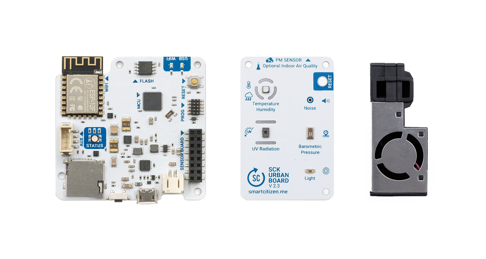
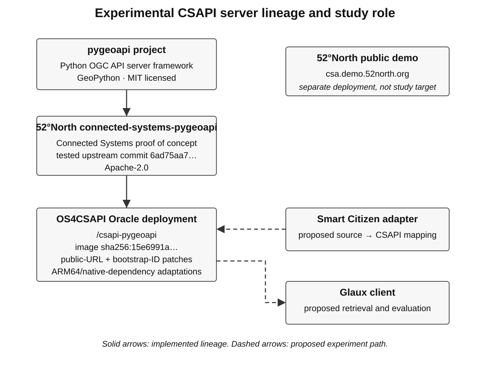
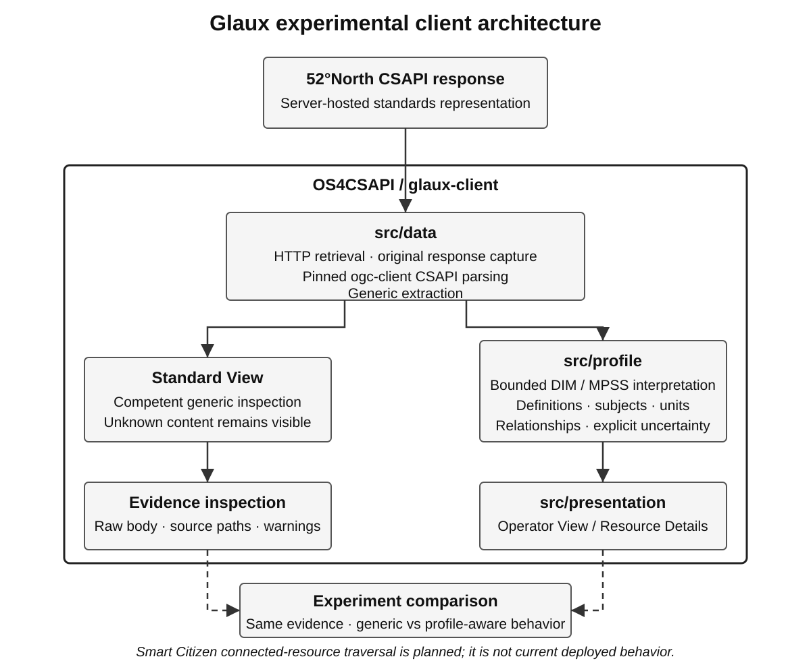
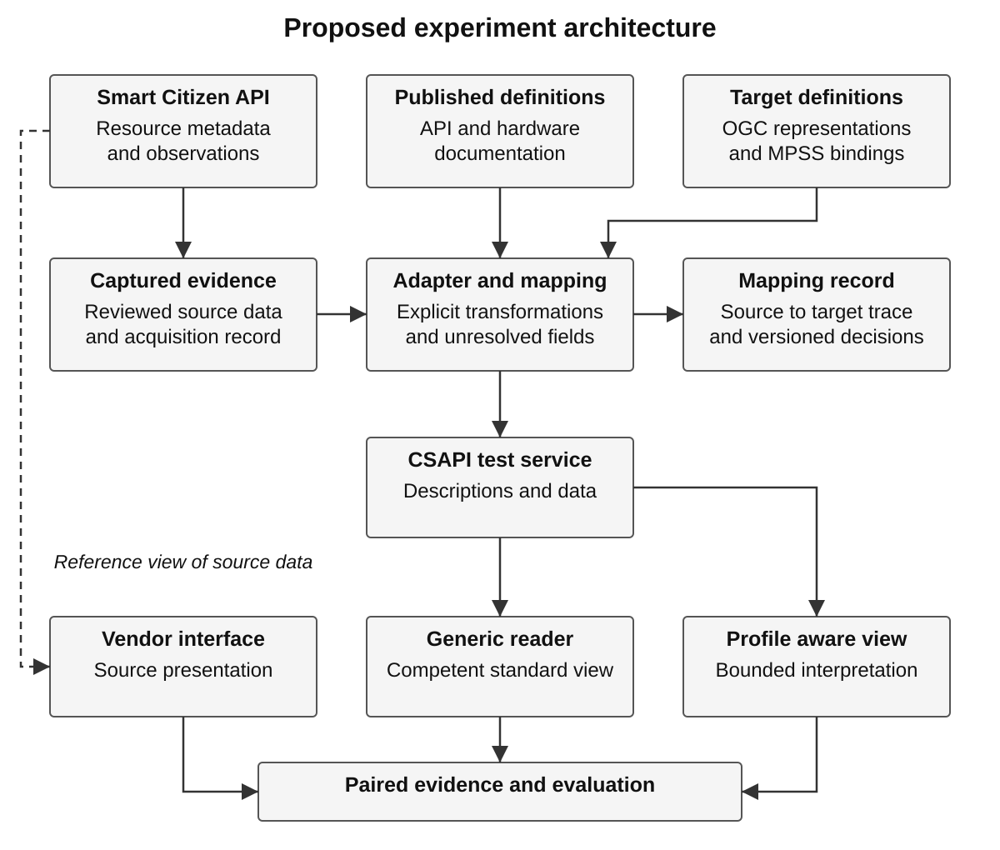
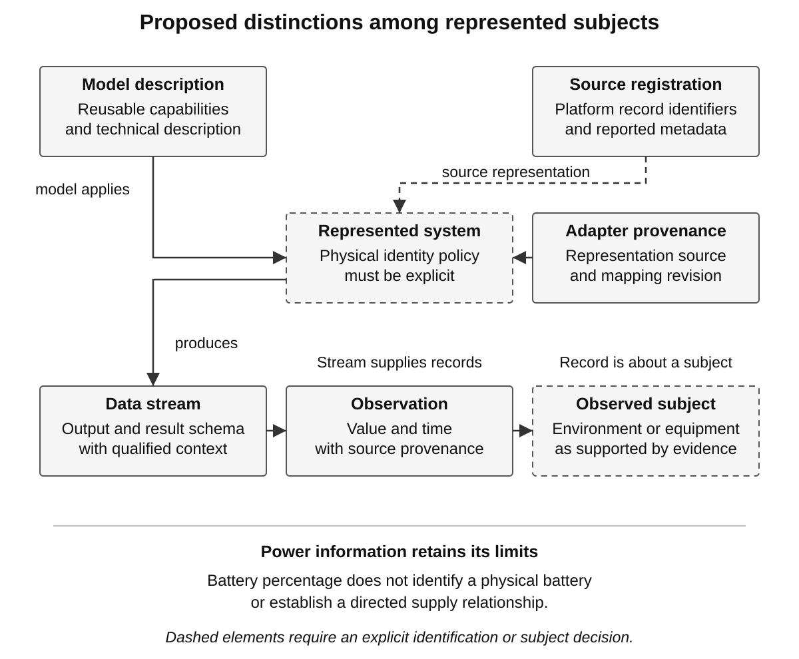
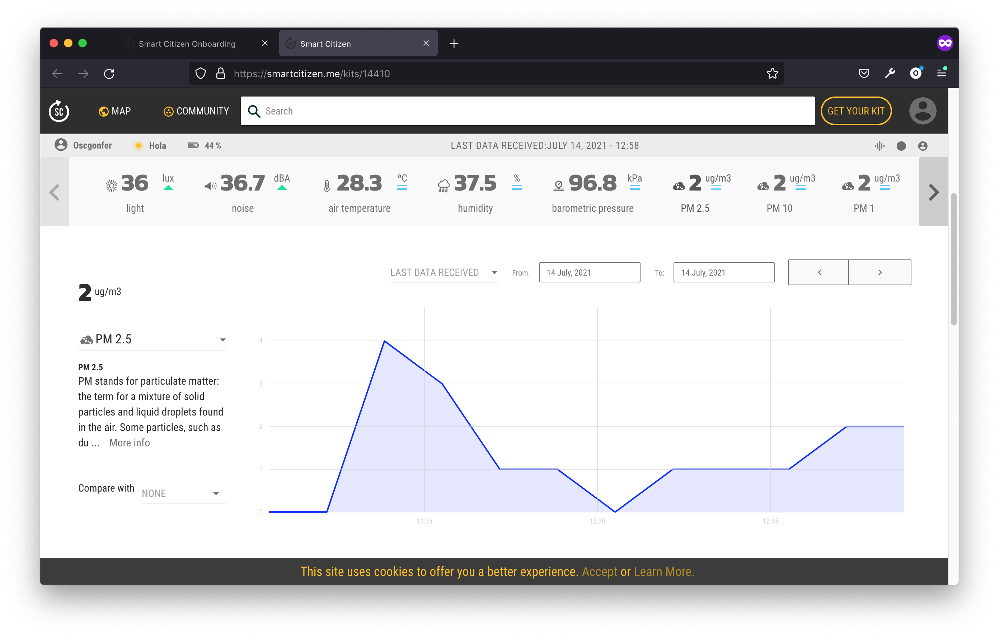
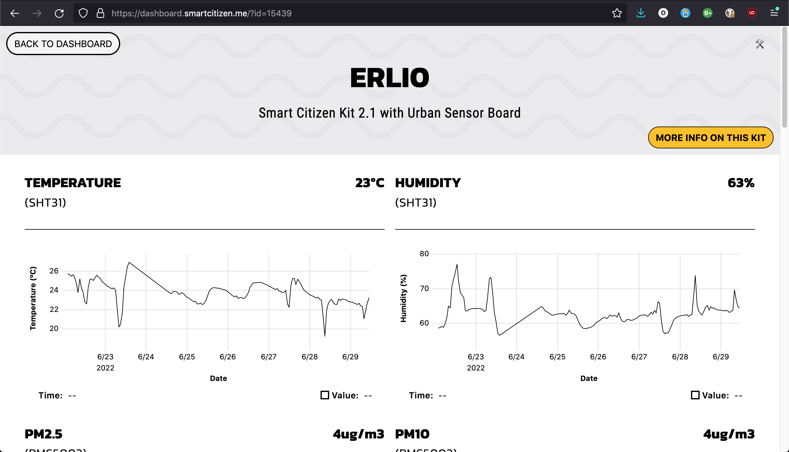

# Evaluating Sensor Information Preservation Through OGC Integration

*A Smart Citizen experiment with the MERLIN domain information model and managed physical sensing systems profile*

MERLIN Project

Working paper version 0.9 | 25 October 2026 | Study protocol with reviewed Phase 1–4 evidence and explicit DIM/Profile architecture

## Abstract

Integrating a sensing system requires preserving the meaning of its information as well as transporting its measurements. An operator may need to distinguish a product model from an installed unit, a producing system from the subject it observes, a source-reported status from an interpretation of that status, and a direct reading from a platform-derived product. This paper defines and advances a Smart Citizen experiment using public source data, an authored adapter, an Open Geospatial Consortium (OGC) API — Connected Systems (CSAPI) service, and the Glaux client to evaluate the MERLIN domain information model (DIM) and Managed Physical Sensing Systems (MPSS) profile. Each consequential mapping is required to identify its native assertion, underlying domain concept, donor concepts, profile binding, standard carrier, authored transformation, presentation implication, and review outcome.

Phases 1–4 have now frozen a reproducible public specimen, characterized its native identities and source semantics, reviewed nine current-state plus two aggregate-history mappings, and designed the connected CSAPI resource graph without writing to the target server. This revision makes the object of evaluation explicit by describing the MERLIN domain information model, the MPSS application-profile and binding layers, their eight whole-system information subjects, the standards-reuse method behind them, and the R01–R20 relationship framework before the experimental apparatus is introduced (MERLIN Project 2026a). The adapter, CSAPI publication and round trip, connected Glaux traversal, and matched generic/profile-aware interface comparison remain unexecuted, so no interoperability or operator-benefit result is claimed.

**Keywords:** sensor integration; domain information model; SensorML; SWE Common; OGC API Connected Systems; semantic preservation; resource details.

## 1 Introduction

The MERLIN Resource Details effort began with the problem of presenting information from heterogeneous sensing systems in a consistent, useful view. TRSS and McQ OmniSense II remain motivating cases; TRSS is retained as the source-system name used by the project rather than expanded here without authoritative support. The subsequent domain-model work expanded the inquiry from individual manufacturer screens to the physical sensing system in employment: its identity, equipment, functions, deployment, configuration, communications, power, and lifecycle. The retained Managed Physical Sensing Systems (MPSS) draft organizes these concerns through eight information subjects and twenty relationship identifiers, R01–R20 (MERLIN Project 2026a, secs. 4–5).

### System selected for the experiment

The Smart Citizen Kit (SCK) is a modular environmental monitoring system. Its documented measurements include air temperature, humidity, particulate matter, noise level, light, and pressure. Figure 1 introduces the SCK2.3 model reported by the first public data specimen selected for this study (Smart Citizen n.d.-c, “What is the Smart Citizen Kit?” and “Measurements”; MERLIN Project 2026b, record “smart-citizen-current-19639”).



**Figure 1. Smart Citizen Kit 2.3 model reference.** The photograph shows the Data Board at left, Urban Board in the center, and particulate-matter module at right. It is reproduced unchanged from the official Smart Citizen / Fab Lab Barcelona documentation (Smart Citizen n.d.-c, “Versions”). It illustrates the product model; it has not been verified as a photograph of the unit associated with registration 19639. The boards and module are shown separately, so the image does not establish that unit's assembled configuration, enclosure, or power connections.

The Data Board provides logging, Wi-Fi, memory-card access, Universal Serial Bus (USB), and a battery connector. The Urban Board carries sensing components and connects a separate particulate-matter module (Smart Citizen n.d.-c, “What is the Smart Citizen Kit?”). For this study, those component roles make physical equipment, sensing functions, communications, and power concrete subjects to examine through the domain information model (DIM) and MPSS. Their presence in model documentation does not establish a verified component inventory for an individual installation.

The selected specimen is public Smart Citizen registration 19639. A formal capture made on 25 October 2026 at 02:43:48 Coordinated Universal Time (UTC) retained the complete Device response, response headers, and bounded temperature and PM2.5 histories with request Uniform Resource Locators (URLs) and Secure Hash Algorithm 256-bit (SHA-256) hashes; it supersedes the earlier 24 October feasibility values as the evidence basis for formal mappings (MERLIN Project 2026k). The source reports hardware “SmartCitizen Kit 2.3,” type “SCK,” version “2.3,” and slug “sck:2,3,” while its channel catalogue includes environmental observations and system-related telemetry such as battery level, received signal strength indication (RSSI), and SD-card indication. The registration and reported model identify the selected data specimen, but enduring physical identity and installed configuration remain separate evidence questions.

**Table 1. System identification and study boundary.** The table separates the physical product family, selected source record, and service through which the study will obtain data. Model-level descriptions and registration metadata have different evidentiary roles. These entries identify the first case without implying that its integration has already been executed (Smart Citizen n.d.-a; n.d.-c; MERLIN Project 2026b).

| Item | Identification | Meaning for this experiment |
| --- | --- | --- |
| System type | Modular environmental monitoring kit | Plain-language description of the equipment; not a newly adopted MPSS classification code |
| Reported product model | SmartCitizen Kit 2.3; type SCK; version 2.3; slug sck:2,3 | Native metadata to preserve and compare with official product documentation |
| Selected public record | Registration 19639; formal frozen capture 20261025T024348Z | Evidence basis for the Phase 1–4 source, mapping, and resource-design work; not a verified physical serial number |
| Source software platform | Smart Citizen Platform and its public API | Existing source service for acquiring data; the proposed CSAPI service and Glaux client have different roles |
| Physical installation | Photograph, serial identity, installed inventory, enclosure, and supply connections unverified | Evidence to obtain before claiming a complete unit-specific equipment or deployment model |

The first case therefore concerns one public Smart Citizen registration, with documentary descriptions of its reported product model. It does not begin with a kit acquired or operated by this project. An owned kit is a later extension for physical and lifecycle evidence, and AirGradient is a later independent comparison. TRSS and McQ OmniSense II remain motivating systems whose accommodation matters to the wider model, but their native datasets are not the input to this first integration case (MERLIN Project 2026c; 2026e).

### Integration question and case selection

The present question is whether this organization helps a client reconstruct useful meaning after integration. Receiving a temperature value demonstrates access to a measurement. It does not establish that the client can identify its producer, distinguish the sampled environment from the equipment, interpret its time, or explain how the information reached the application. Likewise, a populated battery field does not establish an identified power source or its relationship to the operating system. A useful experiment must make such distinctions inspectable rather than treating successful transport as sufficient evidence of semantic preservation.

Smart Citizen was selected as the first candidate because the preliminary study found accessible current and historical responses, informative channel metadata, official model documentation, and a plausible route to an owned physical kit. This is a purposive selection for an integration case study, not the outcome of an exhaustive device survey or a measured ranking of product quality. AirGradient was identified as a later independent comparison, while networking, acoustic, seismic, and radiation sources remain complementary candidates for other questions (MERLIN Project 2026c).

This paper is maintained while the experiment proceeds rather than being written only before execution. Source acquisition, native characterization and the first mapping review are now executed and documented, while adapter publication, CSAPI round-trip testing and client comparison remain future phases (MERLIN Project 2026k; 2026l). Public-data integration still precedes hardware acquisition, and an owned kit remains a later route to physical installation and lifecycle evidence (MERLIN Project 2026e). The frozen specimen provides deterministic replay evidence while any later live acquisition is recorded separately.

## 2 Acronyms and abbreviations

The paper expands uncommon acronyms on first substantive use where practical, but this section provides one place to recover the meaning without searching backward through the text. It includes project shorthand, standards organizations, technical formats, and a few measurement abbreviations that recur in the experiment. Product/model identifiers such as SHT31, SEN5X, and MPL3115A2 are model names rather than acronyms and are therefore not expanded as if they were abbreviations. Where a source uses a particular expansion, the paper preserves that source wording instead of substituting a more familiar variant.

| Acronym / shorthand | Expansion or meaning in this paper |
| --- | --- |
| **API** | Application Programming Interface |
| **CSAPI** | OGC API — Connected Systems; project shorthand used for the Connected Systems API |
| **CSS** | Cascading Style Sheets |
| **CSV** | Comma-Separated Values |
| **DGIWG** | Defence Geospatial Information Working Group |
| **DIM** | Domain Information Model |
| **GEMET** | General Multilingual Environmental Thesaurus |
| **HTTP** | Hypertext Transfer Protocol |
| **ID** | Identifier |
| **JCGM** | Joint Committee for Guides in Metrology |
| **JSON** | JavaScript Object Notation |
| **MERLIN** | Project name used by this study; the paper does not assert an expansion |
| **MPSS** | Managed Physical Sensing Systems |
| **NIST** | National Institute of Standards and Technology |
| **OGC** | Open Geospatial Consortium |
| **OS4CSAPI** | Repository/organization identifier used by the project; the paper does not assert an expansion |
| **PBI** | Product Backlog Item |
| **PM2.5** | Particulate matter in the source category below 2.5 micrometres in size; common environmental shorthand rather than an acronym |
| **PROV** | W3C provenance family/model shorthand |
| **QUDT** | Quantities, Units, Dimensions and Types |
| **RFC** | Request for Comments |
| **RSSI** | Received signal strength indication; Smart Citizen defines it as a measurement of power present in a received radio signal (Smart Citizen n.d.-d) |
| **SCK** | Smart Citizen Kit |
| **SDK** | Software Development Kit |
| **SHA-256** | Secure Hash Algorithm 256-bit |
| **SensorML** | Sensor Model Language |
| **SOSA** | Sensor, Observation, Sample, and Actuator |
| **SSN** | Semantic Sensor Network |
| **SWE** | Sensor Web Enablement |
| **TRSS** | Source-system name used by the project; the paper does not assert an expansion |
| **UI** | User Interface |
| **UID** | Unique Identifier |
| **URI** | Uniform Resource Identifier |
| **URL** | Uniform Resource Locator |
| **USB** | Universal Serial Bus |
| **UTC** | Coordinated Universal Time |
| **UV** | Ultraviolet |
| **UUID** | Universally Unique IDentifier; UUID version 5 is the name-based form used for deterministic Phase 4 study identities (Davis et al. 2024) |
| **VIM** | International Vocabulary of Metrology |
| **W3C** | World Wide Web Consortium |
| **dBA** | A-weighted decibel |
| **dBm** | Decibel referenced to one milliwatt |
## 3 Terms and definitions

The study uses several technical terms that carry narrower meanings than their everyday equivalents. The definitions below are taken from the cited standards or source documentation where an authoritative definition exists, while study-specific terms are explicitly identified as operational definitions rather than external standards. Later uses in the paper are intended to remain consistent with these meanings, and ambiguous source labels are not allowed to override them.

The distinction between a sourced definition and the study's application is important. For example, the World Wide Web Consortium (W3C) PROV data model defines provenance generally, while this study applies that concept to source, processing and integration provenance; the National Institute of Standards and Technology (NIST) defines telemetry around remote measurement transmission, while the paper does not call static model metadata telemetry. Likewise, a source-code method named `calibrated_value` is not treated as proof of calibration in the metrological sense.

| Term | Sourced definition or basis | Meaning used in this study |
| --- | --- | --- |
| **Telemetry** | NIST defines telemetry as measuring one or more quantities, transmitting the results to a distant station, and interpreting, indicating or recording what was measured (Scholl and Suloway 2023). | Remotely transmitted environmental readings and system-related measurement/status reports can be called telemetry. Static catalogue/model metadata, identifiers and documentation are not telemetry merely because they arrive through an API. |
| **Provenance** | W3C PROV describes provenance as information about entities, activities and people/agents involved in producing data or another thing, supporting assessments of quality, reliability or trustworthiness (World Wide Web Consortium 2013). | **Source provenance** records where source assertions came from; **processing provenance** records transformations such as Smart Citizen/Kairos aggregation; **integration provenance** records adapter/server/client acquisition and transformation steps. Rights/licensing metadata can accompany provenance but is not itself the same concept. |
| **Measurement** | The International Vocabulary of Metrology (VIM) defines measurement as the process of experimentally obtaining one or more quantity values reasonably attributable to a quantity (Joint Committee for Guides in Metrology 2012, sec. 2.1). | When quoting Smart Citizen, “measurement” may also denote the source platform's Measurement vocabulary resource. The study does not infer uncertainty, accuracy or formal calibration merely because the source uses the word measurement. |
| **Calibration** | VIM 3 defines calibration as an operation that first relates standards and indications with their uncertainties and then uses that relationship to obtain a measurement result (Joint Committee for Guides in Metrology 2012, sec. 2.39). | The paper reserves formal calibration claims for evidence satisfying that meaning. The Smart Citizen source-code method name `calibrated_value` is quoted as implementation terminology only. |
| **System / Procedure** | CSAPI uses **System** for an instance of infrastructure implementing Procedures and **Procedure** for a datasheet or methodology that can be implemented by multiple System instances (Open Geospatial Consortium 2025a, secs. 9, 13). | The represented SCK instance is distinct from the reusable SCK2.3 model description. Source-platform processing may also be represented as a process System with an associated Procedure when evidence supports that role. |
| **Observation** | CSAPI Observation implements the SOSA Observation concept and carries a result plus required phenomenonTime/resultTime, within a DataStream (Open Geospatial Consortium 2025b, sec. 9.7). | A reading or derived result is not interchangeable with the System, observed property or observed subject. |
| **Feature of Interest / Sampling Feature** | CSAPI calls the real-world domain feature whose properties are ultimately observed the Feature of Interest; a Sampling Feature represents the subset/sample on which observations are actually made (Open Geospatial Consortium 2025a, sec. 14). | The kit is not automatically the observed environmental subject. If the source does not identify a defensible Sampling Feature, the study leaves that association absent rather than inventing one. |
| **DataStream** | CSAPI defines a DataStream as observations acquired by the same System and sharing observed properties; `status` is for status observations of the parent System/subsystems, while `observation` is for other features of interest (Open Geospatial Consortium 2025b, secs. 4.7, 9.2). | DataStream type is selected only after the observed subject is supported. Received signal strength indication (RSSI) therefore remains untyped in the reviewed Phase 4 graph rather than being forced into `status`. |
| **phenomenonTime / resultTime** | CSAPI defines phenomenonTime as the time the observed property value applies to the feature of interest and resultTime as the time the result value was obtained (Open Geospatial Consortium 2025b, sec. 9.7). | Phase 4 uses a documented coincident-time projection for current readings and a qualified source-response result-time proxy for on-demand aggregate products; acquisition time remains separate integration provenance (MERLIN Project 2026m). |
| **Registration / Component** | Smart Citizen says a real device can be registered multiple times; its Component is the platform join between a Device and a Sensor (Smart Citizen n.d.-d, “Schema” and “Components”). | Registration IDs/UUIDs and Component IDs remain source-platform identities, not manufacturer serials or independently identified physical components. |
| **Aggregation** | Smart Citizen `rollup` defines the grouping timespan, `function` defines the grouping method, and `sample_size` is the count of readings examined to build the response (Smart Citizen n.d.-d, “Get Historical Readings”). | “One-hour average” means the source-platform `rollup=1h` and `function=avg` product. The paper does not reinterpret `sample_size` as a per-bin count or invent exact interval boundaries around returned tuple timestamps. |
| **Source time / acquisition time** | These are study operational terms grounded in the source timestamps and provenance requirements rather than external standard terms (MERLIN Project 2026k). | **Source time** is the timestamp the source associates with a reading or aggregate. **Acquisition time** is when this experiment obtained the response and is integration provenance, not an observation time. |
| **Semantic preservation** | This is the study's operational criterion, informed by the role/time distinctions of CSAPI and the mapping method (Open Geospatial Consortium 2025a; 2025b; MERLIN Project 2026l). | Source-supported meaning about identity, producer, observed subject, property, unit, value, time, aggregation, provenance and qualified absence is preserved when the integration does not silently change or invent it. |

## 4 The MERLIN domain information model and MPSS profile

The experiment evaluates the MERLIN domain information model and Managed Physical Sensing Systems profile rather than treating them as unexplained background assumptions. The retained technical baseline is MPSS v0.3.5, dated 17 October 2026, which integrates the domain organization with an initial OGC binding while preserving the distinction between source-derived meaning, reused external concepts, and MERLIN-authored rules (MERLIN Project 2026a). The domain model contributes the protocol-neutral concepts and relationships needed to understand a managed sensing system; the profile and binding select how participating implementations express those meanings using the chosen standards stack. This section summarizes that architecture so later Smart Citizen mappings can be read as tests of a defined model rather than as isolated data-conversion choices.

### Why this work exists

The work originated in the Resource Details problem: heterogeneous sensing systems expose useful information through different manufacturer screens, manuals, identifiers, field names, and operational workflows. Those sources can show what an operator needs to know, but copying each supplier's organization into a common client would preserve vendor silos rather than establish reusable meaning. The investigation therefore broadened from individual screens to the physical sensing system in employment, including its identity, equipment, sensing functions, deployment, configuration, communications, power arrangement, condition, and history (MERLIN Project 2026a, secs. 1, 4). Smart Citizen is an independent real-source test of that broader model, not the source from which the model itself was derived.

The base OGC standards already provide capable resource and encoding mechanisms, so the purpose of MPSS is not to invent another sensor API. The missing problem is domain organization: an integrator still needs a defensible way to distinguish a model from an instance, equipment from a sensing function, the producer from the observed subject, a deployment from persistent equipment identity, or a battery reading from a power-supply relationship. MPSS attempts to make those distinctions reusable across sensing families so clients do not have to reconstruct the same domain logic supplier by supplier. Its value therefore depends on whether the resulting organization preserves real source meaning and remains implementable through the base standards rather than merely sounding plausible on paper.

### Domain model, application profile, binding, and implementation

The retained profile explicitly separates a domain model, an application profile, and a binding, because those artifacts answer different questions (MERLIN Project 2026a, sec. 2). For this experiment, implementation and client behavior are kept as a fourth layer so execution evidence is not confused with the design contract itself. This separation is important when judging success: a sound domain concept can be encoded incorrectly, a correct encoding can be unsupported by one server, and a correctly retrieved representation can still be presented poorly.

**Table 2. Layers of the MERLIN DIM/Profile architecture.** The four layers below distinguish conceptual meaning from the rules and software that realize it. They are complementary rather than interchangeable, and none of them by itself constitutes the whole MPSS result. The examples summarize the retained profile's architecture rather than introduce new requirements (MERLIN Project 2026a, secs. 2, 5).

| Layer | Question it answers | MERLIN/MPSS role | What it does not establish |
| --- | --- | --- | --- |
| Domain information model | What things, properties, relationships, and distinctions matter in this domain? | Defines concepts such as persistent System identity, reusable model description, equipment/function relationships, deployment participation, observation context, power relationships, and lifecycle history | A particular API route, JSON shape, server implementation, or user-interface layout |
| Application profile | Which concepts, options, constraints, and obligations are shared for this purpose? | Selects the managed-physical-sensing-system scope, reusable domain groups, reference behavior, and producer/consumer expectations | Wholesale implementation of every donor standard or identical content for every device |
| OGC binding | How are selected meanings carried in the chosen technical stack? | Maps domain meaning to CSAPI resources/links, SensorML descriptions, SWE components, definition URIs, and dynamic resources | Device-protocol behavior, analytics execution, storage architecture, or operator-screen design |
| Implementation and client | Can software produce, preserve, retrieve, interpret, and present the agreed representations? | Adapter, CSAPI service, standards library, profile interpreter, and Glaux presentation become testable software boundaries | Proof that the underlying domain model is correct merely because code runs |

A profile-aware implementation therefore does more than attach a label to otherwise arbitrary JSON. It implements the selected base-standard representations plus the profile's explicit content, reference, and relationship rules, while any source-native protocol remains a separately identified integration responsibility. Conversely, citing a donor concept or translating one of its meanings into SensorML does not mean the donor's complete runtime or protocol stack has been implemented. This paper preserves those distinctions when it later describes source mappings and experimental results.

### One whole-system model organized through eight information subjects

The MPSS scope centers on an identifiable physical sensing system whose useful description includes the equipment and capabilities that make it work and the deployment or other managed arrangement in which it is employed. Management can be local, remote, gateway-mediated, or maintained through responsible-party records; the family is not restricted to military equipment, continuous connectivity, battery power, or direct Internet addressing (MERLIN Project 2026a, secs. 1.1-1.4). The eight information subjects organize the potential whole-system description, while any one source or device may populate only the portions for which evidence actually exists. They are information responsibilities, not eight new services or a mandatory eight-tab user interface.

**Table 3. Eight connected information subjects in the managed sensing-system model.** The subjects describe different but related questions about the same employed sensing system. They are broad enough to support family-specific detail without forcing every system into an identical field list. Missing source evidence remains missing rather than being manufactured to fill a subject area (MERLIN Project 2026a, sec. 4).

| Information subject | Principal question |
| --- | --- |
| Identity, model, and technical description | What is this system, what reusable model or kind describes it, and what technical information is needed to understand it? |
| Equipment, composition, and physical arrangement | What sensing and supporting equipment participates, and how is that equipment physically related? |
| Sensing capabilities, performance, and outputs | What can the system sense or do, under what relevant conditions, and what information products does it provide? |
| Deployment, emplacement, location, and responsibility | Where, why, when, and under whose responsibility is the system employed? |
| Operating configuration, modes, and supported actions | How is the system configured, what modes/settings matter, and what actions can legitimately be requested? |
| Communications, connectivity, and access arrangement | Through what interfaces, links, gateways, or access paths does the system exchange information or commands? |
| Power sources and operating power arrangement | What powers the equipment, how are sources and consumers related, and what power measurements or service history are relevant? |
| Condition, service, recovery, and lifecycle history | What condition/history explains the system's present state, and what installation, service, replacement, recovery, or redeployment events matter? |


**Figure 2. How the MERLIN DIM and MPSS profile fit together.** Domain research and operator/vendor evidence inform a protocol-neutral model of the sensing system in employment; MPSS then selects purpose-specific constraints and bindings, using native OGC mechanisms first and adding profile-owned definitions only where needed. The resulting CSAPI, SensorML, and SWE Common representations remain available to generic standards clients, while profile-aware clients can use the documented relationships and group definitions to reconstruct a richer whole-system view. The figure is conceptual: it is not a class diagram, API topology, or claim that every donor standard is implemented (MERLIN Project 2026a).

### Where the model came from: reuse rather than reinvention

The model was developed through a deliberate standards and information-model review rather than by promoting the first vendor schema or screen layout into a universal design. Different source families were treated as donors for the areas in which they provide useful established concepts, constraints, or implementation precedent, and their inspection limits were retained rather than erased by the synthesis (MERLIN Project 2026a, secs. 3-4). That approach allows the common model to reuse mature work while keeping MERLIN-authored OGC projections visible as project decisions. It also means that a useful concept may inform MPSS even when the originating supplier, protocol, or standards community does not natively implement CSAPI.

**Table 4. Principal donor responsibilities behind the profile architecture.** The table summarizes the bounded roles assigned in the retained profile rather than listing standards that every implementation must implement. A donor can contribute a concept, constraint, comparison point, or profiling precedent without its whole protocol or runtime becoming part of MPSS. Detailed edition, locator, and evidence limits remain in the profile's research traceability and are carried into individual mappings where those concepts are actually invoked (MERLIN Project 2026a, secs. 3-5).

| Source family | Bounded contribution to the model/profile |
| --- | --- |
| OGC API - Connected Systems, SensorML, and SWE Common | Base resource, relationship, descriptive, dynamic-data, command, semantic-definition, unit, and encoding mechanisms |
| ISO/IEC sensor-network reference architecture and Open Standard for Unattended Sensors material | Whole-system coverage, node/gateway context, unattended-sensor asset/capability examples, and family-level comparison |
| Internet Engineering Task Force hardware, interface, and topology models | Hardware identity/revision concepts, interface layering, and network-node/link distinctions where those meanings apply |
| MIMOSA asset/lifecycle and installation/removal material | Asset continuity, changing associations, service/lifecycle events, and installation/removal concepts |
| Internet Engineering Task Force energy-management and battery models | Power-source, supply, metering, aggregation, battery, and energy-management distinctions |
| Industrial device, technical-data, hierarchy, and capability models | Alternative/complementary equipment, hierarchy, technical-description, and capability concepts used where they improve the common description |
| Marine SensorML profiling work | Precedent for purpose-specific SensorML descriptions, shared vocabularies, and reusable model/instance conventions |
| Military information-model research | Candidate operational organization, purpose, role, and mission detail when the base deployment description is insufficient |

This donor model is intentionally not a standards shopping list. Each consequential reuse must still say whether MERLIN directly reuses a meaning, translates it into an OGC representation, uses it only as an interpretive constraint or precedent, or has not established equivalence. Native OGC mechanisms remain preferred when they already express the required relationship, and locally authored additions remain explicitly local rather than being attributed to the external source. The Smart Citizen experiment uses that same discipline when it traces every selected source assertion through the DIM, donor concepts, MPSS rule, standard carrier, and eventual presentation.

### How MPSS connects domain meaning to OGC representations

The twenty R01-R20 identifiers are local profile relationship identifiers used to make the binding reviewable; they are not names assigned by OGC or another standards organization. Each relationship defines an intended domain meaning, identifies supporting source concepts, selects the applicable native OGC carrier where one exists, and states any additional rule authored by the profile (MERLIN Project 2026a, sec. 5). This makes the design inspectable at the relationship level rather than asking an implementer to infer semantics from labels or from the physical nesting of JSON. It also provides stable handles for findings: an implementation can support one relationship correctly while another remains provisional or unsupported.

For example, R01 relates a particular System to the reusable description of its kind by using the Connected Systems system-kind relationship and SensorML `typeOf` rather than inventing a second model-link mechanism. Other relationships connect equipment to functions, functions to products and settings, observations to their context, supported actions to control resources, communications equipment to interfaces/links/gateways, power sources to consumers, and lifecycle or assessment information to the affected subjects. Some of those associations are direct uses of existing OGC relationships, while others use SensorML/SWE content plus a profile-authored reference rule. The point of R01-R20 is therefore not the numbering itself but the explicit bridge from domain meaning to a concrete, attributable representation.

MPSS also defines reusable group contracts for recognized content such as technical descriptions, equipment roles, sensing functions, function/output bindings, communications interfaces, communication links, gateway access, power associations, and assessment results. Those groups use native SensorML/SWE carriers and semantic definition identifiers, while the profile adds rules such as stable embedded identifiers and how references to embedded subjects are resolved (MERLIN Project 2026a, secs. 5.3-5.5). The profile can be advertised through the standard `profile` link relation without changing the underlying representation's media type or inventing a second API. That mechanism tells a capable client that additional interpretation rules apply; it does not certify conformance or require a profile-unaware client to understand the richer organization.

### Generic access and profile-aware reconstruction

The profile is intended to preserve competent base-standard access rather than make useful data visible only to MERLIN software. A generic client that understands the underlying OGC representations should still be able to inspect Systems, Procedures, Deployments, DataStreams, Observations, typed values, semantic definitions, units, and ordinary links to the extent it supports those standards. A profile-aware client can additionally recognize the MPSS group definitions and relationship rules and assemble those pieces into a coherent whole-system view without relying on supplier-specific labels (MERLIN Project 2026a, secs. 7-8). The experiment's generic-versus-profile-aware comparison is designed to test whether that extra organization adds value without weakening the generic condition.

This distinction also separates information architecture from screen design. MPSS does not prescribe that the eight subjects become eight tabs, and the recovered 560 x 440 Resource Details frame is a project presentation baseline rather than a profile conformance requirement (MERLIN Project 2026d). Glaux therefore keeps standards capture, profile interpretation, and presentation as separate software layers, so a display decision cannot silently redefine the domain model. Sparse or ambiguous source data must remain sparse or ambiguous in both conditions; profile awareness is intended to organize supported meaning, not manufacture completeness.

## 5 Technical standards baseline

The MPSS design uses the OGC sensor and dynamic-data stack as its primary technical realization rather than replacing those standards with a new transport or top-level resource architecture. Open Geospatial Consortium (OGC) API - Connected Systems Part 1 supplies feature-resource mechanisms for Systems, Procedures, Deployments, and related subjects, while Part 2 addresses DataStreams, observation schemas, Observations, controls, commands, and other dynamic resources. These are approved standards in the inspected version 1.0 editions; a specific server must still be checked for the classes and operations it actually implements (Open Geospatial Consortium 2025a, secs. 7-15; 2025b, secs. 9-12). MPSS requirements therefore add a purpose-specific contract on top of the base specifications rather than replacing their conformance obligations.

Sensor Model Language (SensorML) 3.0 provides rich descriptions of processes and physical systems, including outputs, configuration, components, capabilities, and related descriptive content. Sensor Web Enablement (SWE) Common 3.0 provides typed components, semantic definitions, units, structured values, and encoding mechanisms, with official JSON schemas supplying machine-readable structural constraints. These standards provide powerful representation mechanisms, but structural validity alone does not determine whether an integration has identified the correct subject, relationship, time meaning, or source provenance (Open Geospatial Consortium 2025c, secs. 8-9; 2025d, secs. 7-10; n.d.-a; n.d.-b). The Smart Citizen experiment therefore evaluates semantic preservation separately from schema acceptance.

### Power as a discriminating example

Power illustrates why mapping requires more than matching labels. Request for Comments (RFC) 7326 distinguishes power-source, metering, and aggregation relationships, while RFC 7577 defines battery-monitoring objects. MERLIN's selected OGC bindings remain project-authored uses of those donor meanings; neither RFC establishes a MERLIN screen layout or an automatic equivalence with a supplier's battery percentage (Parello et al. 2014, secs. 6.6, 8; Quittek et al. 2015, sec. 4; MERLIN Project 2026a, sec. 5.10). A standards-grounded profile can therefore preserve a simple battery reading without pretending that the reading establishes the larger power arrangement.

The public Smart Citizen specimen reports remaining battery level as a percentage. That is useful measurement evidence, but it does not identify the installed battery, establish which source powers which equipment, or supply replacement history. The experiment will therefore distinguish successful preservation of the percentage from coverage of the wider power-arrangement model (MERLIN Project 2026b, record "smart-citizen-current-19639"). This is representative of the broader method: a profile can define meaningful relationships without permitting an adapter to invent them when the source does not supply the necessary evidence.

## 6 Experimental integration infrastructure

### Experimental CSAPI server

#### Origin and implementation lineage

pygeoapi is an open-source Python server implementation of the OGC API family, designed around a Hypertext Transfer Protocol (HTTP) API, configuration, core API behavior, and pluggable data, process, and formatter components (pygeoapi Development Team 2026, “How pygeoapi works”). 52°North developed its Connected Systems implementation on that foundation and describes the repository as a proof of concept of OGC API – Connected Systems based on pygeoapi (52°North Spatial Information Research GmbH n.d.-a). 52°North reports that the initial Connected Systems API design and prototype were developed through several research projects and were followed by continued pygeoapi-community work around the prototype (52°North Spatial Information Research GmbH 2023; n.d.-b). This lineage explains where the server implementation came from without implying that pygeoapi itself natively supplies every Connected Systems behavior used by the prototype.

The implementation tested by MERLIN was upstream commit `6ad75aa7fbfc76517c8a24c21446471845007855`, whose project metadata identifies connected-systems-pygeoapi version 0.6.0 and pins the 52°North pygeoapi fork at commit `ec1eb38d9a64d93ec9a2e1b9db6fea6dc05f194a` (52°North Spatial Information Research GmbH n.d.-a). At that revision, the container starts Hypercorn over `connected-systems-api/app:APP` and includes the native geospatial dependencies required by the implementation. The upstream repository provides examples for multiple backends and a simulator for inserting example data, so its source tree represents several deployment possibilities rather than one fixed storage architecture. The exact backend used by the OS4CSAPI instance therefore has to come from our deployment evidence, not from inference based on the upstream dependency list.

#### OS4CSAPI Oracle deployment

The server selected for this experiment is the existing Oracle-hosted OS4CSAPI deployment at `https://129-80-248-53.sslip.io/csapi-pygeoapi` (MERLIN Project 2026f). The tested running build corresponded to upstream commit `6ad75aa7...` plus documented deployment adaptations, with container image ID `sha256:15e6991a3697e5f7130ed50bbb958720f2ffa7954f114a70be66cc93c0c489da`. Those adaptations consisted of a public-URL correction, an asynchronous full-scan/bootstrap-ID patch, and retained 64-bit processor-architecture/native-dependency adaptations. Project inventory recorded the endpoint as unauthenticated for the test environment, but that access posture will be reverified before the Smart Citizen run.

The retained evidence does not establish the running instance's exact storage/backend choice, persistent-volume layout, reverse-proxy configuration, restart policy, or complete Docker Compose topology (MERLIN Project 2026f). Upstream examples support multiple backends, and the tested source includes dependencies for more than one potential storage technology, so assigning one of them to the Oracle instance without runtime evidence would be speculation. These configuration details matter because the experiment will eventually evaluate publication, retrieval, relationships, history, and durability rather than only a single request. They are therefore explicit pre-run evidence requirements rather than assumed infrastructure facts.

A separate 52°North demonstration is publicly available at `https://csa.demo.52north.org/`, where the landing page identifies 52°North Spatial Information Research GmbH as the provider and advertises Connected Systems assets (52°North Spatial Information Research GmbH n.d.-c). That service is not the Oracle-hosted deployment used in the MERLIN preservation experiment. Earlier verification work explicitly corrected a test package that targeted the 52°North demo when the intended primary comparison was the OS4CSAPI Oracle instance (MERLIN Project 2026f). The Smart Citizen study will preserve that deployment distinction so a result from one environment cannot be attributed to the other.



**Figure 3. Experimental CSAPI server lineage and study role.** The solid path identifies the implemented lineage from pygeoapi through 52°North's Connected Systems proof of concept to the OS4CSAPI Oracle deployment. The separate 52°North public demo is shown as another deployment rather than as part of the study server. Dashed arrows identify the proposed Smart Citizen adapter and Glaux use, which have not yet been executed. The figure is an authored synthesis of the upstream repositories and the retained deployment baseline (52°North Spatial Information Research GmbH n.d.-a; MERLIN Project 2026f; pygeoapi Development Team 2026).

**Table 5. Server identity and deployment baseline.** The table records facts established for the tested server and distinguishes them from deployment details that still need to be recovered. The exact image and upstream revisions provide a reproducible software checkpoint, while the unknown backend and persistence settings remain real evidence gaps. These gaps do not prevent beginning the mapping work, but they must be closed before claims about durability or exact deployment reproduction (MERLIN Project 2026f).

| Item | Recorded baseline | Standing for this study |
| --- | --- | --- |
| Upstream implementation | 52North/connected-systems-pygeoapi | 52°North Connected Systems proof of concept based on pygeoapi |
| Tested upstream revision | `6ad75aa7fbfc76517c8a24c21446471845007855` | Exact source checkpoint used to identify the running build |
| Project version at tested revision | 0.6.0 | Upstream package metadata, not a conformance level |
| Pinned pygeoapi fork revision | `ec1eb38d9a64d93ec9a2e1b9db6fea6dc05f194a` | Upstream dependency of that source revision |
| OS4CSAPI endpoint | `https://129-80-248-53.sslip.io/csapi-pygeoapi` | Intended Smart Citizen CSAPI target, subject to fresh pre-run health check |
| Hosting | Oracle Cloud test environment | Existing project infrastructure; no new server is required for the first run |
| Tested container image | `sha256:15e6991a3697e5f7130ed50bbb958720f2ffa7954f114a70be66cc93c0c489da` | Exact image identity recorded during October verification |
| Deployment adaptations | Public-URL fix; async full-scan/bootstrap-ID patch; 64-bit processor-architecture/native-dependency adaptations | Local deployment differences from the upstream source checkpoint |
| Authentication | Recorded as none for the test endpoint | Must be reverified before live publication |
| Backend, persistent storage, restart policy | Not established by the recovered evidence | Capture from the running deployment before durability or reproducibility claims |
| 52°North public demo | `https://csa.demo.52north.org/` | Separate external deployment; not the primary study server |

#### Why this implementation is the initial study server

The server was not selected by a claim that 52°North/pygeoapi is universally the best Connected Systems implementation. The glaux-client bootstrap already identified the existing pygeoapi CSAPI test server as the intended server for the later prototype, and a subsequent 19 October 2026 comparison supplied a more specific experimental reason to keep it (MERLIN Project 2026f). In that bounded comparison, the same profile-style SensorML System was submitted to three running Oracle deployments: CS-GO rejected `characteristics`, OpenSensorHub accepted the resource but omitted tested group IDs and conditions on retrieval, and pygeoapi accepted the resource and returned all submitted fields. This result aligns directly with the present study's question about whether profile-relevant meaning survives an integration boundary.

The pygeoapi creation returned HTTP 201 with an explicit UUID in the response body but no `Location` header, so the harness used that UUID only after verifying the fixture's `uniqueId` before cleanup (MERLIN Project 2026f). The retrieved representation preserved every submitted field under the stated comparison rules, the tested response passed the supplemental schema validation used for that sample, and cleanup returned HTTP 200 followed by GET 404. Those findings establish one successful System-level preservation sample rather than complete CSAPI conformance. Restart durability, time-bearing representations, datastream and observation writes, commands, access control, and the complete set of operations needed by the Smart Citizen experiment remain to be exercised separately.

#### Role in the Smart Citizen experiment

The proposed adapter will obtain documented Smart Citizen source data, construct the selected CSAPI/SensorML/SWE representations, and publish them to the Oracle deployment. Glaux will then retrieve the server-hosted resources rather than reading the Smart Citizen API directly for the profile-aware comparison. This makes the server an explicit experimental boundary at which meaning can be preserved, changed, rejected, or lost. A successful server write will therefore be reported separately from the correctness of the mapping and from the usefulness of the resulting client presentation.

Before the first live run, the study will capture the active server revision, image, local patch state, backend/provider, storage configuration, proxy/public-base-URL settings, persistence/restart behavior, authentication posture, and the specific publication interfaces used. Any change from the October 2026 verified build will become part of the execution record rather than being silently treated as the same environment. The experiment will also perform the smallest read/write checks necessary for the actual System, DataStream, schema, and Observation operations it intends to use. This turns deployment configuration into reproducibility evidence instead of background infrastructure that the paper assumes.


### Experimental Glaux client

#### Origin and implementation lineage

The experimental client is `OS4CSAPI/glaux-client`, a standalone TypeScript/Vite browser application created for this study rather than a fork of the existing Glaux, CSAPI Explorer, Alephex, or client-library applications. Its purpose is to keep standards access, MERLIN interpretation, and operator presentation under one observable application boundary while allowing each layer to be tested separately (MERLIN Project 2026g). The name reflects its relationship to the broader Glaux effort and possible future contribution, not an adoption or endorsement by DGIWG or another organization. The current study therefore treats Glaux Client as project-authored experimental software whose behavior must be versioned and examined like the server and adapter.

Standards access is supplied by `OS4CSAPI/ogc-client-CSAPI_2`, an OS4CSAPI fork of Camptocamp's TypeScript `ogc-client` library, while the application code remains a separate repository. The selected `phase-10` revision is pinned at `4ca1d7db9b1ccdf545adbef42ef941139fe11977` and is consumed under the upstream package identity `@camptocamp/ogc-client` through the explicit `@camptocamp/ogc-client/csapi` export (MERLIN Project 2026h; OS4CSAPI 2026). The dependency is linked as a Git submodule and built from its own committed lockfile, so a moving branch or npm release cannot silently change the experiment. Camptocamp's BSD-3-Clause license and attribution are retained, and the application records the library revision independently of its own source revision (Camptocamp n.d.; MERLIN Project 2026h).

#### Why a standalone client and selected library

An earlier architecture review compared forking CSAPI Explorer with building a smaller application on a client library. Explorer offered useful navigation and inspection features, but it also added application behavior such as discovery fallbacks, proxy-relative URL substitutions, and other state that would complicate attribution when a relationship appeared to work or fail (MERLIN Project 2026g). The same review considered `cs-client-ts` a strong alternative because it provides authentication, pagination, validation, and transport hooks. Its convenient common model, however, would add another common-model transformation layer between the wire representation and MERLIN's own interpretation, which is undesirable when the interpretation itself is the object of study. The control-first choice was therefore a standalone application using the ogc-client CSAPI fork, while retaining Explorer and other clients as external inspection or comparison tools rather than experimental foundations.

This choice is task-specific rather than a claim that the selected library is the best general CSAPI software development kit (SDK). The key experimental advantage is that request behavior and original responses remain under application control, allowing the study to distinguish what the server returned from what the parser extracted and what the profile interpreter concluded (MERLIN Project 2026g). The client also preserves unknown or unsupported content for Standard View rather than requiring the profile to explain every supplied field. A future library replacement should therefore be judged by whether it preserves this observable boundary, not by API similarity alone.

#### Application architecture and comparison boundary

Glaux Client deliberately separates three responsibilities: `src/data` performs read-only retrieval, independent source capture, pinned-library parsing, and generic extraction; `src/profile` applies bounded MPSS/DIM interpretation; and `src/presentation` implements the operator-facing views (MERLIN Project 2026g). This separation supports the experimental chain from server representation, through generic parsing, through profile interpretation, to presentation without collapsing those stages into one opaque transformation. Standard View exposes supplied properties, types, units, definitions, relationships, warnings, original text or JSON, and response-body downloads even when the profile does not recognize their meaning. Operator View uses the bounded interpretation layer to organize only supported meanings and retains per-fact source and mapping disclosures.

Both presentation modes operate over the same captured source information, so switching between them is not supposed to retrieve a more favorable dataset. Unsupported or ambiguous content remains available for generic inspection rather than being suppressed to make profile-aware behavior appear better (MERLIN Project 2026g). The current client also preserves the distinction among source time, retrieval time, measurement, estimate, configuration, and reported status when the source provides those meanings. These constraints make the client useful as an experimental instrument because a visible result can be traced backward to the server response and the interpretation rule that produced it.



**Figure 4. Glaux experimental client architecture and interpretation boundary.** The `src/data` layer captures the server response and supplies generic extraction before the evidence branches to competent Standard View inspection and bounded MPSS/DIM interpretation. The `src/profile` layer is the only branch in this diagram that applies project-specific semantic interpretation, while `src/presentation` organizes those recognized meanings for the operator. Both branches therefore begin from the same captured evidence rather than from separate favorable and unfavorable datasets. Smart Citizen connected-resource traversal is shown only as the experiment's next client increment and is not current deployed behavior (MERLIN Project 2026g).

#### Deployed client baseline

The public experimental application is deployed as the Cloudflare Pages project `glaux-client` at `https://glaux-client.pages.dev/` (MERLIN Project 2026i). The current recorded runtime is Git commit `71297c971e2e7532f7c7139600f41e9b58bdcc22`, Cloudflare deployment `97c801c4-c44f-4484-a175-e6651639fe07`, published by Direct Upload rather than Git-triggered deployment. Its Resource Details template opens at the recovered 560 × 440 CSS-pixel working frame and preserves fixed identity/navigation regions around a scrolling content body. Later research and manuscript commits do not alter that deployed runtime unless a separate application build and Pages upload occurs.

**Table 6. Client identity and deployment baseline.** The table records the application, pinned standards-access dependency, public deployment, and current remote-read boundary that exist before the Smart Citizen integration. Application, library, and deployed-runtime revisions are separate identifiers because each can change independently. The proposed Smart Citizen traversal is not attributed to the deployed client until that behavior is implemented and verified (MERLIN Project 2026g; 2026h; 2026i).

| Item | Recorded baseline | Standing for this study |
| --- | --- | --- |
| Application repository | `OS4CSAPI/glaux-client` | Project-authored standalone experimental client; not a fork of Glaux or Explorer |
| Application stack | TypeScript / Vite browser application | Current implementation technology, not a DIM or profile requirement |
| CSAPI library | `OS4CSAPI/ogc-client-CSAPI_2`, branch `phase-10` | Pinned standards-access dependency; separate from application source |
| Exact library revision | `4ca1d7db9b1ccdf545adbef42ef941139fe11977` | Reproducible client-library checkpoint used by the current application |
| Package/export | `@camptocamp/ogc-client` 1.3.1-dev / `@camptocamp/ogc-client/csapi` | Actual package identity and explicit CSAPI import boundary |
| Public application | `https://glaux-client.pages.dev/` | Cloudflare Pages production origin for the experiment UI |
| Deployed runtime commit | `71297c971e2e7532f7c7139600f41e9b58bdcc22` | Application revision actually represented by the current public runtime |
| Cloudflare deployment | `97c801c4-c44f-4484-a175-e6651639fe07` | Direct Upload deployment associated with the recorded runtime |
| Default review frame | 560 × 440 CSS pixels | Recovered Resource Details working size; not a final Dockview constraint |
| Current remote read boundary | Direct System URL, no credentials, at most one advertised SensorML alternate/describedby | Existing capability; full connected-resource traversal remains to be implemented |

The deployed client can currently read an explicitly supplied System resource URL, issue a credential-free GET, preserve the received body, and follow at most one advertised typed SensorML `alternate` or `describedby` link (MERLIN Project 2026g). It does not yet authenticate to a service, discover arbitrary collections, or traverse the full System-to-equipment/deployment/DataStream/schema/Observation graph required by the proposed Smart Citizen study. The existing synthetic power example resolves a fixed local bundle rather than discovering that graph from a server. Consequently, the Smart Citizen experiment includes a client implementation increment rather than assuming the current deployment already provides the necessary traversal.

#### Role in the Smart Citizen experiment

For the live experiment, Glaux will consume the connected resources published through the selected 52°North CSAPI server rather than reading Smart Citizen's native API directly for the operator comparison. The data layer must retrieve and retain the relevant standardized resources and responses, the profile layer must recognize only supported MPSS/DIM meanings, and the presentation layer must reconstruct the Resource Details experience from those meanings. The generic condition will remain competent enough to expose the same standard properties, relationships, units, times, and raw evidence without profile-specific organization. A profile-aware benefit will therefore require an observable difference in supported interpretation or task performance, not merely a more polished layout.

Each executed run will record the Smart Citizen capture revision, adapter revision, CSAPI server revision and image, Glaux source revision, Glaux deployed-runtime revision, pinned client-library revision, and MPSS profile revision. This version chain is necessary because a change at any one layer could alter the final display without changing the others. The first client increment will add the connected-resource retrieval and Smart Citizen presentation needed for the study while retaining the existing original-response and Standard View boundaries. Until that increment is built and verified, Figure 10 and any claim that Glaux reconstructed the Smart Citizen dataset from connected CSAPI resources remain pending experimental evidence.


## 7 Research questions and study design

The study proposes a traceable integration case. A controlled comparison of information presentation will follow that integration. Together, these stages address three research questions.

1. **Semantic preservation.** Which source-supported meanings survive acquisition, adaptation, CSAPI publication, retrieval, and presentation, and where does meaning become ambiguous or lost?
2. **Profile contribution.** Which operator questions become easier to answer through the DIM and MPSS when compared with competent presentation of the same standard resources without profile-specific organization?
3. **Coverage and transfer.** Which information subjects and relationships are exercised, and which mappings remain reusable when a second producer is introduced?

The unit of technical analysis is a traceable assertion: a value, identity, relationship, or contextual statement with an identified source and interpretation. A sample may contain several such assertions. The evaluation will avoid equating the number of observations with domain coverage or treating R01–R20 as twenty interchangeable checklist points. Findings about transport, interpretation, and presentation will be reported separately.

The immediate proposed path is public Smart Citizen acquisition through a documented adapter into an identified CSAPI test service, followed by Glaux retrieval. The exact server, write interfaces, version, adapter revision, and execution environment will be recorded before the first run. They are not selected by implication in this protocol. An owned kit is a later extension for facts that a public feed does not establish.



**Figure 5. Proposed experiment architecture.** Source definitions and captured responses jointly inform the mapping. The two client conditions use the same standardized evidence, while the provider interface supplies a separate presentation reference. All adapter and service connections shown here are proposed. The architecture is authored for this study using the resource distinctions in the selected OGC standards and MPSS baseline (Open Geospatial Consortium 2025a; 2025b; MERLIN Project 2026a).

## 8 Source selection and preliminary observations

### Published definitions and observed responses

Smart Citizen publishes a human-readable schema description, endpoint tables, field meanings, and examples. Its sensor and measurement records also carry descriptive metadata and, where supplied, vocabulary and unit-definition links. The study has verified those resources and actual responses; a complete machine-readable OpenAPI or JSON Schema contract for the exact deployed source API has not yet been verified (Smart Citizen n.d.-d, “Schema,” “Sensors,” and “Measurements”).

Official kit documentation describes modular equipment and sensing functions, and the platform documentation describes data access and front-end applications. The project publishes separate hardware, firmware/tooling, and platform licensing information. Openness helps inspection but does not remove the need to examine data and media reuse terms separately (Smart Citizen n.d.-a; n.d.-b; n.d.-c).

Model documentation must remain distinct from unit-specific evidence. For example, the supplier states that kits shipped from July 2026 omit the UV sensor, while older public records may expose UV channels. A model designation alone therefore does not establish an exact installed inventory (Seeed Studio n.d.; MERLIN Project 2026c).

### Formal Phase 1 source evidence

The 24 October feasibility check established that registration 19639 could provide useful current and historical data, but it is no longer the evidence basis for formal mappings. Phase 1 froze a new complete specimen at `2026-10-25T02:43:48Z`, including the Device response, response headers, request URLs and one-day temperature and PM2.5 histories with SHA-256 hashes (MERLIN Project 2026k). The source reports 21 current channels, with eleven non-SEN5X channels at `02:40:21Z` and ten SEN5X particulate channels at `02:36:21Z`. This two-cohort timing pattern is itself evidence that device-level `last_reading_at` cannot replace channel-specific time.

**Table 7. Selected observations from the formal frozen specimen.** The table uses the retained 25 October source body rather than the earlier feasibility values. Values and times are source-reported and have not yet passed through the proposed adapter or CSAPI server. System-related telemetry is shown alongside environmental observations to exercise different subject and interpretation questions. None of the rows is a readiness or health assessment (MERLIN Project 2026k).

| Reported channel | Source value and unit | Source time UTC | Question exposed |
| --- | --- | --- | --- |
| Air temperature | 19.59 ºC | 02:40:21 | Are property, unit, environmental subject and time preserved? |
| Relative humidity | 65.54 % | 02:40:21 | Can a second SHT31 output remain distinct from component identity? |
| PM2.5 | 9.3 ug/m3 | 02:36:21 | Does the older particulate-channel time remain visible? |
| Battery level | 99.0 % | 02:40:21 | Is parent-System status kept separate from battery identity and supply topology? |
| Wi-Fi RSSI | −45 dBm | 02:40:21 | Can received-signal power remain telemetry without becoming interface/link status? |
| SD-card indication | 1 | 02:40:21 | Is the source categorical meaning retained without becoming Boolean health? |

The formal one-day temperature history contains 24 one-hour average tuples and reports `sample_size=1439`; the corresponding PM2.5 history also contains 24 tuples but reports `sample_size=288` (MERLIN Project 2026k). Smart Citizen documents `sample_size` as the readings examined to build the response, while `rollup=1h` and `function=avg` define the grouping request (Smart Citizen n.d.-d). Returned timestamps are not exact hour boundaries and differ between the two series, so the study preserves each tuple time exactly rather than constructing nominal intervals. These histories are source-platform derived products and are mapped separately from current source-reported results.

**Listing 1. Selected formal temperature fields.** These members are reproduced from `/data/sensors/18` in the frozen Device response. Other members are omitted, and the excerpt is not a source schema or complete response. The listing is retained as a companion JSON file and verified against the frozen body. It replaces the earlier feasibility excerpt as the formal mapping specimen (MERLIN Project 2026k).

```json
{
  "id": 55,
  "name": "Sensirion SHT31 - Temperature",
  "unit": "ºC",
  "unit_definition": "https://qudt.org/vocab/unit/DEG_C",
  "value": 19.59,
  "last_reading_at": "2026-10-25T02:40:21Z"
}
```

The native source also exposed semantic traps that matter to the experiment. Smart Citizen documents `notify.low_battery` and `notify.stopped_publishing` as notification settings, so a false value is not evidence of a healthy battery or healthy publishing state (Smart Citizen n.d.-d; MERLIN Project 2026k). Likewise, `prev_value` has no independent timestamp in the current Device representation and is not used to manufacture a timed trend. These examples show why a familiar label cannot substitute for source semantics.

The inspected Smart Citizen API source adds a further processing qualification. At revision `25a524cb...`, `RawStorer` calls `normalized_value` before storing the `<sensor_id>_raw` entry and then stores the output of a method named `calibrated_value` under the sensor ID that the public Device response exposes as `value` (Smart Citizen 2026). The study therefore calls the public values source-platform reported/processed results rather than untouched raw sensor output, and the method name does not establish calibration in the VIM sense without calibration standards, uncertainty relationships or traceability evidence (Joint Committee for Guides in Metrology 2012). The exact production revision remains unverified, so repository source explains the inspected implementation path without proving byte-for-byte production behavior.

## 9 Proposed dataset and mapping method

### Evidence collection and scope

The formal first dataset now includes source registration and model metadata, a complete 21-channel inventory, definitions, units, individual timestamps, current readings and bounded temperature/PM2.5 history (MERLIN Project 2026k). The representative Phase 3 mapping set covers registration/model identity, temperature, PM2.5, humidity, pressure, A-weighted sound level, battery percentage, RSSI, SD-card indication and the two one-hour aggregate products (MERLIN Project 2026l). Other inventoried channels remain deliberate deferred cases rather than silently unmapped omissions. The selection exercises semantic distinctions rather than maximizing record count.

The formal acquisition retains the endpoint/query, UTC acquisition time, HTTP outcome, response headers, complete response bodies and SHA-256 fingerprints; a later acquisition should additionally freeze the API root/version information when available (MERLIN Project 2026k). Published excerpts identify their relationship to those retained bodies, and the raw capture remains separate from application fixtures. The earlier 24 October evidence record remains a feasibility record and is not retroactively relabeled as the formal specimen (MERLIN Project 2026b). This preserves the difference between feasibility evidence, source evidence and later mapped representations.

Source-reported facts, documentary model information, integration-created facts, and unresolved assertions will remain distinguishable. A model guide can support a description of available interfaces without proving the current peer or configuration of a selected unit. Similarly, an adapter's version and acquisition history are real integration facts, but an adapter restart is not a physical sensor service event.

### Identity and subject relationships

The represented physical system, a platform registration, a sensor catalogue entry, and the adapter have different identity scopes. The source API allows multiple registrations of one physical device and documents components as device-to-sensor associations. Their identifiers cannot silently become physical serials (Smart Citizen n.d.-d, “Schema” and “Components”). Any integration-assigned resource identity will state what it identifies and the evidence linking it to the source.

Environmental measurements must retain their observed environmental subject rather than become measurements of the kit merely because the kit produced them. Equipment-related readings need their appropriate subject as well. Where that subject cannot yet be identified precisely, the mapping will preserve the source assertion and its uncertainty rather than invent a battery resource or redirect historical observations to a later component (MERLIN Project 2026a, R01–R02, R11, R17).



**Figure 6. Proposed conceptual distinctions for the mapped specimen.** This is a model explanation, not a diagram of resources already created on a server. The physical producer, observed subject, model, source registration, and representing software remain distinct. Missing power endpoints or deployment intervals are unresolved evidence requirements, not implicit relationships. Native carrier choices will be fixed in the mapping record (MERLIN Project 2026a, R01, R11, R15–R17; Open Geospatial Consortium 2025a; 2025b).

### Mapping records and concept lineage

For every consequential field, the mapping record will identify its source location, definition, identity scope, subject, quantity, unit, time meaning, aggregation, missing-value treatment, target resource/property, applicable MPSS rule, and presentation decision. Each transformation will have a rationale and an evidence locator. Conflicts between documentation and observed payloads will be recorded and resolved for the affected mapping. Consulting implementation code may help, but its exact revision does not automatically identify the revision deployed by the public service.

Every mapping explanation will connect the native assertion to its underlying DIM concept, the applicable MPSS binding, and the selected CSAPI concepts and representation. It will identify the relevant System, DataStream, Observation, or other resource and explain why that resource has the intended role. Where SensorML or SWE supplies the representation, the explanation will name the actual member, component, semantic definition, and unit mechanism. A JSON destination alone is an incomplete account because it does not explain the meaning being preserved or the model decision behind it.

Each individual donor concept invoked by that explanation will have its own attribution, including its name or identifier, source edition, exact section or object, and inline author-date citation. The account will state whether the concept is directly reused, adapted through an identified binding, used to constrain interpretation, or considered without an established equivalence. A source may contribute both conceptual meaning and an encoding mechanism, but those contributions will be explained separately. Multiple donors supporting one mapping will remain individually visible, and similarity of terminology will not be treated as evidence of historical derivation.

The donor explanation will distinguish an established contribution to the retained model from a source vocabulary encountered in this experiment. It will also identify MERLIN-authored bindings and experiment-authored transformations rather than crediting them to an external standard. Where the donor relationship is unverified, the mapping will say that it is not established and identify the missing evidence. The following requirements apply to every mapping added to this paper, including metadata and relationships as well as numerical readings.

**Table 8. Required explanation for each mapping.** Each mapping receives a stable study-local identifier and a narrative covering these layers. Every invoked donor receives a separately attributable concept entry, even when several donors support the same mapping. Unresolved relationships remain visible until source evidence and review support a disposition.

| Layer | Required explanation | Evidence to identify |
| --- | --- | --- |
| Native assertion | What the source actually asserts, about which subject and time | Source path, definition, capture, and limitations |
| Underlying DIM concept | Entity, property, relationship, and distinctions the mapping preserves | Model concept and exact baseline locator |
| Individual donor concepts | The meaning contributed by each donor and how it is invoked | Concept identifier, edition, section or object, citation, and reuse status |
| MPSS binding | Existing rule applied and any project-authored specialization | Exact rule, rationale, and remaining gap |
| Standard representation | CSAPI resource/association and SensorML/SWE carrier | Standard clause, field/component, definition, and unit |
| Transformation and presentation | Authored conversion, enrichment, label, or grouping and its reason | Mapping revision, code/listing, and source-to-display trace |
| Review outcome | What was preserved, unsupported, changed, or left unresolved | Executed check, evidence, and explicit limits |

### Phase 1–3 review checkpoint

The mapping review was deliberately reopened before Phase 4 so that source-characterization and semantic defects could be corrected before code or server behavior made them implicit; that Phase 1–3 gate is now a completed historical checkpoint. The review retained the core identity, environmental-observation, battery and SD-card conclusions, corrected RSSI's earlier overconfident status classification, and brought the two aggregate-history products into the mapping ledger with explicit processing provenance (MERLIN Project 2026l). It also corrected the source-processing description and the 11+10 timing cohort count, while preserving unresolved result-time and sampling-subject questions rather than inventing answers. The owner subsequently accepted those findings and authorized the Phase 4 resource-graph design recorded below.

| Phase 1–3 item | Reviewed standing |
| --- | --- |
| Formal specimen | Frozen registration 19639 Device response plus temperature and PM2.5 histories with requests, headers and hashes |
| Native characterization | 21 channels; 11 at 02:40:21Z and 10 SEN5X channels at 02:36:21Z; notification, previous-value, location and processing limitations explicit |
| Identity/model | System instance remains distinct from platform registration and reusable SCK2.3 model description |
| Environmental current results | Temperature, PM2.5, humidity, pressure and A-weighted sound level mapped as environmental observations with unresolved sampling feature/resultTime |
| Parent-System status | Battery percentage and SD-card code mapped without inventing battery topology, readiness or Boolean health |
| Received signal strength indication (RSSI) | Quantity preserved; observed subject and optional DataStream type remain unresolved instead of forcing System status |
| Aggregate history | One-hour averages treated as source-platform processing products; Phase 4 supplies the processing System/Procedure and qualified time policy without inventing interval bounds |

### Illustrative encoding

Listing 2 illustrates a proposed SensorML output containing a SWE Quantity. The source measurement-definition URI and unit-definition URI are retained, while the local output name is an authored mapping choice. SensorML's output mechanism and SWE's Quantity and UnitReference structures provide the carriers (Open Geospatial Consortium 2025c; 2025d; n.d.-a, “AbstractProcess.json”; n.d.-b, “Quantity.json” and “basicTypes.json”).

**Listing 2. Proposed SensorML output with a SWE quantity.** This JSON fragment is explanatory authored content. It is not a complete System or a served resource. It does not represent a completed adapter mapping or an executed conformance result.

```json
{
  "outputs": [
    {
      "name": "airTemperature",
      "type": "Quantity",
      "definition": "http://www.eionet.europa.eu/gemet/concept/281",
      "label": "Air temperature",
      "uom": {
        "href": "https://qudt.org/vocab/unit/DEG_C"
      }
    }
  ]
}
```

The fragment describes an output; it does not contain the observed value. The eventual CSAPI DataStream, observation schema, and Observation must preserve their own roles and associations. Phase 4 now supplies explicit phenomenon-time and result-time policies for the first load, and those authored projections are documented rather than inferred from the spelling of source timestamp fields (MERLIN Project 2026m). Complete request and response examples will be added only after actual service publication and retrieval (Open Geospatial Consortium 2025b, secs. 9.2, 9.6–9.7).

### Temperature mapping SC TEMP 01

Mapping `SC-TEMP-01` now uses the formal frozen temperature channel rather than the preliminary feasibility value. The source supplies sensor catalogue ID 55, value 19.59 ºC, unit definition `https://qudt.org/vocab/unit/DEG_C`, air-temperature definition `http://www.eionet.europa.eu/gemet/concept/281`, and channel source time `2026-10-25T02:40:21Z` (MERLIN Project 2026k; 2026l). In the underlying model this is an environmental Observation result produced by the sensing System, with the observed subject distinct from that producer. MPSS R10 and R11 therefore keep output/DataStream correspondence, producer, observed subject and temporal context distinguishable.

The observation-concept lineage runs through CSAPI to SOSA/SSN. `sosa:Sensor`, `sosa:Observation`, `sosa:ObservableProperty`, `sosa:FeatureOfInterest` and `sosa:Result` distinguish the producer, observation, property, subject and outcome, while CSAPI supplies the DataStream and Observation resource mechanisms (World Wide Web Consortium 2017; Open Geospatial Consortium 2025a; 2025b). GEMET concept 281 and QUDT `DEG_C` are source-carried property/unit vocabularies rather than evidence that those vocabularies historically donated every relevant DIM concept (European Environment Agency 2021; QUDT.org n.d.). The local output name remains an experiment-authored choice.

The proposed SensorML output uses a SWE Quantity named `airTemperature` with the source property and unit URIs. Its CSAPI DataStream is type `observation`; linked scalar Observations are expected to yield server-derived `resultType=measure`, rather than the adapter authoring that summary field directly (Open Geospatial Consortium 2025b, sec. 9.2). Phase 4 sets both `phenomenonTime` and `resultTime` to the channel's source reading time as a disclosed coincident-time projection because Smart Citizen supplies no separate result-generation timestamp; experiment acquisition time remains separate provenance (MERLIN Project 2026m). No SamplingFeature is created merely to satisfy the target graph.

Presentation may show the source-reported temperature, unit, property meaning, producer and channel time while stating that the environmental sampling subject is not independently identified. It must not call 19.59 ºC “device temperature,” replace the channel time with the Device's latest time, or use acquisition time as an observation time. These are semantic-preservation requirements, not layout preferences.

### Battery mapping SC BATT 01

Mapping `SC-BATT-01` uses the formal 99 percent result at `2026-10-25T02:40:21Z` and Smart Citizen Measurement 7, whose definition is the SCK remaining battery level in percentage (MERLIN Project 2026k; 2026l). Under the paper's telemetry definition, this is remotely transmitted parent-System power/status telemetry, not evidence of a separately identified battery. MPSS R17 preserves the changing value and observed subject, while R16 is not instantiated because no battery identity, Power Interface or source-to-consumer relationship is supplied. A status DataStream is therefore defensible because the property is explicitly about the parent SCK itself (Open Geospatial Consortium 2025b, sec. 9.2; Scholl and Suloway 2023).

RFC 7326 contributes power-source and metering concepts that constrain against inventing supply topology, and RFC 7577 defines battery objects such as actual charge and actual voltage whose units and meanings are not equivalent to a percentage (Parello et al. 2014; Quittek et al. 2015). The proposed SWE Quantity uses local name `batteryLevel`, source unit code `%`, and the resolvable source concept `https://api.smartcitizen.me/v0/measurements/7` as an experiment-authored semantic definition; linked scalar Observations are expected to yield server-derived `resultType=measure`. The source supplies no separate resultTime, so Phase 4 uses the same channel reading instant for `phenomenonTime` and `resultTime` as the disclosed coincident-time projection used for the other frozen current readings (MERLIN Project 2026m). This projection satisfies the target temporal structure without claiming that Smart Citizen supplied an independent second timestamp.

The display may say “source-reported SCK remaining battery level: 99%” and show its source time. It must not add charge in mAh, voltage, remaining runtime, charging state, a separate battery identity, a supply edge or readiness judgment. This preserved absence is part of the result rather than a missing-value defect.

### Received signal strength indication (RSSI) classification correction

The Phase 3 review changed the earlier proposed classification of `SC-RSSI-01`. Smart Citizen's source vocabulary expands RSSI as “received signal strength indication” and defines it as power present in a received radio signal, but the frozen source does not independently identify whether the observed subject is the parent System, an embedded Wi-Fi subsystem/interface, or the received signal/link context (Smart Citizen n.d.-d; MERLIN Project 2026l). OGC reserves DataStream type `status` for observations of the parent System or its subsystems and `observation` for other features of interest, so equipment context alone does not settle the type (Open Geospatial Consortium 2025b, sec. 9.2). The reviewed Phase 4 design keeps the optional DataStream `type` unset because the source still does not establish that subject.

The value remains a SWE Quantity with source-concept definition `https://api.smartcitizen.me/v0/measurements/78`. The native unit lexeme `dBm` is preserved; QUDT `DeciB-MilliW` is a possible experiment-authored unit normalization because it represents a decibel level referenced to one milliwatt, but Smart Citizen did not supply that URI (QUDT.org 2026). MPSS R13 continues to constrain the interpretation: RSSI is not interface operational status, enabled state, reachability or a directed network link. Presentation therefore reports source RSSI without inventing “Wi-Fi health,” “link up” or signal-quality thresholds.

### Aggregate-history mappings

The one-hour average temperature and PM2.5 series are now explicit Phase 3 mappings rather than deferred examples. Smart Citizen documents the rollup and grouping function, and the inspected implementation shows source-platform aggregation through Kairos; the derived averages therefore have processing provenance that must not be attributed to the physical SCK (Smart Citizen n.d.-d; 2026; MERLIN Project 2026l). OGC permits a process System with `assetType=Process`, an associated Procedure, and a derived Property that references a `baseProperty` and optionally a statistic (Open Geospatial Consortium 2025a, secs. 9, 15). Phase 4 now instantiates that distinction conceptually as a separate source-platform processing System and reusable aggregation Procedure while leaving actual target-server execution for later phases.

The temperature response reports 1,439 readings examined and the PM2.5 response 288, even though both return 24 one-hour aggregate tuples. Those response-wide counts remain query/processing provenance and are not copied into each aggregate as per-bin sample counts. Returned tuple timestamps are preserved exactly, and no nominal one-hour phenomenon interval is invented from the request spelling. Phase 4 uses the frozen history response date as an explicitly qualified source-response proxy for `resultTime`, rather than pretending it is the internal computation-completion time (MERLIN Project 2026m). If the target server cannot preserve the processing distinction without distortion, omitting the aggregate products from the first load is preferable to presenting them as direct physical-kit output.

### Phase 4 reviewed Connected Systems resource graph

Phase 4 converts the reviewed meanings into a concrete, reviewable Connected Systems resource graph without making any server writes (MERLIN Project 2026m). The deterministic first-load design contains two Systems, two Procedures, ten DataStreams with ten observation schemas, and fifty-six Observations: eight frozen current results plus twenty-four temperature and twenty-four PM2.5 aggregate results. The physical Smart Citizen case and the source-platform aggregation process are separate producing Systems, so a one-hour average is not silently attributed to the physical kit. Every created resource is traceable to a Phase 3 mapping, while unsupported topology is represented by deliberate absence rather than by placeholder resources.

**Table 9. Phase 4 resource graph and negative design decisions.** The table summarizes the design that would be implemented by the adapter after this review gate. Study-owned System and Procedure identities use deterministic Universally Unique IDentifier version 5 (UUIDv5) URNs derived from documented project name strings; those identifiers identify MERLIN study representations rather than manufacturer-issued physical assets (Davis et al. 2024; MERLIN Project 2026m). The target graph deliberately omits resource types for which the source does not supply defensible identity or relationship evidence. These choices are design results, not executed server results.

| Design element | Phase 4 decision |
| --- | --- |
| Physical sensing case | One CSAPI System representing the sensing-system instance known through registration 19639; Smart Citizen ID/UUID remain source identifiers |
| Reusable product description | One Procedure for the SCK2.3 model/datasheet; linked through System kind / SensorML `typeOf` |
| Current outputs | Eight DataStreams/schemas for temperature, PM2.5, humidity, pressure, A-weighted sound level, battery level, RSSI, and SD-card indication |
| Aggregate processing | Separate process System plus reusable one-hour-average Procedure; two aggregate DataStreams |
| Current observation time | Channel source time copied to both phenomenonTime and resultTime as a disclosed coincident-time projection |
| Aggregate observation time | Returned tuple time as phenomenonTime; frozen source HTTP response date as a qualified resultTime proxy |
| Environmental SamplingFeature | Not created; source does not identify a defensible sample/air-volume feature |
| Deployment and position | Not created/populated in first load; public location precision and employment meaning are insufficient |
| Component/battery/Wi-Fi/SD Systems | Not created; catalogue/status fields do not establish independently identified resources |
| Local derived Property resources | Not required for first load; stable authored property URIs carry meaning while target Property creation remains unreliable |
| Controls | Not created; no selected command evidence belongs to this read/integration experiment |

The time projections are deliberately explicit because the source exposes fewer temporal distinctions than the Connected Systems Observation model requires. For the eight current results, Phase 4 sets both `phenomenonTime` and `resultTime` to the channel's reading timestamp and keeps experiment acquisition time separate as integration provenance. For the on-demand aggregate products, the returned tuple timestamp remains the phenomenon-time anchor while the corresponding frozen HTTP response date is used only as a source-response proxy for result time. Neither rule claims that Smart Citizen originally supplied two independent timestamps, and both must be revisited if stronger source-side time evidence becomes available.

Phase 4 also exposes implementation constraints in the exact 52°North target revision `6ad75aa7...`. Its route table lacks POST creation for Property resources despite repository examples/create logic, its observation schema is more permissive than the approved standard about phenomenon time, its documentation treats aggregate “meta-datastreams” as future functionality, and cascade deletion remains incomplete (52°North Spatial Information Research GmbH n.d.-a; MERLIN Project 2026m). The design therefore does not depend on local Property creation or implementation-specific aggregate shortcuts, sends both observation times explicitly, and defines child-first cleanup from Observations to DataStreams to Systems to Procedures. These are bounded target-implementation findings, not a claim of complete standards-conformance assessment.
### Expected domain coverage

**Table 10. Expected coverage and remaining evidence needs.** The starting material comes from inspected public evidence and proposed documentary enrichment. These are assessment expectations, not completed implementation results. The profile's inclusion of a subject does not require an unsupported source assertion (MERLIN Project 2026a, secs. 4, 5.1; 2026b; 2026c).

| Information subject | Supported starting material | Principal remaining need |
| --- | --- | --- |
| Identity and description | Registration and reported model | Physical identity and verified firmware |
| Equipment and arrangement | Channel inventory and model documentation | Installed components, support, and attachments |
| Functions and products | Varied readings, definitions, and history | Active-mode and parameter context |
| Deployment and responsibility | Source location and exposure metadata | Employment interval, purpose, and responsible roles |
| Configuration and actions | Documented supported settings | Actual settings and physical command evidence |
| Communications and access | RSSI and source/integration access | Physical peers, interfaces, and directed links |
| Power arrangement | Battery percentage | Identified supplies, power relationships, and changes |
| Condition and lifecycle | Literal status-related indicators | Qualified assessments and physical service history |

An owned or cooperating operator's kit can later supply a verified installation, actual configuration, power connections, and documented physical change. AirGradient will instead test transfer across producers. A second observation feed should not be assumed to solve the same missing physical-context questions automatically.

## 10 Integration and evaluation protocol

### Acquisition and publication

The formal Phase 1 specimen is already frozen and remains the deterministic mapping/replay baseline. Before a later live adapter run, the team will reassess registration 19639 for sufficiently recent data and document any reason for choosing a different live source while retaining the frozen specimen for comparison. Polling, caching and retry behavior will follow documented and observed source behavior, and repeated retrieval of an old observation will not make it new. The adapter will preserve acquisition time separately from source time and document duplicate handling.

The selected CSAPI service will be checked against the exact Phase 4 resource graph before publication. Only reviewed resource types and relationships will be emitted, and the actual endpoint, running revision, assigned server identifiers, and cleanup evidence will be recorded in the execution record. A source sample will then be followed through capture, deterministic adapter output, service response, and client display. Server acceptance establishes one part of that chain; it does not establish full semantic correctness (Open Geospatial Consortium 2025a; 2025b).

### Validation and reportable outcomes

**Table 11. Proposed evaluation criteria.** Structural checks will use the applicable target schemas, parsers, reference-resolution rules, and actual service responses. Semantic checks will compare the source meaning with the meaning represented and displayed. Each executed check will record the input revision, tool/version, scope, outcome, and evidence location. Illustrative code in this draft remains separate from executed evidence.

| Criterion | Evidence to collect |
| --- | --- |
| Traceability | Counts of traced, unresolved, and unsupported displayed assertions, with a stated denominator |
| Concept lineage | Individual donor concepts, exact citations, model/binding connections, reuse or adaptation decisions, and unestablished links |
| Semantic preservation | Field-level comparison of identity, producer, subject, property, unit, value, time, aggregation, and absence |
| Temporal integrity | Channel times retained; historical grouping preserved; refresh time kept separate |
| Qualified absence | Null, filtered, absent, unsupported, zero, and coded states interpreted explicitly |
| Resource consistency | Intended references and stream/schema/observation associations survive publication and retrieval |
| Presentation utility | Answer correctness, access to evidence, navigation steps, and overflow or keyboard obstacles |

Coverage will be reported independently for the eight information subjects and relevant R01–R20 relationships. The record will distinguish supported and exercised content, supported but unimplemented content, source-limited content, and content outside the case. A correctly preserved partial source is a valid result, but it cannot be reported as a complete-domain example.

Discrepancies will be classified as source omission, mapping defect, profile gap, or presentation issue. Uncertain classifications will remain open. A missing battery serial is initially a source limitation; overwriting a channel timestamp is a mapping defect; difficulty finding a preserved timestamp can be a presentation issue. Changes to the profile will require a separately supported disposition rather than being hidden inside the adapter.

## 11 Interface comparison and figure protocol

### Vendor presentation baseline

Before implementing the CSAPI and Glaux comparison, the study fixes a source-provider presentation baseline using first-party Smart Citizen documentation. This reduces post hoc selection risk: the vendor-side examples are chosen before the experiment produces a preferred client result. Smart Citizen describes its website as a near-real-time exploration interface that combines device data with contextual information, and its onboarding guide instructs users to visit the Kit on the platform after it begins publishing and then scroll down to make basic explorations (Smart Citizen n.d.-a; n.d.-e). These documented screens are therefore evidence of intended presentation patterns, not merely decorative examples selected by this study.



**Figure 7. Official Smart Citizen platform example of device measurement exploration.** The first-party onboarding documentation presents this screen immediately after instructing a user to visit a newly publishing Kit and scroll down for basic exploration (Smart Citizen n.d.-e). The historical example shows kit page 14410, a device-level header with a 44 percent battery indication and last-data-received time, a horizontal strip of current light, noise, air-temperature, humidity, pressure, and particulate measurements, and a selected PM2.5 detail with property explanation, date controls, and a time-series graph. The visible data are dated 14 July 2021 and are not observations from registration 19639 or evidence that the current production interface is pixel-identical. The source pixels are reproduced unchanged from Smart Citizen's documentation and their source provenance and separate published rights notices are retained with the study figures (MERLIN Project 2026j).

The screen reveals a vendor presentation strategy that is useful to the experiment independently of its visual styling. Device-level context remains visible while multiple current quantities are summarized with values and units, after which one measurement can be expanded into a semantic explanation and temporal view. The presentation therefore connects resource identity/status, measurement inventory, selected-property meaning, and history instead of treating each API field as an isolated row. MERLIN does not need to copy this layout, but a standards-based reconstruction should preserve enough meaning to support the same kinds of operator questions when the source evidence permits them.



**Figure 8. Official Smart Citizen custom-dashboard example.** Smart Citizen's Data Tools documentation distinguishes the classic Smart Citizen Map from a separate JavaScript dashboard and describes the latter as a simpler but more advanced visualization with device status, filtering, customizable time-series plots, WebSocket notifications, and CSV download (Smart Citizen n.d.-f). The historical screenshot identifies device ERLIO as a Smart Citizen Kit 2.1 with Urban Sensor Board and presents current temperature and humidity values beside sensor designations and multi-day trend plots, with particulate sections continuing below the visible frame. It is an official example of an alternate Smart Citizen presentation, not the core platform screen shown in Figure 7 and not the SCK2.3 specimen selected for this experiment. The source image is reproduced unchanged from the first-party documentation and is retained as design evidence rather than a matched experimental condition (MERLIN Project 2026j).

The two vendor examples show that Smart Citizen itself supports more than one valid presentation of the same broader information ecosystem. The core platform emphasizes a compact set of current metrics plus selected-measurement explanation and history, while the custom dashboard makes model/sensor labels and parallel trends more prominent. That variation is useful to the DIM/Profile study because it reinforces that the domain model should preserve reusable concepts without prescribing one universal screen arrangement. It also gives the Resource Details PBI concrete source-provider questions to preserve: what resource is being viewed, what can it report, what are the current values and units, what does a selected property mean, how recent is the information, and what history is available.

**Table 12. Vendor presentation elements and reconstruction questions.** The table records information made visible in the two first-party examples and converts it into questions for the standards-based reconstruction. It does not assert that every element belongs in the default 560 × 440 Resource Details frame or that the MPSS profile already supplies every required binding. The eventual Glaux result will be evaluated against the underlying questions and preserved meanings rather than against pixel-level imitation of Smart Citizen's interface.

| Vendor presentation element | Visible source-provider role | Question for the DIM/Profile and Glaux reconstruction |
| --- | --- | --- |
| Device/resource header | Keeps the selected Kit and recent reporting context visible | Can the client identify the represented resource and distinguish resource status/context from observations? |
| Current-measurement strip | Summarizes several quantities with values and units at once | Can heterogeneous outputs remain individually meaningful while sharing a compact overview? |
| Battery and last-data context | Shows equipment-related status alongside sensing outputs | Can battery reporting and data freshness remain qualified without becoming readiness or power-topology claims? |
| Selected PM2.5 detail | Adds a human explanation to the selected property | Can the standardized representation preserve a semantic property definition that the client can explain? |
| Date controls and time-series graph | Gives temporal context and history for a selected quantity | Can source time, requested interval, aggregation, and retrieved history remain distinguishable? |
| Sensor/model labels in dashboard | Exposes technical description near current values and trends | Can model, sensing component/function, observed property, and result remain separate but navigable? |

The eventual matched comparison has three conditions: the Smart Citizen source presentation for the selected specimen where a contemporaneous view can be obtained, a competent generic OGC presentation, and a profile-aware Glaux presentation. Figures 6 and 7 establish first-party historical presentation evidence before implementation, but neither is a matched screenshot of public registration 19639. Generic handling will retain useful labels, types, units, timestamps, relationships, and inspection access. It will not be reduced to a deliberately inconvenient JSON dump.

The generic and profile-aware conditions will use the same captured standardized resources. Differences will be attributed to documented presentation rules. Proposed operator tasks will ask a reader to identify the represented resource, distinguish newer readings from older channels, explain an aggregate, locate source evidence, and recognize what remains unknown. Initial evaluation will be investigator inspection, without claims about representative users. A later participant study would require its own recruitment, procedure, and analysis plan.

Each screenshot will record the registration, channel, observation or interval, aggregation, units, capture time, application revision where available, browser, zoom, viewport, and relevant controls. Glaux will be evaluated at the recovered 560 × 440 module size; other sizes will be reported explicitly. The source interface will retain its actual viewport and layout. Where it cannot replay the same sample or interval, images will be described as illustrative interface evidence rather than a matched comparison (MERLIN Project 2026d).

**Table 13. Planned figures and evidence status.** Figures 1–6 identify the selected system, the DIM/Profile architecture, the server, the client, the experiment architecture, and the Smart Citizen-specific conceptual distinctions. Figures 7 and 8 provide first-party historical Smart Citizen user-interface evidence, while the Phase 4 resource graph is maintained as a reviewed design artifact rather than being misrepresented as executed server evidence. Figures 9–11 remain reserved for contemporaneous or executed evidence and will not be filled with simulated substitutes.

| Figure | Intended content | Status in version 0.9 |
| --- | --- | --- |
| 1 | Smart Citizen Kit 2.3 equipment and component roles | Official model reference photograph; not a verified image of registration 19639 |
| 2 | MERLIN DIM / MPSS architecture and standards-binding flow | Included as an authored conceptual architecture diagram |
| 3 | Experimental CSAPI server lineage and study role | Included as an authored server-lineage diagram |
| 4 | Glaux experimental client architecture and interpretation boundary | Included as an authored client-architecture diagram; Smart Citizen graph traversal remains planned |
| 5 | Proposed acquisition, mapping, service, and comparison architecture | Included as an authored diagram |
| 6 | Proposed Smart Citizen model and subject distinctions | Included as an authored diagram |
| 7 | Smart Citizen core-platform measurement exploration | Included first-party documentation screenshot; historical kit 14410 example, not registration 19639 |
| 8 | Smart Citizen custom-dashboard presentation | Included first-party documentation screenshot; historical SCK2.1 dashboard example |
| 9 | Contemporaneous Smart Citizen view for the selected registration/interval, if reproducible | Awaiting documented capture; absence will be reported rather than substituted |
| 10 | Matched generic and profile-aware Glaux views of integrated evidence | Awaiting implementation and capture |
| 11 | Actual CSAPI resource relationships and a traced source-to-display example | Phase 4 design exists; actual server relationships and traced display remain awaiting execution |

Screenshots document visible states. They cannot alone demonstrate semantic correctness or a profile benefit. A screenshot finding must be linked to the source records, mapping decisions, and task outcome. Cropping, annotation, or masking will be disclosed, and the original capture will be retained with its evidence record. Figure captions will identify the source, time basis, comparison limits, and any author-added marks.

## 12 Results to be reported

Phases 1–4 now provide reportable source, mapping, and design results, but the end-to-end integration remains incomplete. The experiment has frozen a complete formal Device specimen and two bounded histories, characterized all 21 current channels, reviewed nine current-state plus two aggregate-history mappings, and designed the first connected CSAPI graph containing two Systems, two Procedures, ten DataStreams/schemas, and fifty-six frozen Observations (MERLIN Project 2026k; 2026l; 2026m). It has also recorded corrections and design constraints discovered by review, including source-processing provenance, notification-setting semantics, the 11+10 timing cohorts, the unresolved RSSI subject, qualified time projections, and explicit negative-resource decisions. No adapter execution, server create/retrieve result, connected Glaux result, task-time improvement, or user outcome is reported.

The Phase 4 graph demonstrates that semantic preservation can require **not** creating apparently convenient resources. A Smart Citizen registration UUID is not established as a manufacturer serial; source catalogue parents do not establish installed-component identity; battery percentage does not establish a battery System or supply topology; received signal strength indication does not establish an interface/link-status resource; and public location metadata does not establish a Deployment. Environmental SamplingFeatures are also omitted because the source does not identify defensible sample features. These absences are evidence-backed design outcomes rather than implementation incompleteness.

The aggregate histories further show why processing provenance changes the resource graph. The one-hour averages are assigned to a separate process System and aggregation Procedure instead of being credited directly to the physical kit, while stable authored property URIs distinguish those derived products from their base observed properties (MERLIN Project 2026m). Current observations use a disclosed coincident-time projection, and aggregate observations use a source-response result-time proxy, because the source supplies fewer time distinctions than CSAPI requires. The next reportable evidence must come from deterministic adapter output and later server round-trip testing against this reviewed design.
## 13 Discussion and limitations

The immediate public-data case is strongest for reported quantities, source-platform descriptions, telemetry, and integration provenance. It remains weaker for unit-specific physical composition, operating configuration, deployment history, power topology, maintenance, and independently identified environmental samples, and more readings cannot fill those relationships by themselves. Phase 4 makes those boundaries concrete by declining to create a Deployment, SamplingFeature, battery, Wi-Fi interface, storage component, or other resource that the evidence cannot identify (MERLIN Project 2026m). Documentary model enrichment must not be presented as observation of the particular installation, while source-platform processing must not be presented as direct physical-sensor output.

The formal Phase 1 capture archives the complete Device body plus the two selected history bodies, but it is still only one bounded specimen and did not freeze every possible endpoint or production-version indicator. The selected source may change its fields, permissions, processing code or availability, and the inspected Smart Citizen source revision is not independently proven to be the exact production revision (Smart Citizen 2026). The current and aggregate time mappings are therefore explicit projections rather than claims that Smart Citizen supplied all CSAPI-required temporal semantics natively. A later independent producer can test transfer, while an owned kit can address physical evidence gaps; these are different extensions.

The Phase 4 target-server findings are similarly bounded. The inspected 52°North revision exposes concrete route/schema/delete behaviors that affect this experiment's planned request strategy, but the study has not performed a full OGC conformance test or established that the deployed Oracle instance is byte-for-byte identical to every inspected upstream behavior (52°North Spatial Information Research GmbH n.d.-a; MERLIN Project 2026f; 2026m). Structural correctness, service interoperability, and operator benefit remain separate evidence questions. The study will retain the distinction between native source meanings, approved standard requirements, target implementation behavior, MERLIN-authored bindings, and client choices throughout later phases.
## 14 Reproducibility and document maintenance

The manuscript, acronyms-and-abbreviations table, figures, code listings, reference metadata, and publication manifest will be maintained together in the repository. Each paper revision will state its version, date, changed evidence, and execution status. The Word edition will be generated from the maintained manuscript and inspected after rendering. Source and output fingerprints will make a stale derived edition detectable.

Narrative paragraphs, including the abstract and explanatory figure, table, and listing captions, will contain three to five sentences. Headings, metadata, research-question items, table cells, code, and reference entries retain their respective structural formats. The publication check will enforce the paragraph rule, while editorial review will assess whether each paragraph develops a coherent point. Each mapping revision must also maintain the individual donor attributions and the explanation of its model and standard-representation roles. New domain-specific acronyms or recurring abbreviations must be expanded on first substantive use where practical and added to the maintained acronym table; the publication verifier checks the required acronym inventory and repeated uppercase shorthand against documented exclusions.

References use the Chicago Manual of Style eighteenth-edition author-date system. Undated pages retain access dates; same-author/same-year suffixes are applied consistently; citations identify specific sections or evidence records when useful. “MERLIN Project” is an editorial corporate-author label for the cited project working documents, not a claim of individual authorship or outside institutional endorsement (University of Chicago Press n.d.).

The existing fourteen imported project artifacts retain their versions and bytes. This paper is a new research artifact. Its mapping choices and findings will be reconciled into the appropriate PBI, wireframe, profile, and DIM records when supported; publication of a research draft does not silently amend those baselines. The next paper revision should add actual deterministic adapter evidence after the Phase 5 review gate; executed server relationships and source-to-display traces remain later evidence and must not be backfilled from the Phase 4 design alone.

## 15 Conclusion

This study has moved from source assessment and semantic mapping through a reviewed Phase 4 resource design. A formal Smart Citizen specimen is frozen, its native identities and source semantics are characterized, the representative mappings are reviewed, and a concrete CSAPI graph now states what would be created and what must remain absent. The graph separates the physical sensing case from source-platform aggregate processing, uses deterministic study identities without claiming manufacturer identity, and makes temporal projections explicit rather than hiding source under-specification (MERLIN Project 2026m). The accompanying acronym and definition sections are maintained as part of the evidence discipline so specialized shorthand does not become an implicit barrier to understanding.

The next question is whether a deterministic adapter can emit exactly this reviewed graph from the frozen specimen without adding unsupported semantics. That is the Phase 5 question, and it remains separate from Phase 6 server publication and later Glaux presentation. No server resource, user-interface result, or interoperability success is claimed merely because the graph is now concrete. Later execution results will be evaluated against this Phase 4 baseline rather than allowing code or target-server behavior to redefine the mapping after the fact.
## References

52°North Spatial Information Research GmbH. 2023. *52°North Annual Report 2023*. Münster, Germany. https://52north.org/delivery/annual_report/52%C2%B0North_Annual_Report_2023.pdf.

52°North Spatial Information Research GmbH. n.d.-a. “connected-systems-pygeoapi.” GitHub repository, tested revision 6ad75aa7fbfc76517c8a24c21446471845007855. Accessed October 24, 2026. https://github.com/52North/connected-systems-pygeoapi/tree/6ad75aa7fbfc76517c8a24c21446471845007855.

52°North Spatial Information Research GmbH. n.d.-b. “Open Source Projects Contributions.” Accessed October 24, 2026. https://52north.org/software/software-components/open-source-projects-contributions/.

52°North Spatial Information Research GmbH. n.d.-c. “connected-systems-pygeoapi.” Public demonstration service. Accessed October 24, 2026. https://csa.demo.52north.org/.

Davis, Kyle, Brad Peabody, and Paul Leach. 2024. *Universally Unique IDentifiers (UUIDs)*. RFC 9562. Standards Track. May. https://doi.org/10.17487/RFC9562.

Camptocamp. n.d. “ogc-client.” GitHub repository. Accessed October 24, 2026. https://github.com/camptocamp/ogc-client.

European Environment Agency. 2021. “Air Temperature.” *GEMET*, version 4.2.3, December 6. Concept 281. Accessed October 24, 2026. https://www.eionet.europa.eu/gemet/en/concept/281.

Joint Committee for Guides in Metrology. 2012. *International Vocabulary of Metrology—Basic and General Concepts and Associated Terms (VIM)*. 3rd ed., 2008 version with minor corrections. JCGM 200:2012. https://doi.org/10.59161/JCGM200-2012.

MERLIN Project. 2026a. *Managed Physical Sensing Systems and Deployments: Profile Scope, Content Outline and Integrated Binding Draft*. Version 0.3.5. October 17. Project working draft. https://github.com/OS4CSAPI/glaux-client/blob/1a24fdff71ef801d9b326d2b42a63743db737a8e/Docs/Design/MPSS/MERLIN_Managed_Physical_Sensing_Systems_Profile_Integrated_Binding_Draft_v0.3.5_17OCT2026.docx.

MERLIN Project. 2026b. “Open Sensor Candidate Access Observations.” October 24. Research evidence record, schema version 1. https://github.com/OS4CSAPI/glaux-client/blob/1a24fdff71ef801d9b326d2b42a63743db737a8e/Docs/Research/Evidence/OPEN_SENSOR_ACCESS_2026-10-24.json.

MERLIN Project. 2026c. “Open Sensor Candidates for MERLIN DIM and MPSS Experiments.” October 24. Research report. https://github.com/OS4CSAPI/glaux-client/blob/1a24fdff71ef801d9b326d2b42a63743db737a8e/Docs/Research/Reports/OPEN_SENSOR_CANDIDATES_2026-10-24.md.

MERLIN Project. 2026d. “Resource Details Wireframe Template.” October 24. Design and implementation record. https://github.com/OS4CSAPI/glaux-client/blob/1a24fdff71ef801d9b326d2b42a63743db737a8e/Docs/Design/RESOURCE_DETAILS_TEMPLATE.md.

MERLIN Project. 2026e. “Smart Citizen Experiment Plan.” October 24. Proposed experiment plan. https://github.com/OS4CSAPI/glaux-client/blob/1a24fdff71ef801d9b326d2b42a63743db737a8e/Docs/Plans/SMART_CITIZEN_EXPERIMENT_PLAN.md.

MERLIN Project. 2026f. “52°North connected-systems-pygeoapi Experimental Server Baseline.” October 24. Research evidence record. https://github.com/OS4CSAPI/glaux-client/blob/work/details-view-20261023/Docs/Research/Evidence/PYGEOAPI_SERVER_BASELINE_2026-10-24.md.

MERLIN Project. 2026g. “Glaux Client Selection and Experimental Architecture Baseline.” October 24. Research evidence record. https://github.com/OS4CSAPI/glaux-client/blob/work/details-view-20261023/Docs/Research/Evidence/GLAUX_CLIENT_BASELINE_2026-10-24.md.

MERLIN Project. 2026h. “Dependency Provenance and Reproducibility.” October 23. Project dependency record. https://github.com/OS4CSAPI/glaux-client/blob/work/details-view-20261023/Docs/DEPENDENCIES.md.

MERLIN Project. 2026i. “Cloudflare Deployment Continuation.” October 24. Deployment record. https://github.com/OS4CSAPI/glaux-client/blob/work/details-view-20261023/Docs/Plans/CLOUDFLARE_DEPLOYMENT.md.

MERLIN Project. 2026j. “Smart Citizen Vendor Presentation Baseline.” October 24. Research evidence record. https://github.com/OS4CSAPI/glaux-client/blob/work/details-view-20261023/Docs/Research/Evidence/SMART_CITIZEN_VENDOR_UI_BASELINE_2026-10-24.md.

MERLIN Project. 2026k. “Smart Citizen Source Specimen and Native Inventory.” October 25. Experiment workbook record. https://github.com/OS4CSAPI/glaux-client/blob/work/details-view-20261023/Docs/Research/Studies/Smart_Citizen/Workbook/01_SOURCE_SPECIMEN_AND_INVENTORY.md.

MERLIN Project. 2026l. “Smart Citizen Mapping Ledger.” October 25. Experiment workbook record. https://github.com/OS4CSAPI/glaux-client/blob/work/details-view-20261023/Docs/Research/Studies/Smart_Citizen/Workbook/02_MAPPING_LEDGER.md.

MERLIN Project. 2026m. “Smart Citizen Proposed CSAPI Resource Graph and Request Design.” October 25. Experiment workbook record. https://github.com/OS4CSAPI/glaux-client/blob/work/details-view-20261023/Docs/Research/Studies/Smart_Citizen/Workbook/03_CSAPI_RESOURCE_GRAPH.md.

Open Geospatial Consortium. 2025a. *OGC API—Connected Systems—Part 1: Feature Resources*. Version 1.0. OGC 23-001. Edited by Alexandre Robin. July 16. https://docs.ogc.org/is/23-001/23-001.html.

Open Geospatial Consortium. 2025b. *OGC API—Connected Systems—Part 2: Dynamic Data*. Version 1.0. OGC 23-002. Edited by Alexandre Robin. July 16. https://docs.ogc.org/is/23-002/23-002.html.

Open Geospatial Consortium. 2025c. *OGC SensorML Encoding Standard*. Version 3.0. OGC 23-000. Edited by Alexandre Robin. July 16. https://docs.ogc.org/is/23-000/23-000.html.

Open Geospatial Consortium. 2025d. *OGC SWE Common Data Model Encoding Standard*. Version 3.0.0. OGC 24-014. Edited by Alexandre Robin. July 16. https://docs.ogc.org/is/24-014/24-014.html.

Open Geospatial Consortium. n.d.-a. “Index of /sensorML/3.0/json.” Official SensorML 3.0 JSON schema repository. Accessed October 24, 2026. https://schemas.opengis.net/sensorML/3.0/json/.

Open Geospatial Consortium. n.d.-b. “Index of /sweCommon/3.0/json.” Official SWE Common 3.0 JSON schema repository. Accessed October 24, 2026. https://schemas.opengis.net/sweCommon/3.0/json/.

OS4CSAPI. 2026. “ogc-client-CSAPI_2.” GitHub repository, phase-10 revision 4ca1d7db9b1ccdf545adbef42ef941139fe11977. Accessed October 24, 2026. https://github.com/OS4CSAPI/ogc-client-CSAPI_2/tree/4ca1d7db9b1ccdf545adbef42ef941139fe11977.

Parello, John, Benoit Claise, Brad Schoening, and Juergen Quittek. 2014. *Energy Management Framework*. RFC 7326. Informational. September. https://doi.org/10.17487/RFC7326.

pygeoapi Development Team. 2026. *pygeoapi 0.25.dev0 Documentation*. October 22. https://docs.pygeoapi.io/en/latest/.

QUDT.org. n.d. “Degree Celsius.” *QUDT Units Vocabulary*, version 3.5.3. Unit DEG_C. Accessed October 24, 2026. https://qudt.org/vocab/unit/DEG_C.

QUDT.org. 2026. *QUDT Units Vocabulary*. Version 3.5.3. Accessed October 25, 2026. https://www.qudt.org/doc/DOC_VOCAB-UNITS.html.

Quittek, Juergen, Rolf Winter, and Thomas Dietz. 2015. *Definition of Managed Objects for Battery Monitoring*. RFC 7577. Standards Track. July. https://doi.org/10.17487/RFC7577.

Scholl, Matthew, and Theresa Suloway. 2023. *Introduction to Cybersecurity for Commercial Satellite Operations*. NIST Interagency/Internal Report 8270. July. National Institute of Standards and Technology. https://doi.org/10.6028/NIST.IR.8270.

Seeed Studio. n.d. “Smart Citizen Kit 2.3—Open Source Environmental Monitoring Kit.” SKU 114993536. Accessed October 24, 2026. https://www.seeedstudio.com/Smart-Citizen2-3-p-6327.html.

Smart Citizen. 2026. “smartcitizen-api.” GitHub repository, revision 25a524cbfb036f8950c247b847d8884a4e776297. Accessed October 25, 2026. https://github.com/fablabbcn/smartcitizen-api/tree/25a524cbfb036f8950c247b847d8884a4e776297.

Smart Citizen. n.d.-a. “Data Platform.” *Smart Citizen Docs*. Accessed October 24, 2026. https://docs.smartcitizen.me/data/data-platform/.

Smart Citizen. n.d.-b. “Open Source.” *Smart Citizen Docs*. Accessed October 24, 2026. https://docs.smartcitizen.me/about/open-source/.

Smart Citizen. n.d.-c. “Smart Citizen Kit.” *Smart Citizen Docs*. Accessed October 24, 2026. https://docs.smartcitizen.me/hardware/kit/.

Smart Citizen. n.d.-d. “SmartCitizen API Reference.” Accessed October 24, 2026. https://developer.smartcitizen.me/.

Smart Citizen. n.d.-e. “Onboarding Your Kit.” *Smart Citizen Docs*. Accessed October 24, 2026. https://docs.smartcitizen.me/guides/getting-started/onboarding-your-kit/.

Smart Citizen. n.d.-f. “Data Tools.” *Smart Citizen Docs*. Accessed October 24, 2026. https://docs.smartcitizen.me/data/data-tools/.

University of Chicago Press. n.d. “Author-Date: Sample Citations.” *The Chicago Manual of Style Online*. Accessed October 24, 2026. https://www.chicagomanualofstyle.org/tools_citationguide/citation-guide-2.html.

World Wide Web Consortium. 2013. *PROV-DM: The PROV Data Model*. W3C Recommendation, April 30. https://www.w3.org/TR/prov-dm/.

World Wide Web Consortium. 2017. *Semantic Sensor Network Ontology*. W3C Recommendation, October 19. https://www.w3.org/TR/2017/REC-vocab-ssn-20171019/.
