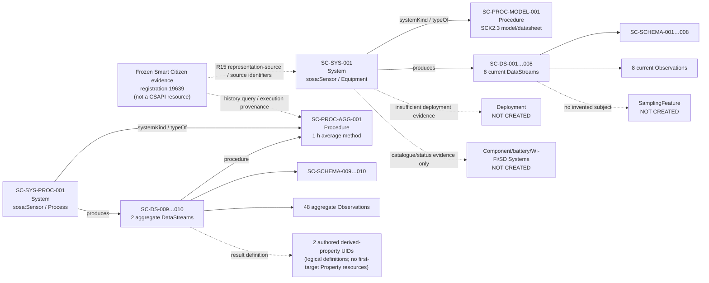

# 03 — Proposed CSAPI resource graph and request design

**Status:** Phase 4 design re-audited before Phase 5 against the actual MPSS v0.3.5 technical baseline and later research. Resource counts remain unchanged, but the current design now adds accepted R15 representation-source provenance and explicitly distinguishes the persistent aggregate Process System, reusable Procedure, and frozen query/response provenance. See [06_MODEL_CURRENCY_AUDIT.md](06_MODEL_CURRENCY_AUDIT.md). No adapter or server write has occurred.

## 1. Design objective and governing constraints

The first CSAPI representation shall preserve the reviewed meaning of the frozen Smart Citizen specimen without using target-resource creation as a way to invent missing semantics. The design therefore separates the physical sensing-system representation from source-platform processing, keeps source registration identity distinct from manufacturer/physical identity, preserves channel-specific times, and leaves unsupported observed-subject relationships absent.

The design is grounded in:

- frozen source evidence `20261025T024348Z` and the reviewed [source inventory](01_SOURCE_SPECIMEN_AND_INVENTORY.md);
- the reviewed [Phase 3 mapping ledger](02_MAPPING_LEDGER.md);
- MPSS v0.3.5, especially R01–R02, R10–R11, R13, R15–R17 and the accepted identity/composition/provenance guidance informed by SAPIENT, ISA, The Open Group SOSA, Power and OMS research;
- [OGC API — Connected Systems Part 1](https://docs.ogc.org/is/23-001/23-001.html) for Systems, Procedures, Sampling Features and Property definitions;
- [OGC API — Connected Systems Part 2](https://docs.ogc.org/is/23-002/23-002.html) for DataStreams, observation schemas and Observations;
- SensorML 3.0 / SWE Common 3.0 carriers selected by those standards; and
- the exact first-target 52°North source revision `6ad75aa7fbfc76517c8a24c21446471845007855`.

The graph follows four rules:

1. **Create only evidence-backed resources.** A source field does not imply that a resource of the similarly named CSAPI type exists.
2. **Use standard resources before project conventions.** Project-authored identifiers and derived-property definitions are explicit and do not replace standard resource semantics.
3. **Make temporal projection visible.** Where the source supplies fewer temporal distinctions than CSAPI requires, the authored projection is documented rather than disguised as a source fact.
4. **Design for the approved standard first, then record target-server constraints.** A permissive or incomplete implementation does not redefine the standard for this experiment.
5. **Separate accepted profile rules from later research candidates.** A later donor or stress-test finding can trigger a review but is not a technical obligation until it is dispositioned into the accepted baseline.

## 2. Study identity policy

CSAPI requires persistent URI-valued unique identifiers for System and Procedure resources. The experiment will not promote Smart Citizen Device ID `19639`, Device UUID `02612831-3387-4cb2-8bed-cf87670ca1e5`, catalogue IDs, or component IDs into manufacturer-issued physical identities.

Study-owned feature UIDs use deterministic UUIDv5 URNs. The UUIDv5 namespace is the standard URL namespace and the exact name string below is the reproducibility input. These UIDs identify **MERLIN study representations**, not the manufacturer's physical asset.

| Local ID | Semantic scope | UUIDv5 name string | Resulting UID |
| --- | --- | --- | --- |
| SC-SYS-001 | Sensing-system instance known through Smart Citizen registration 19639 | `https://github.com/OS4CSAPI/glaux-client/experiments/smart-citizen/registration/19639/system` | `urn:uuid:a8e68038-11f9-57a0-92ae-641e70fbbbd8` |
| SC-PROC-MODEL-001 | Reusable SmartCitizen Kit 2.3 model/datasheet description | `https://github.com/OS4CSAPI/glaux-client/experiments/smart-citizen/model/sck/2.3` | `urn:uuid:e2d9ce2b-53a9-587b-86fc-1fe78b82b623` |
| SC-SYS-PROC-001 | Study representation of the Smart Citizen historical aggregation process | `https://github.com/OS4CSAPI/glaux-client/experiments/smart-citizen/process/historical-aggregation/v1` | `urn:uuid:df8a8c07-c3fb-573f-9f42-68ca78f17eae` |
| SC-PROC-AGG-001 | Reusable one-hour-average aggregation procedure | `https://github.com/OS4CSAPI/glaux-client/experiments/smart-citizen/procedure/historical-aggregation/v1` | `urn:uuid:462c1217-09a5-5816-b9dd-08a3b688b79a` |
| SC-PROP-TEMP-AVG-001 | Study definition of one-hour-average air temperature | `https://github.com/OS4CSAPI/glaux-client/experiments/smart-citizen/property/air-temperature/hourly-average/v1` | `urn:uuid:e1e3a0a5-3e91-580c-9a9e-d12cde93cef8` |
| SC-PROP-PM25-AVG-001 | Study definition of one-hour-average PM2.5 | `https://github.com/OS4CSAPI/glaux-client/experiments/smart-citizen/property/pm25/hourly-average/v1` | `urn:uuid:164f756c-a568-5983-b311-91f65c35fc15` |

Local server IDs remain server-scoped implementation identifiers. Phase 5/6 shall record every assigned ID and shall not use it as a substitute for the semantic UID. Smart Citizen registration ID and UUID remain separately labeled source identifiers/provenance on SC-SYS-001, and SC-SYS-001 also carries the applicable MPSS v0.3.5 R15 **representation-source** group so source/adapter provenance is represented using the current accepted profile rather than prose alone.

## 3. Resource inventory

### 3.1 Resources created in the first deterministic load

| Local ID | CSAPI resource type | Intended identity / role | Source/mapping basis | Depends on | Create? | Notes |
| --- | --- | --- | --- | --- | --- | --- |
| SC-PROC-MODEL-001 | Procedure | Reusable SCK2.3 hardware datasheet/model description | SC-ID-01; MPSS R01 | none | **Yes** | SensorML hardware-datasheet class; model designation/revision only where evidenced; no manufacturer/firmware inference |
| SC-SYS-001 | System | Sensing-system instance represented by registration 19639 | SC-ID-01 | SC-PROC-MODEL-001 | **Yes** | `systemType=sosa:Sensor`; `assetType=Equipment`; System `typeOf/systemKind` → model Procedure; selected outputs declared; R15 representation-source provenance retained |
| SC-PROC-AGG-001 | Procedure | Source-platform one-hour-average methodology | SC-TEMP-AGG-01; SC-PM25-AGG-01 | none | **Yes** | `procedureType=sosa:ObservingProcedure`; records `rollup=1h`, `function=avg`, `all_intervals=true` and inspected-code limits |
| SC-SYS-PROC-001 | System | Persistent study representation of the source-platform data-transforming aggregation process/service | SC-TEMP-AGG-01; SC-PM25-AGG-01 | SC-PROC-AGG-001 | **Yes** | SensorML `SimpleProcess`; `systemType=sosa:Sensor`, `assetType=Process`; no location; `typeOf` → reusable aggregation Procedure; **not one query execution** |
| SC-DS-001 | DataStream | Current air-temperature output | SC-TEMP-01 | SC-SYS-001 | **Yes** | `type=observation`; `outputName=airTemperature`; `live=false` for frozen replay |
| SC-DS-002 | DataStream | Current PM2.5 output | SC-PM25-01 | SC-SYS-001 | **Yes** | `type=observation`; `outputName=pm25`; `live=false` |
| SC-DS-003 | DataStream | Current relative-humidity output | SC-HUM-01 | SC-SYS-001 | **Yes** | `type=observation`; `outputName=relativeHumidity`; `live=false` |
| SC-DS-004 | DataStream | Current barometric-pressure output | SC-PRESS-01 | SC-SYS-001 | **Yes** | `type=observation`; `outputName=barometricPressure`; `live=false` |
| SC-DS-005 | DataStream | Current A-weighted sound-pressure-level output | SC-NOISE-01 | SC-SYS-001 | **Yes** | `type=observation`; `outputName=noiseLevelA`; `live=false` |
| SC-DS-006 | DataStream | Current SCK remaining-battery-level status | SC-BATT-01 | SC-SYS-001 | **Yes** | `type=status`; `outputName=batteryLevel`; `live=false` |
| SC-DS-007 | DataStream | Current Wi-Fi RSSI output | SC-RSSI-01 | SC-SYS-001 | **Yes** | **omit optional `type`** because observed subject remains unresolved; `outputName=wifiRssi`; `live=false` |
| SC-DS-008 | DataStream | Current SD-card categorical status | SC-SD-01 | SC-SYS-001 | **Yes** | `type=status`; `outputName=sdCardPresence`; `live=false` |
| SC-DS-009 | DataStream | One-hour-average air-temperature product | SC-TEMP-AGG-01 | SC-SYS-PROC-001, SC-PROC-AGG-001 | **Yes** | `type=observation`; `outputName=airTemperatureHourlyMean`; `procedure@link` → aggregation Procedure; `live=false` |
| SC-DS-010 | DataStream | One-hour-average PM2.5 product | SC-PM25-AGG-01 | SC-SYS-PROC-001, SC-PROC-AGG-001 | **Yes** | `type=observation`; `outputName=pm25HourlyMean`; `procedure@link` → aggregation Procedure; `live=false` |
| SC-SCHEMA-001…010 | Observation Schema | Per-DataStream JSON result contract | all selected mappings | corresponding DataStream | **Yes, inline with DataStream creation** | Standard `application/json` schema with SWE Common `resultSchema`; no invented SamplingFeature parameter |
| SC-OBS-CURRENT-001…008 | Observation | Eight frozen current results | selected current mappings | SC-DS-001…008 | **Yes** | one result per selected current channel |
| SC-OBS-TEMP-AVG-001…024 | Observation | 24 returned one-hour temperature aggregates | SC-TEMP-AGG-01 | SC-DS-009 | **Yes** | exact returned tuple values/timestamps retained |
| SC-OBS-PM25-AVG-001…024 | Observation | 24 returned one-hour PM2.5 aggregates | SC-PM25-AGG-01 | SC-DS-010 | **Yes** | exact returned tuple values/timestamps retained |

The first deterministic load therefore contains **2 Procedures, 2 Systems, 10 DataStreams, 10 observation schemas, and 56 Observations**. Observation schemas are addressable schema resources after creation but are supplied inline with DataStream creation on the first target.

### 3.2 Logical Property definitions not created on the first target

| Local ID | Logical CSAPI concept | Base property | Study meaning | First-target create? |
| --- | --- | --- | --- | --- |
| SC-PROP-TEMP-AVG-001 | Derived Property | `http://www.eionet.europa.eu/gemet/concept/281` | One-hour average air temperature produced by the source-platform aggregation procedure | **No** |
| SC-PROP-PM25-AVG-001 | Derived Property | `http://dd.eionet.europa.eu/vocabulary/aq/pollutant/6001` | One-hour average PM2.5 mass concentration produced by the source-platform aggregation procedure | **No** |

The logical UIDs above are used as the SWE `definition` values of the aggregate result schemas. Each definition is an **experiment-authored qualified variable meaning**: one-hour mean of the named base property under SC-PROC-AGG-001, with the stream's retained unit. This is compatible with the foundational-semantics/I-ADOPT finding that a curated variable definition may carry missing qualification through native SWE semantics, but it is not an I-ADOPT or QUDT ontology-runtime claim.

A local Property resource is **not a prerequisite** for a SWE semantic-definition URI. If a later target supports Property creation cleanly, these definitions can be materialized as CSAPI DerivedProperty resources without changing the identity of the aggregate DataStreams or observations.

## 4. Explicit resources and relationships that are not created

| Candidate | Decision | Reason |
| --- | --- | --- |
| SamplingFeature for “ambient air” | **Do not create** | The source identifies environmental properties but no independently identified sample/air volume or sampling geometry. CSAPI makes the observation SamplingFeature association optional. |
| Deployment | **Do not create** | Public location/exposure metadata lacks verified deployment interval, purpose, emplacement method and precision standing. |
| System position on SC-SYS-001 | **Do not populate in first load** | Returned coordinates may be fuzzed because `precise_location` is filtered; encoding them as the System's spatial position would imply precision not established by the source. |
| SHT31, SEN5X, MPL3115A2 or microphone System/component instances | **Do not create** | Smart Citizen catalogue ancestry/model records do not identify independently managed installed component instances. |
| Battery System | **Do not create** | Battery percentage supplies no independent battery identity or R16 supply relationship. |
| Wi-Fi interface/antenna System | **Do not create** | RSSI label/measurement does not establish interface identity, interface type, operational state or directed link topology. |
| SD-card System | **Do not create** | Source supplies a categorical parent-System indicator, not independently identified equipment. |
| Separate source-registration resource | **Do not create** | Device ID/UUID are retained through the represented System's source/provenance content, including the accepted R15 representation-source mechanism; a second resource would falsely suggest a separate domain entity is required by CSAPI. |
| Current-value source-platform processing System | **Do not create in this phase** | Current public values have implementation evidence of normalization/calibration-like source processing, but the exact production procedure/revision is not established. The physical SCK study System remains the reported-output producer and processing remains explicit provenance. |
| ControlStream/Command | **Do not create** | The first experiment is read/integration focused and no physical command evidence is selected. |
| Local Property resources | **Do not create on the first 52°North load** | The exact target revision exposes no POST route for `/properties`; see target constraints below. |
| Process-input edge from SC-SYS-001 to SC-SYS-PROC-001 | **Do not invent** | The aggregate service consumes Smart Citizen native history, not a reviewed CSAPI-to-CSAPI input link. Source query/capture provenance belongs in the Procedure and frozen acquisition/execution record. |
| ProcessingExecution common resource | **Do not create** | Later OSCAR research correctly distinguishes a reusable Procedure, persistent process/software implementation and one execution/derivation activity, but MPSS v0.3.5 has no accepted universal ProcessingExecution resource/binding and the Smart Citizen source exposes no stable execution identity. The frozen request/response remains provenance. |

## 5. System and Procedure content

### 5.1 SC-SYS-001 — represented Smart Citizen sensing System

- SensorML class: **PhysicalSystem**.
- CSAPI system type: **sosa:Sensor**.
- CSAPI asset type: **Equipment**, encoded through the standard SensorML classifier mapping.
- UID: `urn:uuid:a8e68038-11f9-57a0-92ae-641e70fbbbd8`.
- Human label: source Device name may be used as the label, with the source registration separately disclosed.
- System kind/typeOf: SC-PROC-MODEL-001.
- Source identifiers retained:
  - Smart Citizen Device ID `19639`;
  - Smart Citizen Device UUID `02612831-3387-4cb2-8bed-cf87670ca1e5`.
- MPSS R15 representation-source group: populate only with v0.3.5 catalogue terms/code-space values supported by the source evidence, identifying the Smart Citizen native source/specification and the MERLIN adapter that authors the standardized representation. This is representation provenance, not a physical component, gateway or source-standard conformance claim.
- Selected outputs declared on the System: `airTemperature`, `pm25`, `relativeHumidity`, `barometricPressure`, `noiseLevelA`, `batteryLevel`, `wifiRssi`, `sdCardPresence`.
- No manufacturer, firmware revision, physical serial, position, component inventory, Deployment, interface topology or power topology is inferred.

The selected outputs belong on the System instance rather than being asserted as a universal SCK2.3 model inventory. The frozen specimen contains UV channels while current product material can differ by shipping variant, so exact output inventory is instance/source evidence rather than a universal model claim.

### 5.2 SC-PROC-MODEL-001 — reusable SCK2.3 model description

- Procedure type: sensor datasheet / **sosa:Sensor**.
- SensorML class: **PhysicalSystem** (hardware equipment specification).
- UID: `urn:uuid:e2d9ce2b-53a9-587b-86fc-1fe78b82b623`.
- Technical description carries the reviewed model designation `SmartCitizen Kit 2.3` and revision/version `2.3`.
- Manufacturer and firmware remain absent unless separately evidenced.
- No position is allowed on the Procedure.

### 5.3 SC-SYS-PROC-001 — source-platform aggregate producer

The aggregate values are not attributed to the physical kit. They are represented as observations produced by a separate **persistent software/process System**:

- SensorML class: **SimpleProcess**.
- CSAPI system type: **sosa:Sensor**. CSAPI's Sensor definition includes software that can respond to input data composed from prior Observation results and generate a Result, which fits an aggregation process at this scope.
- CSAPI asset type: **Process** because it transforms data coming from other systems.
- UID: `urn:uuid:df8a8c07-c3fb-573f-9f42-68ca78f17eae`.
- System kind/typeOf: SC-PROC-AGG-001.
- Outputs: `airTemperatureHourlyMean` and `pm25HourlyMean`.
- No position is supplied.

This System is **not a particular history-query execution**. SC-PROC-AGG-001 is the reusable method, SC-SYS-PROC-001 is the persistent study representation of the data-transforming implementation, and the frozen request/response headers/body constitute execution/integration provenance. This distinction reconciles the Phase 4 design with later processing-execution research without inventing a universal execution resource that MPSS v0.3.5 does not define.

### 5.4 SC-PROC-AGG-001 — reusable aggregation method

- Procedure type: **sosa:ObservingProcedure**.
- SensorML class: **SimpleProcess**.
- UID: `urn:uuid:462c1217-09a5-5816-b9dd-08a3b688b79a`.
- Method description records:
  - source Smart Citizen readings endpoint;
  - `rollup=1h`;
  - `function=avg`;
  - `all_intervals=true`;
  - inspected Smart Citizen source revision `25a524cbfb036f8950c247b847d8884a4e776297`;
  - implementation evidence that Kairos aligned sampling is requested and that close expected/returned interval points can be merged by the current `all_intervals` code path; and
  - the limitation that the inspected repository revision is not independently proven to be the production revision serving the frozen response.

The Procedure describes **how the derived product was obtained**, while the processing System identifies the producer of those aggregate Observations.

## 6. DataStream and schema design

| DS | System | outputName | type | Procedure | SWE result schema | Unit | Frozen observations |
| --- | --- | --- | --- | --- | --- | --- | ---: |
| SC-DS-001 | SC-SYS-001 | `airTemperature` | observation | — | Quantity; definition GEMET air temperature | QUDT DEG_C href | 1 |
| SC-DS-002 | SC-SYS-001 | `pm25` | observation | — | Quantity; definition Eionet PM2.5 | Eionet ug.m-3 href | 1 |
| SC-DS-003 | SC-SYS-001 | `relativeHumidity` | observation | — | Quantity; definition QUDT RelativeHumidity | QUDT PERCENT href | 1 |
| SC-DS-004 | SC-SYS-001 | `barometricPressure` | observation | — | Quantity; definition QUDT AtmosphericPressure | QUDT KiloPA href | 1 |
| SC-DS-005 | SC-SYS-001 | `noiseLevelA` | observation | — | Quantity; definition QUDT SoundPressureLevel | QUDT DeciB_A href | 1 |
| SC-DS-006 | SC-SYS-001 | `batteryLevel` | status | — | Quantity; definition Smart Citizen Measurement 7 | SWE/UCUM code `%` | 1 |
| SC-DS-007 | SC-SYS-001 | `wifiRssi` | **omitted** | — | Quantity; definition Smart Citizen Measurement 78 | source symbol `dBm` + authored QUDT DeciB-MilliW href | 1 |
| SC-DS-008 | SC-SYS-001 | `sdCardPresence` | status | — | DataRecord with Category field; source definition Measurement 79; allowed tokens `0`, `1` | none | 1 |
| SC-DS-009 | SC-SYS-PROC-001 | `airTemperatureHourlyMean` | observation | SC-PROC-AGG-001 | Quantity; definition SC-PROP-TEMP-AVG-001 UID | QUDT DEG_C href | 24 |
| SC-DS-010 | SC-SYS-PROC-001 | `pm25HourlyMean` | observation | SC-PROC-AGG-001 | Quantity; definition SC-PROP-PM25-AVG-001 UID | Eionet ug.m-3 href | 24 |

All ten DataStreams begin with `live=false` because Phase 5 first implements deterministic replay of the frozen specimen. A later explicitly verified live-polling increment can change the applicable live-state behavior without altering the meaning of the retained frozen observations.

Each DataStream has its own observation schema because property definition, unit, outputName and/or result structure differ. For the default `application/json` observation format, the standard first-load schema is:

```json
{
  "obsFormat": "application/json",
  "resultSchema": {
    "...": "the reviewed SWE Quantity or DataRecord for this DataStream"
  }
}
```

No `parametersSchema` is needed for the first current observations. Source request/capture provenance and response-wide aggregate metadata such as `sample_size` remain execution evidence rather than being repeated as if they were per-observation result parameters.

The target repository's simulator includes a historical `resultTimeSchema` member in its example payload, but the exact target DataStream schema at the tested revision does not contain that member and the approved Part 2 JSON observation-schema model uses `resultSchema` plus optional `parametersSchema`. The first-load design follows the approved standard and the target's actual schema, not the stale simulator member.

## 7. Observation temporal policy

### 7.1 Current observations — coincident-time projection

Smart Citizen documents the reading timestamp as the time when the reading took place and supplies no independently identified result-completion time in the frozen Device representation. CSAPI requires both `phenomenonTime` and `resultTime`.

For SC-OBS-CURRENT-001…008:

- `phenomenonTime` = the channel's own `last_reading_at`;
- `resultTime` = the **same source reading instant**;
- acquisition time `2026-10-25T02:43:48Z` remains separate integration provenance and is not substituted for either field.

This is an **authored coincident-time projection**, not a claim that Smart Citizen supplied two distinct timestamps. It is accepted for this instantaneous current-reading representation because the single source timestamp is explicitly the reading time and no evidence establishes a later source result-generation instant. If later source evidence establishes a distinct resultTime, the mapping must change rather than preserving this fallback by habit.

Consequently:

| Current mapping | phenomenonTime = resultTime |
| --- | --- |
| SC-TEMP-01 | `2026-10-25T02:40:21Z` |
| SC-PM25-01 | `2026-10-25T02:36:21Z` |
| SC-HUM-01 | `2026-10-25T02:40:21Z` |
| SC-PRESS-01 | `2026-10-25T02:40:21Z` |
| SC-NOISE-01 | `2026-10-25T02:40:21Z` |
| SC-BATT-01 | `2026-10-25T02:40:21Z` |
| SC-RSSI-01 | `2026-10-25T02:40:21Z` |
| SC-SD-01 | `2026-10-25T02:40:21Z` |

The design explicitly sends both fields even though the tested 52°North observation schema is more permissive and can default an omitted `phenomenonTime` to `resultTime`.

### 7.2 Aggregate observations — source-anchor plus source-response projection

The historical endpoint returns each aggregate as a `[recorded_at, value]` tuple but does not state exact interval boundaries or a separate result-generation timestamp. The query itself creates an on-demand one-hour-average product.

For SC-OBS-TEMP-AVG-001…024:

- `phenomenonTime` = the exact tuple `recorded_at` returned by Smart Citizen;
- `resultTime` = `2026-10-25T02:43:49Z`, projected from the HTTP `Date` header of the frozen temperature-history response.

For SC-OBS-PM25-AVG-001…024:

- `phenomenonTime` = the exact tuple `recorded_at` returned by Smart Citizen;
- `resultTime` = `2026-10-25T02:43:50Z`, projected from the HTTP `Date` header of the frozen PM2.5-history response.

The HTTP response date is used only because this result is generated by an on-demand source-platform aggregation request; it is a **source-response result-time proxy**, not proof of the exact internal computation-completion instant. The one-hour averaging meaning is carried by the derived property and aggregation Procedure rather than by inventing a one-hour `phenomenonTime` interval around each returned timestamp.

Response-wide `sample_size=1439` and `sample_size=288` remain query/processing provenance. They are not copied into each aggregate Observation as per-bin counts.

## 8. Relationship inventory

| Relationship ID | Subject | Predicate / role | Object | Time scope | Supporting mapping | Status |
| --- | --- | --- | --- | --- | --- | --- |
| SC-REL-001 | SC-SYS-001 | systemKind / SensorML `typeOf` | SC-PROC-MODEL-001 | description scope | SC-ID-01 / R01 | **create** |
| SC-REL-001A | SC-SYS-001 | MPSS `representation-source` provenance | Smart Citizen native source + MERLIN adapter reference | representation scope | SC-ID-01 / R15 | **create as descriptive profile content** |
| SC-REL-002…009 | SC-SYS-001 | produces DataStream / `outputName` correspondence | SC-DS-001…008 | frozen specimen / later same output identities | current mappings / R10-R11 | **create** |
| SC-REL-010 | SC-SYS-PROC-001 | systemKind / `typeOf` | SC-PROC-AGG-001 | processing representation | aggregate mappings | **create** |
| SC-REL-011…012 | SC-SYS-PROC-001 | produces DataStream | SC-DS-009…010 | frozen history query | aggregate mappings / R10-R11 | **create** |
| SC-REL-013…014 | SC-DS-009…010 | used Procedure | SC-PROC-AGG-001 | all aggregate observations in stream | aggregate mappings | **create** |
| SC-REL-015…024 | DataStream | has schema | SC-SCHEMA-001…010 | DataStream validity | all mappings | **create** |
| SC-REL-025…032 | SC-DS-001…008 | has member Observation | SC-OBS-CURRENT-001…008 | source channel time | current mappings | **create** |
| SC-REL-033 | SC-DS-009 | has member Observations | 24 temperature aggregates | 24 Oct source series | SC-TEMP-AGG-01 | **create** |
| SC-REL-034 | SC-DS-010 | has member Observations | 24 PM2.5 aggregates | 24 Oct source series | SC-PM25-AGG-01 | **create** |
| SC-REL-NEG-001 | environmental streams | SamplingFeature association | — | — | R11/source limitation | **absent intentionally** |
| SC-REL-NEG-002 | SC-SYS-001 | Deployment | — | — | source limitation | **absent intentionally** |
| SC-REL-NEG-003 | SC-SYS-001 | R16 power association | battery source/consumer | — | SC-BATT-01 | **absent intentionally** |
| SC-REL-NEG-004 | SC-SYS-001 | R13 interface/link topology | Wi-Fi interface/link | — | SC-RSSI-01 | **absent intentionally** |
| SC-REL-NEG-005 | SC-SYS-001 | processing-input edge | SC-SYS-PROC-001 | frozen history | aggregate provenance | **not invented** |

## 9. Resource graph



The dotted source-evidence arrows are research/provenance relationships, not invented CSAPI graph predicates.

## 10. First-target request strategy

### Procedures before Systems

Create SC-PROC-MODEL-001 and SC-PROC-AGG-001 first. Create the Systems only after their Procedure UIDs can be resolved to canonical target URLs/IDs.

For the 52°North target, the System `typeOf` link should use the standard `ogc-rel:procedures` relation and the known Procedure UID during creation so the implementation can resolve the local Procedure. Phase 5 shall capture the rewritten canonical link returned by the server rather than assuming it.

### Systems before DataStreams

Create SC-SYS-001 and SC-SYS-PROC-001 and retain their server-assigned local IDs. Create DataStreams only through the nested paths:

- `POST /systems/{sckSystemId}/datastreams`
- `POST /systems/{processSystemId}/datastreams`

The target implementation derives the parent System association from the nested path. The request therefore shall not fabricate a writable `system@link`.

### DataStreams carry schemas at creation

Each create request supplies:

- `name`;
- reviewed `outputName`;
- optional reviewed `type` (omitted for RSSI);
- `live=false`;
- `procedure@link` only for the aggregate streams; and
- the standard JSON observation `schema`.

Read-only summary fields such as `observedProperties`, `phenomenonTime`, `resultTime`, `formats` and `resultType` are **not submitted as authored facts**.

### Observations last

Only after all ten DataStreams and schemas are retrieved and checked should observations be posted to:

`POST /datastreams/{datastreamId}/observations`

Each request carries both `phenomenonTime` and `resultTime`, plus the reviewed result. No SamplingFeature ID is included.

## 11. Deterministic creation, retrieval and cleanup order

### Create

1. Preflight the actual target: record endpoint, advertised conformance/OpenAPI, running image/revision/patch state and access posture; do not infer these from the retained baseline if they changed.
2. Query by study UID and inspect nested resources so a prior interrupted run is detected before any POST.
3. Create SC-PROC-MODEL-001.
4. Create SC-PROC-AGG-001.
5. Create SC-SYS-001 with model `typeOf`.
6. Create SC-SYS-PROC-001 with aggregation `typeOf`.
7. Retrieve both Systems in SensorML and verify UID, type, asset type, typeOf and outputs before creating dynamic resources.
8. Create SC-DS-001…008 nested under SC-SYS-001, each with its schema.
9. Create SC-DS-009…010 nested under SC-SYS-PROC-001, each with its schema and Procedure link.
10. Retrieve all ten DataStreams and all ten `/schema` resources; verify outputName, type standing, producer, Procedure and result schema.
11. Post the eight current Observations.
12. Post the 24 temperature aggregate Observations.
13. Post the 24 PM2.5 aggregate Observations.
14. Retrieve every DataStream and Observation set; compare values, property definitions, units, producer, times and counts against the frozen mapping evidence.
15. Only a later authorized phase may expose this loaded graph to connected Glaux traversal.

### Cleanup

Do **not** depend on target cascade deletion. At the inspected 52°North revision, cascade deletion for DataStreams is unimplemented and System cascade behavior is also incomplete.

Cleanup order:

1. delete all 56 experiment Observations individually and verify they are absent;
2. delete SC-DS-001…010 and verify they are absent;
3. delete SC-SYS-PROC-001 and SC-SYS-001;
4. delete SC-PROC-AGG-001 and SC-PROC-MODEL-001;
5. re-query the study UIDs and nested endpoints to confirm no experiment resources remain.

This child-first procedure is the deterministic rollback path for failed or repeated runs.

## 12. Target-server constraints discovered during Phase 4

The first target remains the recorded 52°North/pygeoapi deployment, but the design does not hide source-revision limitations.

### 12.1 Property creation route mismatch

At upstream revision `6ad75aa7...`, the repository contains example requests that POST DerivedProperty resources, and the provider layer contains create logic for `EntityType.PROPERTIES`. However, the actual route table exposes only GET/PUT/DELETE for `/properties` and no POST route. The generic Part 1 `replace` method also instantiates a `System` object regardless of resource type, so PUT is not accepted as a safe pseudo-create workaround for this experiment.

**Disposition:** no local Property resource is required by the first load. Derived-property UUID URIs are used in SWE result schemas and documented in this workbook. Property materialization is deferred until the running target capability is verified or corrected in a separately authorized server change.

### 12.2 Observation-time schema is more permissive than the approved standard

The inspected target `observation.schema` requires `resultTime` but makes `phenomenonTime` optional and states that it defaults to resultTime. The approved OGC Part 2 resource model requires both.

**Disposition:** every experiment Observation supplies both fields. Target permissiveness shall not be used to weaken the standard representation.

### 12.3 No implementation-specific meta-datastream shortcut

The retained 52°North documentation lists time-aggregated “meta-datastreams” such as hourly averages as future support.

**Disposition:** the experiment does not wait for or emulate a nonstandard meta-datastream feature. Aggregate products use ordinary standard DataStreams produced by SC-SYS-PROC-001 with the aggregation Procedure and derived-property definitions.

### 12.4 Cascade cleanup is not available

The target provider explicitly rejects/does not implement cascade deletion for DataStreams with Observations; System cascade handling is also incomplete.

**Disposition:** Phase 5/6 must implement the child-first cleanup sequence above and record every assigned server ID.

## 13. Phase 4 resolutions of the carried questions

| Carried question | Phase 4 resolution |
| --- | --- |
| What should identify the CSAPI System? | A deterministic study-owned UUIDv5 URN identifies the **representation of the sensing system known through registration 19639**. Smart Citizen ID/UUID remain source identifiers, not physical serials, and R15 representation-source records the native-source/adapter provenance. |
| Must environmental observations have a SamplingFeature? | **No.** The association remains absent because the source does not identify a defensible sampling feature. |
| What becomes current-reading `resultTime`? | Use the same source reading instant as phenomenonTime as an explicitly documented coincident-time projection. Do not use acquisition time. |
| What is RSSI's DataStream type? | **Leave optional `type` absent** until the observed subject is established; do not force status/observation from the label. |
| Who produces the hourly averages? | SC-SYS-PROC-001, a persistent software/process System, using reusable SC-PROC-AGG-001. The physical kit is not credited with source-platform aggregation, and one HTTP query execution is not conflated with either the persistent System or reusable Procedure. |
| What becomes aggregate `resultTime`? | Use the frozen history HTTP response `Date` as an explicit source-response proxy for the on-demand derived result; retain the tuple timestamp as phenomenonTime and do not invent interval bounds. |
| Are aggregate Property resources required? | No. Stable authored derived-property URIs carry the meaning for the first load; target Property creation is currently unreliable. |
| Should the current source-platform processing path get its own System? | Not in the first graph. Evidence is insufficient to identify an exact production transformation Procedure; preserve it as processing provenance while the SCK study System remains the reported current-output producer. |

## 14. Completion gate

**Phase 4 design gate: re-satisfied after current-model currency audit.**

A reviewer can trace every proposed created resource to a reviewed Phase 3 mapping, explain every relationship, identify every authored identity/time projection, and see which tempting resources/relationships are deliberately absent. Creation dependencies and child-first cleanup order are deterministic. Known target-server constraints are recorded without changing the standard model or writing to the server.

Phase 5 remains blocked until the paper/current-work closeout for the currency audit is complete. When Phase 5 resumes, the adapter must emit this **audited** graph from the frozen specimen; it may not revert to the pre-audit graph or silently omit the current R15 provenance content.
